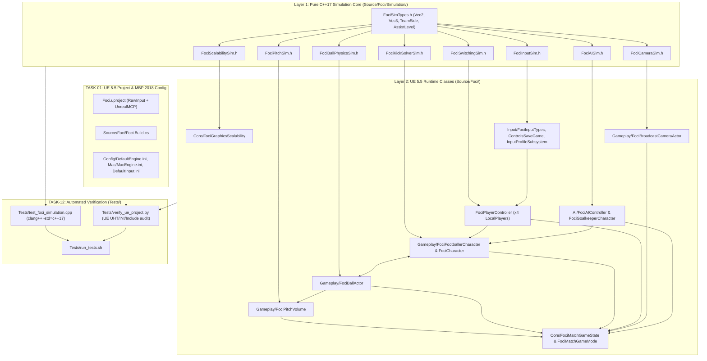

# Foci — Hydrogen-Ready Technical Specification & Granular Task Breakdown

> [!IMPORTANT]
> **Autonomous Execution Contract for the Executing Agent (Hydrogen Model)**
> 1. **No Clarifying Questions**: Execute `TASK-01` through `TASK-12` sequentially from start to finish in a single autonomous pass without stopping to ask the user questions. Every architectural, coordinate, naming, math, UE 5.5 API, and verification decision is finalized in this document.
> 2. **Repository Path**: `/home/antigravity/BobanPoznanovic/Foci` (exact workspace root; do not assume any external symlink exists).
> 3. **Cloud VM Toolchain & Scope**:
>    - This Debian 12 Linux VM has `clang++` (14.0.6), `cmake` (3.25.1), `ninja`, and `python3` installed, and does **not** have Unreal Engine Editor installed.
>    - **Text files only**: Do **not** attempt to create binary Unreal assets (`.uasset`, `.umap`, Blueprints, Behavior Trees, UMG widgets, or NavMeshes). All tasks create/modify C++ (`.h`/`.cpp`), C# (`.Build.cs`), JSON (`.uproject`), INI (`.ini`), Python (`.py`), and Shell (`.sh`) files only.
> 4. **Files That Must Remain Untouched**:
>    - Do **not** modify `Source/Foci/Foci.h`, `Source/Foci/Foci.cpp`, `Source/Foci/FociGameMode.h`, `Source/Foci/FociGameMode.cpp`, `Source/Foci/Foci.Target.cs`, `Source/Foci/FociEditor.Target.cs`, `Config/DefaultGame.ini`, `Config/DefaultEditor.ini`, `README.md`, or anything under `Plugins/UnrealMCP/`.
> 5. **Two-Layer Architecture (Zero Duplication Between UE 5.5 Code and Standalone C++17 Tests)**:
>    - **Layer 1 — Pure C++17 Simulation Core (`Source/Foci/Simulation/*.h`)**: Header-only deterministic math & rules inside `namespace FociSim`, using **only** standard C++17 headers (`<cmath>`, `<cstdint>`, `<algorithm>`, `<array>`, `<functional>`, `<limits>`, `<vector>`, `<map>`, `<string>`). **Zero** Unreal Engine includes or macros. Define `constexpr float kPi = 3.14159265358979323846f;` inside `namespace FociSim` (never use `PI` or `M_PI`, which collide with UE macros). When syntax-checking `.h` files directly with `clang++ 14.0.6`, always pass `-x c++-header` so Clang does not warn on `#pragma once` or treat `.h` as a C header.
>    - **Layer 2 — Unreal Engine 5.5 Runtime Classes (`Source/Foci/{Core,Input,Gameplay,AI}/*`, `Source/Foci/FociPlayerController.*`, `Source/Foci/FociCharacter.h`)**: Thin UE 5.5 `UCLASS`/`AActor`/`UGameInstanceSubsystem` wrappers whose static solver functions delegate directly to `FociSim::...` inside their `.cpp` files (never `#include "Simulation/..."` inside a UHT-parsed `.h` file; always include `Simulation/*.h` from `.cpp` files).
>    - **Direct Test Coverage**: `Tests/test_foci_simulation.cpp` (`TASK-12`) `#include`s the actual production headers in `Source/Foci/Simulation/` directly (`-I/home/antigravity/BobanPoznanovic/Foci/Source/Foci`) so every unit test verifies the real production simulation logic.
> 6. **Strict UE 5.5 UHT & Include Rules**:
>    - Every UE `.h` file must contain `#pragma once` before any `#include` (leading copyright comment lines are allowed), include `"CoreMinimal.h"`, and place `#include "<HeaderBaseName>.generated.h"` as the **final** `#include` line.
>    - Use module-root-relative `#include` paths for all project headers (e.g., `#include "Input/FociInputTypes.h"`, `#include "Gameplay/FociBallActor.h"`, `#include "Simulation/FociBallPhysicsSim.h"`).
>    - Export all public `UCLASS` and `USTRUCT` types with `FOCI_API`.
>    - **Never** mark `uint32` fields with `BlueprintReadWrite` or `BlueprintReadOnly` (UHT rejects `uint32` in Blueprints; use `int32` or `uint8`).
> 7. **Player Indexing Convention (0-Based Internal, 1-Based Display)**:
>    - Human Player 1 = `PlayerIndex 0`, Human Player 2 = `PlayerIndex 1`, Human Player 3 = `PlayerIndex 2`, Human Player 4 = `PlayerIndex 3`.
>    - AI-controlled footballers always have `ControllingHumanPlayerIndex = -1`.

---

## 1. System Architecture, Coordinate Conventions & File Map



### 1.1 3D World Coordinate System & Broadcast Stick Mapping (`1 uu = 1 cm`)
- **Pitch Center (Kickoff Spot)**: `(X = 0.0, Y = 0.0, Z = 0.0)`
- **Pitch Length (Touchline / X-Axis)**: `105 m = 10500.0 cm` (`HalfPitchLengthCm = 5250.0f`)
  - **Home Team Goal Line**: `X = -5250.0 cm` (Home attacks toward `+X`, screen-right).
  - **Away Team Goal Line**: `X = +5250.0 cm` (Away attacks toward `-X`, screen-left).
- **Pitch Width (Goal Line / Y-Axis)**: `68 m = 6800.0 cm` (`HalfPitchWidthCm = 3400.0f`)
  - **Far / Top Touchline**: `Y = -3400.0 cm` (top of broadcast TV screen).
  - **Near / Bottom Touchline**: `Y = +3400.0 cm` (bottom of broadcast TV screen, broadcast camera gantry side).
- **Vertical Axis (Elevation / Z-Axis)**:
  - **Turf Surface**: `Z = 0.0 cm`.
  - **Ball Center Resting on Turf**: `Z = 11.0 cm` (FIFA Size 5 radius `R = 11.0 cm`).
- **3D Goal Frame Dimensions**:
  - **Goal Width (Inner Post-to-Post along Y)**: `7.32 m = 732.0 cm` (`Y in [-366.0, +366.0]`, `GoalHalfWidthCm = 366.0f`).
  - **Goal Height (Ground to Lower Edge of Crossbar along Z)**: `2.44 m = 244.0 cm` (`Z in [0.0, 244.0]`, `GoalCrossbarHeightCm = 244.0f`).
  - **Goal Net Depth (along X)**: `200.0 cm`.
- **Shared Broadcast Camera & Gamepad Stick-to-World Mapping (CRITICAL — Use Consistently Everywhere)**:
  - `AFociBroadcastCameraActor::CameraBoom` has `RelativeRotation = FRotator(-26.0f, -90.0f, 0.0f)`: the camera sits on the `+Y` near-side broadcast gantry looking across the pitch toward `-Y` (`CameraForwardXY = (0, -1, 0)`, `CameraRightXY = (+1, 0, 0)`).
  - Therefore, on screen: **Screen Right = `+X`**, **Screen Left = `-X`**, **Screen Up = `-Y`**, **Screen Down = `+Y`**.
  - For any 2D gamepad stick vector `Stick = (Stick.X, Stick.Y)` (where `+X` is push right, `+Y` is push up):
    ```cpp
    WorldDir3D = FVector(Stick.X, -Stick.Y, 0.0f).GetSafeNormal();
    ```
  - Use this exact mapping in `AFociFootballerCharacter` (`TASK-07`), `AFociPlayerController` / `SelectBestTeammateToSwitch3D` (`TASK-08`), and `AFociAIController` (`TASK-10`).

### 1.2 Complete File Creation & Modification Map (`TASK-01` .. `TASK-12`)
| Task | Action | Exact File Path (relative to `/home/antigravity/BobanPoznanovic/Foci`) |
| :--- | :--- | :--- |
| `TASK-01` | Modify | `Foci.uproject`, `Source/Foci/Foci.Build.cs`, `Config/DefaultEngine.ini`, `Config/DefaultInput.ini` |
| `TASK-01` | Create | `Config/Mac/MacEngine.ini` |
| `TASK-02` | Create | `Source/Foci/Simulation/FociSimTypes.h`, `Source/Foci/Simulation/FociScalabilitySim.h`, `Source/Foci/Core/FociGraphicsScalability.h`, `Source/Foci/Core/FociGraphicsScalability.cpp` |
| `TASK-03` | Create | `Source/Foci/Input/FociInputTypes.h`, `Source/Foci/Input/FociControlsSaveGame.h` |
| `TASK-04` | Create | `Source/Foci/Simulation/FociInputSim.h`, `Source/Foci/Input/FociInputProfileSubsystem.h`, `Source/Foci/Input/FociInputProfileSubsystem.cpp` |
| `TASK-05` | Create | `Source/Foci/Simulation/FociBallPhysicsSim.h`, `Source/Foci/Gameplay/FociBallActor.h`, `Source/Foci/Gameplay/FociBallActor.cpp` |
| `TASK-06` | Create | `Source/Foci/Simulation/FociPitchSim.h`, `Source/Foci/Gameplay/FociPitchVolume.h`, `Source/Foci/Gameplay/FociPitchVolume.cpp` |
| `TASK-07` | Create | `Source/Foci/Simulation/FociKickSolverSim.h`, `Source/Foci/Gameplay/FociFootballerCharacter.h`, `Source/Foci/Gameplay/FociFootballerCharacter.cpp` |
| `TASK-07` | Modify | `Source/Foci/FociCharacter.h` |
| `TASK-08` | Create | `Source/Foci/Simulation/FociSwitchingSim.h` |
| `TASK-08` | Modify | `Source/Foci/FociPlayerController.h`, `Source/Foci/FociPlayerController.cpp` |
| `TASK-09` | Create | `Source/Foci/Simulation/FociCameraSim.h`, `Source/Foci/Gameplay/FociBroadcastCameraActor.h`, `Source/Foci/Gameplay/FociBroadcastCameraActor.cpp` |
| `TASK-10` | Create | `Source/Foci/Simulation/FociAISim.h`, `Source/Foci/AI/FociAIController.h`, `Source/Foci/AI/FociAIController.cpp`, `Source/Foci/AI/FociGoalkeeperCharacter.h`, `Source/Foci/AI/FociGoalkeeperCharacter.cpp` |
| `TASK-11` | Create | `Source/Foci/Core/FociMatchGameState.h`, `Source/Foci/Core/FociMatchGameState.cpp`, `Source/Foci/Core/FociMatchGameMode.h`, `Source/Foci/Core/FociMatchGameMode.cpp` |
| `TASK-12` | Create | `Tests/test_foci_simulation.cpp`, `Tests/verify_ue_project.py`, `Tests/run_tests.sh` |

---

## 2. Granular Task Specifications for Hydrogen Model

---

### `TASK-01`: Configure Build Rules, MacBook Pro 2018 Metal SM5 Rendering, and PS5 DualSense RawInput

#### Objective
Enable `RawInput` in `Foci.uproject`, configure `Foci.Build.cs` module dependencies and include root, and configure `Config/DefaultEngine.ini`, `Config/Mac/MacEngine.ini`, and `Config/DefaultInput.ini` for locked **60 FPS** on MacBook Pro 2018 (Metal SM5, Forward Shading, MSAA, Baked GI, Capsule Shadows, single shared viewport with splitscreen disabled) plus 4 PlayStation 5 DualSense controllers (`0x054C` / `0x0CE6`).

#### Files to Modify / Create
1. **Modify `Foci.uproject`** — exact contents:
```json
{
	"FileVersion": 3,
	"EngineAssociation": "5.5",
	"Category": "",
	"Description": "Foci Unreal Engine Project",
	"Modules": [
		{
			"Name": "Foci",
			"Type": "Runtime",
			"LoadingPhase": "Default",
			"AdditionalDependencies": [
				"Engine"
			]
		}
	],
	"Plugins": [
		{
			"Name": "ModelingToolsEditorMode",
			"Enabled": true,
			"TargetAllowList": [
				"Editor"
			]
		},
		{
			"Name": "UnrealMCP",
			"Enabled": true,
			"TargetAllowList": [
				"Editor"
			]
		},
		{
			"Name": "RawInput",
			"Enabled": true
		}
	]
}
```
2. **Modify `Source/Foci/Foci.Build.cs`** — exact contents (adds `ModuleDirectory` so module-root-relative `#include "Input/..."` works from every subfolder without referencing non-existent directories):
```csharp
using UnrealBuildTool;

public class Foci : ModuleRules
{
	public Foci(ReadOnlyTargetRules Target) : base(Target)
	{
		PCHUsage = PCHUsageMode.UseExplicitOrSharedPCHs;

		PublicIncludePaths.Add(ModuleDirectory);

		PublicDependencyModuleNames.AddRange(new string[]
		{
			"Core",
			"CoreUObject",
			"Engine",
			"InputCore",
			"EnhancedInput",
			"AIModule",
			"UMG",
			"Slate",
			"SlateCore",
			"PhysicsCore"
		});

		PrivateDependencyModuleNames.AddRange(new string[] { });
	}
}
```
3. **Modify `Config/DefaultEngine.ini`** — exact contents (note: in UE 5.5, `r.AntiAliasingMethod=3` is MSAA, while `2` is TAA; `r.GenerateMeshDistanceFields=False` saves VRAM when Lumen is disabled):
```ini
[/Script/EngineSettings.GameMapsSettings]
EditorStartupMap=/Game/Maps/Stadium_Main
GameDefaultMap=/Game/Maps/Stadium_Main
GlobalDefaultGameMode=/Script/Foci.FociMatchGameMode
bUseSplitscreen=False

[/Script/Engine.RendererSettings]
r.ForwardShading=True
r.GenerateMeshDistanceFields=False
r.DynamicGlobalIlluminationMethod=0
r.ReflectionMethod=2
r.Shadow.Virtual.Enable=0
r.Nanite=0
r.AllowStaticLighting=True
r.AntiAliasingMethod=3
r.MSAACount=2
r.ScreenPercentage=85
r.CapsuleShadows=1
r.CapsuleDirectShadows=1
r.CapsuleIndirectShadows=1

[/Script/MacTargetPlatform.MacTargetSettings]
MaxShaderLanguageVersion=4
bUseFastIntrinsics=True
bEnableMathOptimizations=True
FrameRateLock=PUFRL_60
```
4. **Create `Config/Mac/MacEngine.ini`** — exact contents:
```ini
[SystemSettings]
r.Metal.ShaderInlining=1
r.Metal.UseFastMath=1
r.ForwardShading=1
r.DynamicGlobalIlluminationMethod=0
r.Shadow.Virtual.Enable=0
r.Shadow.CSM.MaxCascades=2
r.Shadow.MaxCSMResolution=1024
r.CapsuleShadows=1
r.CapsuleDirectShadows=1
r.CapsuleIndirectShadows=1
r.AntiAliasingMethod=3
r.MSAACount=2
r.SSR.Quality=2
r.ScreenPercentage=85
t.MaxFPS=60
```
5. **Modify `Config/DefaultInput.ini`** — exact contents:
```ini
[/Script/Engine.InputSettings]
DefaultPlayerInputClass=/Script/EnhancedInput.EnhancedPlayerInput
DefaultInputComponentClass=/Script/EnhancedInput.EnhancedInputComponent
+AxisConfig=(AxisKeyName="Gamepad_LeftX",AxisProperties=(DeadZone=0.120000,Sensitivity=1.000000,Exponent=1.000000,bInvert=False))
+AxisConfig=(AxisKeyName="Gamepad_LeftY",AxisProperties=(DeadZone=0.120000,Sensitivity=1.000000,Exponent=1.000000,bInvert=False))
+AxisConfig=(AxisKeyName="Gamepad_RightX",AxisProperties=(DeadZone=0.120000,Sensitivity=1.000000,Exponent=1.000000,bInvert=False))
+AxisConfig=(AxisKeyName="Gamepad_RightY",AxisProperties=(DeadZone=0.120000,Sensitivity=1.000000,Exponent=1.000000,bInvert=False))
+AxisConfig=(AxisKeyName="Gamepad_LeftTriggerAxis",AxisProperties=(DeadZone=0.050000,Sensitivity=1.000000,Exponent=1.000000,bInvert=False))
+AxisConfig=(AxisKeyName="Gamepad_RightTriggerAxis",AxisProperties=(DeadZone=0.050000,Sensitivity=1.000000,Exponent=1.000000,bInvert=False))

[/Script/RawInput.RawInputSettings]
bRegisterDefaultDevice=True
+DeviceConfigurations=(VendorID="0x054C",ProductID="0x0CE6",AxisProperties=((Key=Gamepad_LeftX,bGamepadStick=True,Offset=0.000000),(Key=Gamepad_LeftY,bInverted=True,bGamepadStick=True,Offset=0.000000),(Key=Gamepad_RightX,bGamepadStick=True,Offset=0.000000),(Key=Gamepad_RightY,bInverted=True,bGamepadStick=True,Offset=0.000000),(Key=Gamepad_LeftTriggerAxis,Offset=0.000000),(Key=Gamepad_RightTriggerAxis,Offset=0.000000)),ButtonProperties=((Key=Gamepad_FaceButton_Left),(Key=Gamepad_FaceButton_Bottom),(Key=Gamepad_FaceButton_Right),(Key=Gamepad_FaceButton_Top),(Key=Gamepad_LeftShoulder),(Key=Gamepad_RightShoulder),(Key=Gamepad_LeftTrigger),(Key=Gamepad_RightTrigger),(Key=Gamepad_Special_Left),(Key=Gamepad_Special_Right),(Key=Gamepad_LeftThumbstick),(Key=Gamepad_RightThumbstick)))
```

#### Verification Command
```bash
python3 -c 'import json; d=json.load(open("Foci.uproject")); assert any(p["Name"]=="RawInput" and p["Enabled"] for p in d["Plugins"]); e=open("Config/DefaultEngine.ini").read(); m=open("Config/Mac/MacEngine.ini").read(); i=open("Config/DefaultInput.ini").read(); b=open("Source/Foci/Foci.Build.cs").read(); assert "r.AntiAliasingMethod=3" in e and "bUseSplitscreen=False" in e and "GlobalDefaultGameMode=/Script/Foci.FociMatchGameMode" in e; assert "t.MaxFPS=60" in m; assert "0x054C" in i and "0x0CE6" in i and "0.120000" in i; assert "PhysicsCore" in b and "AIModule" in b; print("TASK-01 OK")'
```

#### Acceptance Criteria
- Verification command prints `TASK-01 OK` and exits with code `0`.

---

### `TASK-02`: Implement Shared Simulation Base Types & MacBook Pro 2018 Scalability Manager (`UFociGraphicsScalability`)

#### Objective
Create the pure C++17 simulation foundation header `FociSimTypes.h`, pure C++17 scalability preset resolver `FociScalabilitySim.h`, and UE 5.5 Blueprint Function Library `UFociGraphicsScalability` that switches rendering CVars at runtime between 3 hardware-tailored presets for MacBook Pro 2018.

#### Files to Create
1. `Source/Foci/Simulation/FociSimTypes.h` (Pure C++17 — no UE headers)
2. `Source/Foci/Simulation/FociScalabilitySim.h` (Pure C++17 — no UE headers)
3. `Source/Foci/Core/FociGraphicsScalability.h`
4. `Source/Foci/Core/FociGraphicsScalability.cpp`

#### Exact Implementation Specification
1. **`Source/Foci/Simulation/FociSimTypes.h`**:
   - `#pragma once`, includes `<algorithm>`, `<cmath>`, `<cstdint>`.
   - `namespace FociSim`:
     - `inline constexpr float kPi = 3.14159265358979323846f;`
     - `inline constexpr float kSmallNumber = 1.e-4f;`
     - `inline constexpr int32_t kMaxHumanPlayers = 4;`
     - `struct Vec2 { float X = 0.0f; float Y = 0.0f; };` with `SizeSquared()`, `Size()`, `operator+`, `operator-`, `operator*`.
     - `struct Vec3 { float X = 0.0f; float Y = 0.0f; float Z = 0.0f; };` with:
       - `operator+`, `operator-`, `operator*(float)`, `operator+=(const Vec3&)`
       - `SizeSquared()`, `Size()`, `Size2D()`, `SizeSquared2D()`
       - `GetSafeNormal(float Tolerance = kSmallNumber) const`
       - `GetSafeNormal2D(float Tolerance = kSmallNumber) const` (zeroes `Z` then normalizes XY)
       - `static float Dot(const Vec3& A, const Vec3& B)`
       - `static Vec3 Cross(const Vec3& A, const Vec3& B)` (`(A.Y*B.Z - A.Z*B.Y, A.Z*B.X - A.X*B.Z, A.X*B.Y - A.Y*B.X)`)
       - `static float Dist2D(const Vec3& A, const Vec3& B)`
       - `static float Dist3D(const Vec3& A, const Vec3& B)`
     - Helper functions in `namespace FociSim`:
       - `inline float Clamp(float Value, float MinVal, float MaxVal)`
       - `inline float Lerp(float A, float B, float Alpha)`
       - `inline Vec3 Lerp(const Vec3& A, const Vec3& B, float Alpha)`
       - `inline float GetMappedRangeValueClamped(float InMin, float InMax, float OutMin, float OutMax, float Value)`
       - `inline Vec3 StickToBroadcastWorldDir(const Vec2& Stick)` -> `Vec3{Stick.X, -Stick.Y, 0.0f}.GetSafeNormal()`
     - Shared pure enums matching UE `uint8` values verbatim:
       - `enum class TeamSide : uint8_t { Neutral = 0, Home = 1, Away = 2 };`
       - `enum class AssistLevel : uint8_t { Assisted = 0, Semi = 1, Manual = 2 };`

2. **`Source/Foci/Simulation/FociScalabilitySim.h`**:
   - `#pragma once`, `#include "Simulation/FociSimTypes.h"`.
   - `namespace FociSim`:
     - `enum class GraphicsPreset : uint8_t { MacBook2018_IrisPerformance = 0, MacBook2018_RadeonBalanced = 1, PhotorealBroadcastReplay = 2 };`
     - `struct GraphicsConfig` with exact fields and defaults (defaults match `MacBook2018_RadeonBalanced`):
       - `int32_t TargetFPS = 60;`
       - `float ScreenPercentage = 85.0f;`
       - `int32_t MSAACount = 2;`
       - `int32_t CSMMaxCascades = 2;`
       - `int32_t MaxCSMResolution = 1024;`
       - `bool bEnableCapsuleShadows = true;`
       - `int32_t SSRQuality = 2;`
       - `float GrassCullDistanceMultiplier = 1.0f;`
     - `inline GraphicsConfig GetGraphicsConfigForPreset(GraphicsPreset Preset)` (include `default:` returning `MacBook2018_RadeonBalanced` to satisfy `-Wreturn-type`):
       - `MacBook2018_IrisPerformance`: `{60, 75.0f, 2, 1, 1024, true, 1, 0.75f}`
       - `MacBook2018_RadeonBalanced`: `{60, 85.0f, 2, 2, 1024, true, 2, 1.0f}`
       - `PhotorealBroadcastReplay`: `{30, 100.0f, 4, 3, 2048, true, 3, 1.5f}`

3. **`Source/Foci/Core/FociGraphicsScalability.h`**:
   - Includes (exact order): `"CoreMinimal.h"`, `"Kismet/BlueprintFunctionLibrary.h"`, `"FociGraphicsScalability.generated.h"`.
   - `UENUM(BlueprintType) enum class EFociGraphicsPreset : uint8`:
     - `MacBook2018_IrisPerformance = 0`
     - `MacBook2018_RadeonBalanced = 1`
     - `PhotorealBroadcastReplay = 2`
   - `USTRUCT(BlueprintType) struct FOCI_API FFociGraphicsConfig`:
     - All 8 fields as `UPROPERTY(EditAnywhere, BlueprintReadWrite, Category = "Foci|Graphics")` with exact UE types (`int32 TargetFPS = 60;`, `float ScreenPercentage = 85.0f;`, `int32 MSAACount = 2;`, `int32 CSMMaxCascades = 2;`, `int32 MaxCSMResolution = 1024;`, `bool bEnableCapsuleShadows = true;`, `int32 SSRQuality = 2;`, `float GrassCullDistanceMultiplier = 1.0f;`).
   - `UCLASS() class FOCI_API UFociGraphicsScalability : public UBlueprintFunctionLibrary`:
     - `UFUNCTION(BlueprintPure, Category = "Foci|Graphics") static FFociGraphicsConfig GetConfigForPreset(EFociGraphicsPreset Preset);`
     - `UFUNCTION(BlueprintCallable, Category = "Foci|Graphics", meta = (WorldContext = "WorldContextObject")) static void ApplyGraphicsPreset(const UObject* WorldContextObject, EFociGraphicsPreset Preset);`

4. **`Source/Foci/Core/FociGraphicsScalability.cpp`**:
   - Includes: `"Core/FociGraphicsScalability.h"`, `"Simulation/FociScalabilitySim.h"`, `"HAL/IConsoleManager.h"`.
   - `GetConfigForPreset` delegates to `FociSim::GetGraphicsConfigForPreset(static_cast<FociSim::GraphicsPreset>(static_cast<uint8>(Preset)))` and copies all 8 fields into `FFociGraphicsConfig`.
   - `ApplyGraphicsPreset` suppresses unused parameter `(void)WorldContextObject;`, calls `GetConfigForPreset(Preset)`, and uses a local helper lambda around `IConsoleManager::Get().FindConsoleVariable(Name)` checking `if (CVar != nullptr) { CVar->Set(Value, ECVF_SetByCode); }` for all 13 CVars:
     - `t.MaxFPS` (`static_cast<float>(Config.TargetFPS)`)
     - `r.ScreenPercentage` (`Config.ScreenPercentage`)
     - `r.AntiAliasingMethod` (`3`)
     - `r.MSAACount` (`Config.MSAACount`)
     - `r.Shadow.CSM.MaxCascades` (`Config.CSMMaxCascades`)
     - `r.Shadow.MaxCSMResolution` (`Config.MaxCSMResolution`)
     - `r.CapsuleShadows` (`Config.bEnableCapsuleShadows ? 1 : 0`)
     - `r.CapsuleDirectShadows` (`Config.bEnableCapsuleShadows ? 1 : 0`)
     - `r.CapsuleIndirectShadows` (`Config.bEnableCapsuleShadows ? 1 : 0`)
     - `r.SSR.Quality` (`Config.SSRQuality`)
     - `foliage.CullDistanceScale` (`Config.GrassCullDistanceMultiplier`)
     - `r.DynamicGlobalIlluminationMethod` (`0`) and `r.Shadow.Virtual.Enable` (`0`).

#### Verification Command
```bash
clang++ -std=c++17 -fsyntax-only -Wall -Wextra -Werror -I Source/Foci -x c++-header Source/Foci/Simulation/FociSimTypes.h Source/Foci/Simulation/FociScalabilitySim.h && echo "TASK-02 OK"
```

#### Acceptance Criteria
- `FociSimTypes.h` and `FociScalabilitySim.h` pass strict `clang++ -std=c++17 -Wall -Wextra -Werror` syntax checks; `FociGraphicsScalability.h/.cpp` follow all UE 5.5 UHT conventions and expose both Blueprint methods.

---

### `TASK-03`: Define PlayStation 5 DualSense Input Types & Per-Player SaveGame (`FociInputTypes.h` & `UFociControlsSaveGame`)

#### Objective
Define all UE 5.5 `UENUM`/`USTRUCT` data types for PS5 DualSense buttons, football gameplay actions, control contexts, presets (*Classic*, *Alternate*, *TwoButton*, *Custom*), assist settings, team sides, and the SaveGame class storing 4 independent human player profiles.

#### Files to Create
1. `Source/Foci/Input/FociInputTypes.h`
2. `Source/Foci/Input/FociControlsSaveGame.h`

#### Exact Implementation Specification
1. **`Source/Foci/Input/FociInputTypes.h`**:
   - Includes (exact order): `"CoreMinimal.h"`, `"FociInputTypes.generated.h"`.
   - Define all 7 `UENUM(BlueprintType) enum class ... : uint8` with explicit integer values:
     - **`EFociPS5Button : uint8`**:
       `Cross = 0, Circle = 1, Square = 2, Triangle = 3, L1 = 4, R1 = 5, L2 = 6, R2 = 7, L3 = 8, R3 = 9, DPadUp = 10, DPadDown = 11, DPadLeft = 12, DPadRight = 13, Touchpad = 14, Options = 15`
     - **`EFociControlContext : uint8`**:
       `OnBall = 0, OffBall = 1, System = 2`
     - **`EFociGameplayAction : uint8`**:
       - Context `OnBall` (`0..7`): `GroundPass = 0, ThroughBall = 1, LobPassCross = 2, Shoot = 3, Sprint = 4, FinesseModifier = 5, ChipModifier = 6, ShieldBall = 7`
       - Context `OffBall` (`8..13`): `SwitchPlayer = 8, StandingTackle = 9, SlidingTackle = 10, TeammateContain = 11, Jockey = 12, GoalkeeperRush = 13`
       - Context `System` (`14..17`): `TacticalMentalityUp = 14, TacticalMentalityDown = 15, OffsideTrap = 16, PauseMatch = 17`
     - **`EFociControlPreset : uint8`**:
       `Classic = 0, Alternate = 1, TwoButton = 2, Custom = 3`
     - **`EFociAssistLevel : uint8`**:
       `Assisted = 0, Semi = 1, Manual = 2`
     - **`EFociAutoSwitchMode : uint8`**:
       `AirAndLooseBalls = 0, AirBallsOnly = 1, ManualOnly = 2`
     - **`EFociTeamSide : uint8`**:
       `Neutral = 0, Home = 1, Away = 2`
   - **`USTRUCT(BlueprintType) struct FOCI_API FFociPlayerInputProfile`**:
     - `GENERATED_BODY()`
     - All fields marked `UPROPERTY(EditAnywhere, BlueprintReadWrite, Category = "Foci|Input")`:
       - `int32 PlayerIndex = 0;` (`0` to `3` for Human Players 1–4)
       - `FString ProfileName = TEXT("Player 1");`
       - `EFociTeamSide TeamSide = EFociTeamSide::Home;`
       - `EFociControlPreset Preset = EFociControlPreset::Classic;`
       - `TMap<EFociGameplayAction, EFociPS5Button> ActionBindings;`
       - `EFociAssistLevel PassAssistance = EFociAssistLevel::Assisted;`
       - `EFociAssistLevel ShotAssistance = EFociAssistLevel::Assisted;`
       - `EFociAssistLevel CrossAssistance = EFociAssistLevel::Assisted;`
       - `EFociAutoSwitchMode AutoSwitchMode = EFociAutoSwitchMode::AirAndLooseBalls;`
       - `bool bAnalogSprint = true;`
       - `bool bEnableVibration = true;`

2. **`Source/Foci/Input/FociControlsSaveGame.h`**:
   - Includes (exact order): `"CoreMinimal.h"`, `"GameFramework/SaveGame.h"`, `"Input/FociInputTypes.h"`, `"FociControlsSaveGame.generated.h"`.
   - `UCLASS() class FOCI_API UFociControlsSaveGame : public USaveGame`:
     - `static constexpr int32 MaxHumanPlayers = 4;`
     - `UPROPERTY(VisibleAnywhere, BlueprintReadWrite, Category = "Foci|SaveGame") FString SaveSlotName = TEXT("FociControlsSaveSlot");`
     - `UPROPERTY(VisibleAnywhere, BlueprintReadWrite, Category = "Foci|SaveGame") int32 UserIndex = 0;` (**MUST be `int32`, NOT `uint32`**, for UHT Blueprint compatibility and `UGameplayStatics::SaveGameToSlot`!)
     - `UPROPERTY(EditAnywhere, BlueprintReadWrite, Category = "Foci|SaveGame") TArray<FFociPlayerInputProfile> PlayerProfiles;`
     - Inline constructor `UFociControlsSaveGame() = default;` (no separate `.cpp` file required).

#### Verification Command
```bash
python3 -c 't=open("Source/Foci/Input/FociInputTypes.h").read(); s=open("Source/Foci/Input/FociControlsSaveGame.h").read(); assert "#include \"FociInputTypes.generated.h\"" in t and "EFociControlContext" in t and "FFociPlayerInputProfile" in t; assert "int32 UserIndex" in s and "uint32" not in s and "#include \"FociControlsSaveGame.generated.h\"" in s; print("TASK-03 OK")'
```

#### Acceptance Criteria
- Verification command prints `TASK-03 OK`; all 7 `UENUM`s, `FFociPlayerInputProfile`, and `UFociControlsSaveGame` compile cleanly under UE 5.5 UHT rules.

---

### `TASK-04`: Implement Per-Player PS5 DualSense Profile & Remapping Subsystem (`UFociInputProfileSubsystem`)

#### Objective
Implement the pure C++17 4-player profile & conflict-swapping remapper (`FociInputSim.h`) and UE 5.5 `UFociInputProfileSubsystem` (`UGameInstanceSubsystem`) so each of the 4 human players (`PlayerIndex 0..3`) can independently choose a preset (*Classic*, *Alternate*, *TwoButton*), remap any PS5 DualSense button with automatic same-context conflict swapping, translate buttons to/from Unreal `FKey`, and persist profiles via `UFociControlsSaveGame`.

#### Files to Create
1. `Source/Foci/Simulation/FociInputSim.h` (Pure C++17 — no UE headers)
2. `Source/Foci/Input/FociInputProfileSubsystem.h`
3. `Source/Foci/Input/FociInputProfileSubsystem.cpp`

#### Exact Implementation Specification
1. **Preset Binding Table (Authoritative for both `FociInputSim.h` and `UFociInputProfileSubsystem`)**:
   | Gameplay Action | Context | `Classic` | `Alternate` | `TwoButton` |
   | :--- | :--- | :--- | :--- | :--- |
   | `GroundPass` | `OnBall` | `Cross` | `Cross` | `Cross` |
   | `ThroughBall` | `OnBall` | `Triangle` | `Triangle` | `Cross` |
   | `LobPassCross` | `OnBall` | `Square` | `Circle` | `Square` |
   | `Shoot` | `OnBall` | `Circle` | `Square` | `Circle` |
   | `Sprint` | `OnBall` | `R2` | `R2` | `R2` |
   | `FinesseModifier` | `OnBall` | `R1` | `R1` | `R1` |
   | `ChipModifier` | `OnBall` | `L1` | `L1` | `L1` |
   | `ShieldBall` | `OnBall` | `L2` | `L2` | `L2` |
   | `SwitchPlayer` | `OffBall` | `L1` | `L1` | `Cross` |
   | `StandingTackle` | `OffBall` | `Circle` | `Square` | `Circle` |
   | `SlidingTackle` | `OffBall` | `Square` | `Circle` | `Square` |
   | `TeammateContain` | `OffBall` | `R1` | `R1` | `R1` |
   | `Jockey` | `OffBall` | `L2` | `L2` | `L2` |
   | `GoalkeeperRush` | `OffBall` | `Triangle` | `Triangle` | `Triangle` |
   | `TacticalMentalityUp` | `System` | `DPadRight` | `DPadRight` | `DPadRight` |
   | `TacticalMentalityDown` | `System` | `DPadLeft` | `DPadLeft` | `DPadLeft` |
   | `OffsideTrap` | `System` | `DPadUp` | `DPadUp` | `DPadUp` |
   | `PauseMatch` | `System` | `Options` | `Options` | `Options` |
   - Passing `ControlPreset::Custom` to `BuildPresetBindings` returns the `Classic` binding table as its base.

2. **`Source/Foci/Simulation/FociInputSim.h`**:
   - `#pragma once`, includes `"Simulation/FociSimTypes.h"`, `<algorithm>`, `<array>`, `<map>`, `<string>`.
   - Mirror the exact `uint8_t` enums (`PS5Button`, `ControlContext`, `GameplayAction`, `ControlPreset`, `AutoSwitchMode`) with identical integer values to `FociInputTypes.h`.
   - `struct PlayerInputProfile` matching `FFociPlayerInputProfile` (using `std::string ProfileName`, `std::map<GameplayAction, PS5Button> ActionBindings`).
   - `inline ControlContext GetActionContext(GameplayAction Action)`:
     - `GroundPass..ShieldBall` (`0..7`) -> `ControlContext::OnBall`
     - `SwitchPlayer..GoalkeeperRush` (`8..13`) -> `ControlContext::OffBall`
     - `TacticalMentalityUp..PauseMatch` (`14..17`) -> `ControlContext::System`
   - `inline bool AreActionsInSameContext(GameplayAction A, GameplayAction B)` -> `GetActionContext(A) == GetActionContext(B)`.
   - `inline std::map<GameplayAction, PS5Button> BuildPresetBindings(ControlPreset Preset)` implementing the exact table above.
   - `class InputProfileManager`:
     - Holds `std::array<PlayerInputProfile, kMaxHumanPlayers> Profiles;`
     - Constructor calls `EnsureDefaultProfilesInitialized()`:
       - `PlayerIndex = i` (`0..3`), `ProfileName = "Player " + std::to_string(i + 1)`
       - `TeamSide = (i < 2) ? TeamSide::Home : TeamSide::Away` (default 2v2: P1 & P2 Home, P3 & P4 Away)
       - `Preset = ControlPreset::Classic`, `ActionBindings = BuildPresetBindings(ControlPreset::Classic)`.
     - `void ApplyControlPreset(int32_t PlayerIndex, ControlPreset Preset)`: if `PlayerIndex` in `[0, 3]`, sets `Preset` and rebuilds `ActionBindings` (if `Preset != Custom`, replaces `ActionBindings = BuildPresetBindings(Preset)`).
     - `void RemapPlayerAction(int32_t PlayerIndex, GameplayAction Action, PS5Button NewButton, bool bSwapConflictingInSameContext = true)`:
       - Returns if `PlayerIndex < 0 || PlayerIndex >= kMaxHumanPlayers`.
       - Looks up `OldButton = Profile.ActionBindings[Action]` (if missing, initializes from `Classic`).
       - If `bSwapConflictingInSameContext && OldButton != NewButton`: iterates over all entries `(OtherAction, BoundButton)` in `Profile.ActionBindings`; if `OtherAction != Action && BoundButton == NewButton && AreActionsInSameContext(OtherAction, Action)`, sets `BoundButton = OldButton`.
       - Sets `Profile.ActionBindings[Action] = NewButton`.
       - Sets `Profile.Preset = ControlPreset::Custom`.
     - `void SetPlayerTeamSide(int32_t PlayerIndex, TeamSide NewTeamSide)`
     - `const PlayerInputProfile& GetPlayerProfile(int32_t PlayerIndex) const` (clamps index to `[0, 3]`).
     - `PS5Button GetBoundButtonForAction(int32_t PlayerIndex, GameplayAction Action) const`.

3. **`Source/Foci/Input/FociInputProfileSubsystem.h`**:
   - Includes (exact order): `"CoreMinimal.h"`, `"Subsystems/GameInstanceSubsystem.h"`, `"InputCoreTypes.h"`, `"Input/FociInputTypes.h"`, `"FociInputProfileSubsystem.generated.h"`.
   - Dynamic multicast delegate (declared before `UCLASS`):
     ```cpp
     DECLARE_DYNAMIC_MULTICAST_DELEGATE_TwoParams(FFociOnPlayerProfileChanged, int32, PlayerIndex, const FFociPlayerInputProfile&, UpdatedProfile);
     ```
   - `UCLASS() class FOCI_API UFociInputProfileSubsystem : public UGameInstanceSubsystem`:
     - Lifecycle overrides:
       - `virtual void Initialize(FSubsystemCollectionBase& Collection) override;` (calls `EnsureDefaultProfilesInitialized()` then `LoadProfilesFromDisk()`)
       - `virtual void Deinitialize() override;` (calls `SaveProfilesToDisk()`)
     - Delegate property:
       - `UPROPERTY(BlueprintAssignable, Category = "Foci|Input") FFociOnPlayerProfileChanged OnPlayerProfileChanged;`
     - Public `UFUNCTION` methods:
       - `UFUNCTION(BlueprintCallable, Category = "Foci|Input") void EnsureDefaultProfilesInitialized();`
       - `UFUNCTION(BlueprintCallable, Category = "Foci|Input") bool LoadProfilesFromDisk();`
       - `UFUNCTION(BlueprintCallable, Category = "Foci|Input") bool SaveProfilesToDisk();`
       - `UFUNCTION(BlueprintPure, Category = "Foci|Input") FFociPlayerInputProfile GetPlayerProfile(int32 PlayerIndex) const;`
       - `UFUNCTION(BlueprintCallable, Category = "Foci|Input") void ApplyControlPreset(int32 PlayerIndex, EFociControlPreset Preset);`
       - `UFUNCTION(BlueprintCallable, Category = "Foci|Input") void RemapPlayerAction(int32 PlayerIndex, EFociGameplayAction Action, EFociPS5Button NewButton, bool bSwapConflictingInSameContext = true);`
       - `UFUNCTION(BlueprintCallable, Category = "Foci|Input") void SetPlayerTeamSide(int32 PlayerIndex, EFociTeamSide NewTeamSide);`
       - `UFUNCTION(BlueprintCallable, Category = "Foci|Input") void SetPlayerAssistSettings(int32 PlayerIndex, EFociAssistLevel PassAssist, EFociAssistLevel ShotAssist, EFociAssistLevel CrossAssist, EFociAutoSwitchMode AutoSwitchMode);`
       - `UFUNCTION(BlueprintPure, Category = "Foci|Input") EFociPS5Button GetBoundButtonForAction(int32 PlayerIndex, EFociGameplayAction Action) const;`
       - `UFUNCTION(BlueprintPure, Category = "Foci|Input") bool FindActionForButtonInContext(int32 PlayerIndex, EFociPS5Button Button, EFociControlContext Context, EFociGameplayAction& OutAction) const;`
       - `UFUNCTION(BlueprintPure, Category = "Foci|Input") static EFociControlContext GetActionContext(EFociGameplayAction Action);`
       - `UFUNCTION(BlueprintPure, Category = "Foci|Input") static bool AreActionsInSameContext(EFociGameplayAction ActionA, EFociGameplayAction ActionB);`
       - `UFUNCTION(BlueprintPure, Category = "Foci|Input") static TMap<EFociGameplayAction, EFociPS5Button> BuildPresetBindings(EFociControlPreset Preset);`
       - `UFUNCTION(BlueprintPure, Category = "Foci|Input") static FKey ConvertPS5ButtonToUnrealKey(EFociPS5Button Button);`
       - `UFUNCTION(BlueprintPure, Category = "Foci|Input") static EFociPS5Button ConvertUnrealKeyToPS5Button(const FKey& Key, bool& bOutIsValid);`
     - Private storage: `UPROPERTY() TArray<FFociPlayerInputProfile> PlayerProfiles;`

4. **`Source/Foci/Input/FociInputProfileSubsystem.cpp`**:
   - Includes: `"Input/FociInputProfileSubsystem.h"`, `"Input/FociControlsSaveGame.h"`, `"Simulation/FociInputSim.h"`, `"Kismet/GameplayStatics.h"`.
   - Delegate context, preset building, and conflict-swapping logic to `FociSim::...` (syncing `PlayerProfiles` and broadcasting `OnPlayerProfileChanged.Broadcast(PlayerIndex, PlayerProfiles[PlayerIndex])` whenever `ApplyControlPreset`, `RemapPlayerAction`, `SetPlayerTeamSide`, or `SetPlayerAssistSettings` modifies a profile).
   - **Exact 16-entry `ConvertPS5ButtonToUnrealKey` / `ConvertUnrealKeyToPS5Button` Mapping**:
     - `Cross <-> EKeys::Gamepad_FaceButton_Bottom`
     - `Circle <-> EKeys::Gamepad_FaceButton_Right`
     - `Square <-> EKeys::Gamepad_FaceButton_Left`
     - `Triangle <-> EKeys::Gamepad_FaceButton_Top`
     - `L1 <-> EKeys::Gamepad_LeftShoulder`
     - `R1 <-> EKeys::Gamepad_RightShoulder`
     - `L2 <-> EKeys::Gamepad_LeftTrigger`
     - `R2 <-> EKeys::Gamepad_RightTrigger`
     - `L3 <-> EKeys::Gamepad_LeftThumbstick`
     - `R3 <-> EKeys::Gamepad_RightThumbstick`
     - `DPadUp <-> EKeys::Gamepad_DPad_Up`
     - `DPadDown <-> EKeys::Gamepad_DPad_Down`
     - `DPadLeft <-> EKeys::Gamepad_DPad_Left`
     - `DPadRight <-> EKeys::Gamepad_DPad_Right`
     - `Touchpad <-> EKeys::Gamepad_Special_Left`
     - `Options <-> EKeys::Gamepad_Special_Right`
     - (Unknown `FKey` sets `bOutIsValid = false` and returns `EFociPS5Button::Cross`.)
   - `LoadProfilesFromDisk()` checks `UGameplayStatics::DoesSaveGameExist(TEXT("FociControlsSaveSlot"), 0)`, loads `UFociControlsSaveGame`, and copies valid `PlayerProfiles` (filling missing slots with defaults).
   - `SaveProfilesToDisk()` creates `UFociControlsSaveGame` via `UGameplayStatics::CreateSaveGameObject(UFociControlsSaveGame::StaticClass())`, assigns `PlayerProfiles`, and calls `UGameplayStatics::SaveGameToSlot(SaveObj, SaveObj->SaveSlotName, SaveObj->UserIndex)`.

#### Verification Command
```bash
clang++ -std=c++17 -fsyntax-only -Wall -Wextra -Werror -I Source/Foci -x c++-header Source/Foci/Simulation/FociInputSim.h && echo "TASK-04 OK"
```

#### Acceptance Criteria
- `FociInputSim.h` compiles cleanly with zero warnings; remapping Player 1 (`PlayerIndex = 0`)'s `Shoot` from `Circle` to `Square` swaps Player 1's `LobPassCross` to `Circle` without modifying Player 1's Off-Ball bindings or Players 2–4 (`PlayerIndex 1..3`).

---

### `TASK-05`: Implement 3D Ball Physics Actor with 120 Hz Sub-Stepping & Magnus Spin (`AFociBallActor`)

#### Objective
Implement deterministic 3D football physics (`FociBallPhysicsSim.h`) with aerodynamic drag, dimensionless Magnus lift/curve ($\vec{\omega} \times \vec{v}$), gravity, turf bounce restitution, rolling friction, and trajectory prediction, wrapped in `AFociBallActor` with 120 Hz sub-stepping and clean possession ownership API.

#### Files to Create
1. `Source/Foci/Simulation/FociBallPhysicsSim.h` (Pure C++17 — no UE headers)
2. `Source/Foci/Gameplay/FociBallActor.h`
3. `Source/Foci/Gameplay/FociBallActor.cpp`

#### Exact Implementation Specification
1. **Ball Physics Constants (Verified Dimensionally in cm / s / rad)**:
   - `BallRadiusCm = 11.0f`
   - `BallMassKg = 0.43f`
   - `TurfRestitution = 0.68f`
   - `TurfRollingFriction = 320.0f` (`cm/s^2`)
   - `AirDragCoefficient = 0.00022f` (`cm^-1`)
   - `MagnusCoefficient = 0.010f` (**dimensionless**: since `omega` is `rad/s` and `v` is `cm/s`, `omega x v` is already in `cm/s^2`; `0.010f` produces ~210 cm lateral curve over 1.0 s on a 25 m/s finesse shot with `omega_z = 35 rad/s`, matching real FIFA Size 5 physics $\rho \pi R^3 / m \approx 0.0119$)
   - `SpinDecayRate = 1.4f` (`s^-1`)
   - `GravityCmPerSecSq = 980.0f` (`cm/s^2`)

2. **`Source/Foci/Simulation/FociBallPhysicsSim.h`**:
   - `#pragma once`, includes `"Simulation/FociSimTypes.h"`.
   - `namespace FociSim`:
     - `struct BallPhysicsParams` storing all 7 constants above with their default values.
     - `inline void StepBallPhysics3D(Vec3& InOutPosition, Vec3& InOutVelocity, Vec3& InOutAngularVelocity, float DeltaTime, float GroundZ = 0.0f, float RadiusCm = 11.0f, float Restitution = 0.68f, float RollingFriction = 320.0f, float DragCoeff = 0.00022f, float MagnusCoeff = 0.010f, float SpinDecay = 1.4f)`:
       - Guard: if `DeltaTime <= 0.0f`, return immediately.
       - **Step 1 (Air Drag)**: `Speed = InOutVelocity.Size();` `InOutVelocity += InOutVelocity * (-DragCoeff * Speed * DeltaTime);`
       - **Step 2 (Magnus Lift / Curve)**: Recompute `Speed = InOutVelocity.Size(); SpinMag = InOutAngularVelocity.Size();`. If `SpinMag > kSmallNumber && Speed > 20.0f`, `MagnusAccel = Vec3::Cross(InOutAngularVelocity, InOutVelocity) * MagnusCoeff; InOutVelocity += MagnusAccel * DeltaTime;`
       - **Step 3 (Gravity vs. Ground Roll)**:
         - `ZMin = GroundZ + RadiusCm;`
         - If `InOutPosition.Z <= ZMin + 0.5f && std::fabs(InOutVelocity.Z) < 35.0f`:
           - `InOutPosition.Z = ZMin; InOutVelocity.Z = 0.0f;`
           - `HorizSpeed = InOutVelocity.Size2D();`
           - If `HorizSpeed > 0.0f`: `NewHoriz = std::max(0.0f, HorizSpeed - RollingFriction * DeltaTime); Scale = NewHoriz / HorizSpeed; InOutVelocity.X *= Scale; InOutVelocity.Y *= Scale;`
         - Else:
           - `InOutVelocity.Z -= 980.0f * DeltaTime;`
       - **Step 4 (Position Integration)**: `InOutPosition += InOutVelocity * DeltaTime;`
       - **Step 5 (Turf Bounce)**:
         - If `InOutPosition.Z < ZMin`:
           - `InOutPosition.Z = ZMin;`
           - If `InOutVelocity.Z < 0.0f`:
             - `InOutVelocity.Z = -InOutVelocity.Z * Restitution;`
             - `InOutVelocity.X *= 0.88f; InOutVelocity.Y *= 0.88f;`
             - If `InOutVelocity.Z < 25.0f`: `InOutVelocity.Z = 0.0f;`
       - **Step 6 (Spin Decay)**:
         - `DecayFactor = std::max(0.0f, 1.0f - SpinDecay * DeltaTime);`
         - `InOutAngularVelocity = InOutAngularVelocity * DecayFactor;`
     - `inline Vec3 PredictBallPositionAtTime(const Vec3& StartPos, const Vec3& StartVel, const Vec3& StartAngVel, float FutureSeconds, float GroundZ = 0.0f, const BallPhysicsParams& Params = {})`:
       - Integrates `StepBallPhysics3D` in `StepDt = 1.0f / 60.0f` increments until `Elapsed >= FutureSeconds` (clamping the final step to remaining time).

3. **`Source/Foci/Gameplay/FociBallActor.h`**:
   - Includes (exact order): `"CoreMinimal.h"`, `"GameFramework/Actor.h"`, `"Input/FociInputTypes.h"`, `"FociBallActor.generated.h"`.
   - Forward declarations: `class USphereComponent; class UStaticMeshComponent; class ACharacter;`
   - **Important (Avoids Circular Dependency)**: Store `PossessingFootballer` and `LastTouchFootballer` as `TWeakObjectPtr<ACharacter>` (every `AFociFootballerCharacter` inherits from `ACharacter`), keeping the exact member names without needing `FociFootballerCharacter.h` in `TASK-05`.
   - `UCLASS() class FOCI_API AFociBallActor : public AActor`:
     - Constructor `AFociBallActor();` (`PrimaryActorTick.bCanEverTick = true;`, creates `CollisionSphere` as `RootComponent` with `InitSphereRadius(BallRadiusCm)`, disables UE default rigidbody physics `SetSimulatePhysics(false)` so custom 120 Hz sub-stepping has full deterministic control, attaches `BallMesh` to `CollisionSphere`).
     - `virtual void Tick(float DeltaTime) override;`
     - Components (`UPROPERTY(VisibleAnywhere, BlueprintReadOnly, Category = "Foci|Ball")`):
       - `TObjectPtr<USphereComponent> CollisionSphere;`
       - `TObjectPtr<UStaticMeshComponent> BallMesh;`
     - Physics parameters (`UPROPERTY(EditAnywhere, BlueprintReadWrite, Category = "Foci|Ball|Physics")`):
       - `float BallRadiusCm = 11.0f;`
       - `float BallMassKg = 0.43f;`
       - `float TurfRestitution = 0.68f;`
       - `float TurfRollingFriction = 320.0f;`
       - `float AirDragCoefficient = 0.00022f;`
       - `float MagnusCoefficient = 0.010f;`
       - `float SpinDecayRate = 1.4f;`
       - `float GroundZ = 0.0f;`
     - Runtime state (`UPROPERTY(VisibleAnywhere, BlueprintReadWrite, Category = "Foci|Ball|State")`):
       - `FVector LinearVelocity = FVector::ZeroVector;`
       - `FVector AngularVelocity = FVector::ZeroVector;`
       - `EFociTeamSide LastTouchTeam = EFociTeamSide::Neutral;`
       - `float PossessionLockoutTimer = 0.0f;`
       - `TWeakObjectPtr<ACharacter> PossessingFootballer;` (plain public C++ member, no `UPROPERTY` macro)
       - `TWeakObjectPtr<ACharacter> LastTouchFootballer;` (plain public C++ member, no `UPROPERTY` macro)
     - Public methods:
       - `UFUNCTION(BlueprintCallable, Category = "Foci|Ball") void KickBall(const FVector& NewLinearVelocity, const FVector& NewAngularVelocity, ACharacter* Kicker, EFociTeamSide KickerTeam);`
       - `UFUNCTION(BlueprintCallable, Category = "Foci|Ball") void SetPossessingFootballer(ACharacter* NewOwner, EFociTeamSide OwnerTeam);`
       - `UFUNCTION(BlueprintCallable, Category = "Foci|Ball") void ReleasePossession();`
       - `UFUNCTION(BlueprintCallable, Category = "Foci|Ball") void ResetBallToLocation(const FVector& NewWorldLocation);`
       - `UFUNCTION(BlueprintPure, Category = "Foci|Ball") bool CanBeCapturedBy(const ACharacter* Candidate) const;` (`return !PossessingFootballer.IsValid() && (PossessionLockoutTimer <= 0.0f || LastTouchFootballer.Get() != Candidate);`)
       - `UFUNCTION(BlueprintPure, Category = "Foci|Ball") FVector PredictBallPositionAtTime(float FutureSeconds) const;`
       - `UFUNCTION(BlueprintCallable, Category = "Foci|Ball|Physics") static void StepBallPhysics3D(FVector& InOutPosition, FVector& InOutVelocity, FVector& InOutAngularVelocity, float DeltaTime, float InGroundZ, float RadiusCm, float Restitution, float RollingFriction, float DragCoeff, float MagnusCoeff, float SpinDecay);`

4. **`Source/Foci/Gameplay/FociBallActor.cpp`**:
   - Includes: `"Gameplay/FociBallActor.h"`, `"Simulation/FociBallPhysicsSim.h"`, `"Components/SphereComponent.h"`, `"Components/StaticMeshComponent.h"`, `"GameFramework/Character.h"`.
   - `KickBall`: clears `PossessingFootballer.Reset()`, sets `LastTouchFootballer = Kicker`, `LastTouchTeam = KickerTeam`, `LinearVelocity = NewLinearVelocity`, `AngularVelocity = NewAngularVelocity`, `PossessionLockoutTimer = 0.18f`.
   - `SetPossessingFootballer`: sets `PossessingFootballer = NewOwner`, `LastTouchFootballer = NewOwner`, `LastTouchTeam = OwnerTeam`, zeroes `LinearVelocity` and `AngularVelocity`, sets `PossessionLockoutTimer = 0.0f`.
   - `Tick(float DeltaTime)`:
     - Decrements `PossessionLockoutTimer = FMath::Max(0.0f, PossessionLockoutTimer - DeltaTime)`.
     - If `ACharacter* Owner = PossessingFootballer.Get()`: positions ball at dribble socket `FVector DribblePos = Owner->GetActorLocation() + Owner->GetActorForwardVector() * 55.0f; DribblePos.Z = GroundZ + BallRadiusCm; SetActorLocation(DribblePos);` and updates `LinearVelocity = Owner->GetVelocity();`.
     - Else: runs 120 Hz sub-stepping (`constexpr float MaxSubStep = 1.0f / 120.0f; float Remaining = FMath::Clamp(DeltaTime, 0.0f, 0.1f);`) calling `StepBallPhysics3D` in a loop, then `SetActorLocation(Pos)` and applies visual rotation to `BallMesh` proportional to `AngularVelocity` / rolling distance.

#### Verification Command
```bash
clang++ -std=c++17 -fsyntax-only -Wall -Wextra -Werror -I Source/Foci -x c++-header Source/Foci/Simulation/FociBallPhysicsSim.h && echo "TASK-05 OK"
```

#### Acceptance Criteria
- `FociBallPhysicsSim.h` compiles cleanly with zero warnings; `StepBallPhysics3D` produces > 100 cm lateral `Y` deflection on a 1.0 s finesse shot (`vx = 2500`, `vz = 420`, `wz = 35`) and bounces an aerial lob on `Z = 11.0 cm` to a rolling stop.

---

### `TASK-06`: Implement 3D Pitch Volume, Goal Line Technology & Offside Evaluator (`AFociPitchVolume`)

#### Objective
Implement FIFA 3D pitch boundary evaluation (whole-ball rule, 3D goal frame under crossbar, Goal Kick / Corner Kick / Throw-In classification), exact 3D restart coordinates, and second-last-defender offside evaluation in pure C++17 (`FociPitchSim.h`) and UE 5.5 (`AFociPitchVolume`).

#### Files to Create
1. `Source/Foci/Simulation/FociPitchSim.h` (Pure C++17 — no UE headers)
2. `Source/Foci/Gameplay/FociPitchVolume.h`
3. `Source/Foci/Gameplay/FociPitchVolume.cpp`

#### Exact Implementation Specification
1. **`Source/Foci/Simulation/FociPitchSim.h`**:
   - `#pragma once`, includes `"Simulation/FociSimTypes.h"`, `<algorithm>`, `<functional>`, `<vector>`.
   - `namespace FociSim`:
     - `enum class PitchEvent : uint8_t { InPlay = 0, GoalScoredHome = 1, GoalScoredAway = 2, ThrowInHome = 3, ThrowInAway = 4, CornerKickHome = 5, CornerKickAway = 6, GoalKickHome = 7, GoalKickAway = 8 };`
     - `inline PitchEvent EvaluateBallBoundary3D(const Vec3& BallCenterLocation, float BallRadiusCm, TeamSide LastTouchTeam, float HalfLengthCm = 5250.0f, float HalfWidthCm = 3400.0f, float GoalHalfWidth = 366.0f, float CrossbarHeight = 244.0f)`:
       - **Whole-Ball Rule (check goal lines first, then touchlines)**:
         1. Crossed `+X` goal line (`BallCenterLocation.X - BallRadiusCm > HalfLengthCm`):
            - If `std::fabs(BallCenterLocation.Y) <= (GoalHalfWidth - BallRadiusCm) && BallCenterLocation.Z >= 0.0f && (BallCenterLocation.Z + BallRadiusCm) <= CrossbarHeight`: return `PitchEvent::GoalScoredHome`.
            - Else: return `(LastTouchTeam == TeamSide::Home) ? PitchEvent::GoalKickAway : PitchEvent::CornerKickHome`.
         2. Crossed `-X` goal line (`BallCenterLocation.X + BallRadiusCm < -HalfLengthCm`):
            - If `std::fabs(BallCenterLocation.Y) <= (GoalHalfWidth - BallRadiusCm) && BallCenterLocation.Z >= 0.0f && (BallCenterLocation.Z + BallRadiusCm) <= CrossbarHeight`: return `PitchEvent::GoalScoredAway`.
            - Else: return `(LastTouchTeam == TeamSide::Away) ? PitchEvent::GoalKickHome : PitchEvent::CornerKickAway`.
         3. Crossed `+-Y` touchline (`std::fabs(BallCenterLocation.Y) - BallRadiusCm > HalfWidthCm`):
            - Return `(LastTouchTeam == TeamSide::Home) ? PitchEvent::ThrowInAway : PitchEvent::ThrowInHome`.
         4. Otherwise: return `PitchEvent::InPlay`.
     - `inline bool IsPlayerInOffsidePosition3D(float ReceiverX, float BallXAtPass, TeamSide AttackingTeam, const std::vector<float>& DefenderXPositions, float HalfLengthCm = 5250.0f)`:
       - If `AttackingTeam == TeamSide::Neutral`: return `false`.
       - Own-half immunity:
         - If `AttackingTeam == TeamSide::Home && ReceiverX <= 0.0f`: return `false`.
         - If `AttackingTeam == TeamSide::Away && ReceiverX >= 0.0f`: return `false`.
       - Copy `DefenderXPositions` into `Sorted`:
         - For **`TeamSide::Home`** (attacks `+X`): sort **descending** (`std::greater<float>()`). `SecondLastDefenderX = (Sorted.size() >= 2) ? Sorted[1] : HalfLengthCm;`. Return `(ReceiverX > BallXAtPass + 5.0f) && (ReceiverX > SecondLastDefenderX + 5.0f)`.
         - For **`TeamSide::Away`** (attacks `-X`): sort **ascending** (`std::less<float>()`). `SecondLastDefenderX = (Sorted.size() >= 2) ? Sorted[1] : -HalfLengthCm;`. Return `(ReceiverX < BallXAtPass - 5.0f) && (ReceiverX < SecondLastDefenderX - 5.0f)`.
     - `inline Vec3 ComputeRestartLocation3D(PitchEvent Event, const Vec3& LastOutBallLocation, float HalfLengthCm = 5250.0f, float HalfWidthCm = 3400.0f, float BallRadiusCm = 11.0f)`:
       - `GoalScoredHome` / `GoalScoredAway` / `InPlay` -> `{0.0f, 0.0f, BallRadiusCm}`
       - `CornerKickHome` (Home takes corner at Away's `+X` goal line) -> `{HalfLengthCm - 50.0f, (LastOutBallLocation.Y >= 0.0f ? HalfWidthCm - 50.0f : -(HalfWidthCm - 50.0f)), BallRadiusCm}` (`(+5200, +-3350, 11)`)
       - `CornerKickAway` (Away takes corner at Home's `-X` goal line) -> `{-(HalfLengthCm - 50.0f), (LastOutBallLocation.Y >= 0.0f ? HalfWidthCm - 50.0f : -(HalfWidthCm - 50.0f)), BallRadiusCm}` (`(-5200, +-3350, 11)`)
       - `GoalKickHome` -> `{-(HalfLengthCm - 550.0f), 0.0f, BallRadiusCm}` (`(-4700, 0, 11)`)
       - `GoalKickAway` -> `{(HalfLengthCm - 550.0f), 0.0f, BallRadiusCm}` (`(+4700, 0, 11)`)
       - `ThrowInHome` / `ThrowInAway` -> `{Clamp(LastOutBallLocation.X, -(HalfLengthCm - 50.0f), HalfLengthCm - 50.0f), (LastOutBallLocation.Y >= 0.0f ? HalfWidthCm - 20.0f : -(HalfWidthCm - 20.0f)), BallRadiusCm}`

2. **`Source/Foci/Gameplay/FociPitchVolume.h`**:
   - Includes (exact order): `"CoreMinimal.h"`, `"GameFramework/Actor.h"`, `"Input/FociInputTypes.h"`, `"FociPitchVolume.generated.h"`.
   - Forward declaration: `class UBoxComponent;`
   - `UENUM(BlueprintType) enum class EFociPitchEvent : uint8` matching `FociSim::PitchEvent` values `0..8`.
   - `UCLASS() class FOCI_API AFociPitchVolume : public AActor`:
     - Constructor `AFociPitchVolume();` (`PrimaryActorTick.bCanEverTick = false;`, creates `PitchBoundsVolume` `UBoxComponent` as `RootComponent` with `SetBoxExtent(FVector(HalfPitchLengthCm, HalfPitchWidthCm, 1500.0f))`, collision profile `"NoCollision"`).
     - `UPROPERTY(VisibleAnywhere, BlueprintReadOnly, Category = "Foci|Pitch") TObjectPtr<UBoxComponent> PitchBoundsVolume;`
     - Configurable dimensions (`UPROPERTY(EditAnywhere, BlueprintReadWrite, Category = "Foci|Pitch")`):
       - `float HalfPitchLengthCm = 5250.0f;`
       - `float HalfPitchWidthCm = 3400.0f;`
       - `float GoalHalfWidthCm = 366.0f;`
       - `float GoalCrossbarHeightCm = 244.0f;`
       - `float PenaltyBoxLengthCm = 1650.0f;`
       - `float PenaltyBoxHalfWidthCm = 2016.0f;`
     - Public methods:
       - `UFUNCTION(BlueprintPure, Category = "Foci|Pitch") FVector GetKickOffSpot() const;` (`GetActorLocation() + FVector(0.0f, 0.0f, 11.0f)`)
       - `UFUNCTION(BlueprintPure, Category = "Foci|Pitch") FVector ComputeRestartLocation3D(EFociPitchEvent Event, const FVector& LastOutBallLocation) const;`
       - `UFUNCTION(BlueprintPure, Category = "Foci|Pitch") static EFociPitchEvent EvaluateBallBoundary3D(const FVector& BallCenterLocation, float BallRadiusCm, EFociTeamSide LastTouchTeam, float HalfLengthCm = 5250.0f, float HalfWidthCm = 3400.0f, float GoalHalfWidth = 366.0f, float CrossbarHeight = 244.0f);`
       - `UFUNCTION(BlueprintPure, Category = "Foci|Pitch") static bool IsPlayerInOffsidePosition3D(float ReceiverX, float BallXAtPass, EFociTeamSide AttackingTeam, const TArray<float>& DefenderXPositions);`

3. **`Source/Foci/Gameplay/FociPitchVolume.cpp`**:
   - Includes: `"Gameplay/FociPitchVolume.h"`, `"Simulation/FociPitchSim.h"`, `"Components/BoxComponent.h"`.
   - Delegates `EvaluateBallBoundary3D`, `IsPlayerInOffsidePosition3D`, and `ComputeRestartLocation3D` directly to `FociSim::...`.

#### Verification Command
```bash
clang++ -std=c++17 -fsyntax-only -Wall -Wextra -Werror -I Source/Foci -x c++-header Source/Foci/Simulation/FociPitchSim.h && echo "TASK-06 OK"
```

#### Acceptance Criteria
- `FociPitchSim.h` compiles cleanly with zero warnings; `EvaluateBallBoundary3D` enforces the whole-ball rule and crossbar height, and `IsPlayerInOffsidePosition3D` sorts defenders descending for Home and ascending for Away.

---

### `TASK-07`: Implement 3D Footballer Character, Kick Trajectory Solver & Tackle Mechanics (`AFociFootballerCharacter`)

#### Objective
Implement the deterministic 3D pass/shot velocity & spin solver (`FociKickSolverSim.h`), build `AFociFootballerCharacter` (attributes, locomotion/sprint/jockey speed modulation, stamina, dribble socket, assisted/semi/manual pass & shot execution, standing/sliding tackles), and update `Source/Foci/FociCharacter.h` to inherit from `AFociFootballerCharacter`.

#### Files to Create / Modify
1. **Create `Source/Foci/Simulation/FociKickSolverSim.h`** (Pure C++17 — no UE headers)
2. **Create `Source/Foci/Gameplay/FociFootballerCharacter.h`**
3. **Create `Source/Foci/Gameplay/FociFootballerCharacter.cpp`**
4. **Modify `Source/Foci/FociCharacter.h`** (exact inheritance update only; do **not** break `FociCharacter.cpp` or `FociGameMode.cpp`)

#### Exact Implementation Specification
1. **`Source/Foci/Simulation/FociKickSolverSim.h`**:
   - `#pragma once`, includes `"Simulation/FociSimTypes.h"`.
   - `namespace FociSim`:
     - `inline void ComputeKickVelocityAndSpin3D(const Vec3& StartLocation, const Vec3& RawAimDirection2D, float PowerRatio, bool bIsShot, bool bIsLobOrCross, bool bIsThroughBall, bool bIsFinesse, bool bIsChip, AssistLevel Assist, const Vec3& IdealAssistedTargetLocation, Vec3& OutLaunchVelocity, Vec3& OutSpinVectorRadPerSec)`:
       - Clamp `const float P = Clamp(PowerRatio, 0.0f, 1.0f);`
       - Compute normalized horizontal aim:
         - `Vec3 DirRaw = RawAimDirection2D.GetSafeNormal2D();` If `DirRaw.SizeSquared2D() < kSmallNumber`, `DirRaw = {1.0f, 0.0f, 0.0f};`
         - `Vec3 ToIdeal = IdealAssistedTargetLocation - StartLocation;`
         - `Vec3 DirIdeal = (ToIdeal.Size2D() >= 1.0f) ? ToIdeal.GetSafeNormal2D() : DirRaw;`
         - `float AssistWeight = (Assist == AssistLevel::Assisted) ? 0.75f : ((Assist == AssistLevel::Semi) ? 0.35f : 0.0f);`
         - `Vec3 FinalDir2D = Lerp(DirRaw, DirIdeal, AssistWeight).GetSafeNormal2D();` If degenerate, `FinalDir2D = DirRaw;`
       - Backspin helper (produces upward `+Z` Magnus lift via `omega x v` for any horizontal direction `FinalDir2D`):
         - `auto MakeBackspin = [&](float Mag) -> Vec3 { return {Mag * FinalDir2D.Y, -Mag * FinalDir2D.X, 0.0f}; };`
       - **Exact 6-Mode Priority & Formulas**:
         1. `if (bIsShot && bIsChip)` (**Chip Shot**):
            - `PitchDeg = 42.0f; Speed = Lerp(1100.0f, 1750.0f, P); OutSpinVectorRadPerSec = MakeBackspin(16.0f);`
         2. `else if (bIsShot && bIsFinesse)` (**Finesse Shot**):
            - `PitchDeg = Lerp(6.0f, 16.0f, P); Speed = Lerp(1800.0f, 3400.0f, P) * 0.86f;`
            - Inward curve toward `Y = 0` goal center: `const float SideSign = ((StartLocation.Y >= 0.0f) == (FinalDir2D.X >= 0.0f)) ? -1.0f : 1.0f;`
            - `OutSpinVectorRadPerSec = {0.0f, 0.0f, SideSign * 38.0f};`
         3. `else if (bIsShot)` (**Standard / Driven Shot**):
            - `PitchDeg = Lerp(4.0f, 19.0f, P); Speed = Lerp(1800.0f, 3400.0f, P); OutSpinVectorRadPerSec = MakeBackspin(6.0f);`
         4. `else if (bIsLobOrCross)` (**Lob Pass / Cross**):
            - `PitchDeg = Lerp(24.0f, 38.0f, P); Speed = Lerp(1400.0f, 2700.0f, P); OutSpinVectorRadPerSec = MakeBackspin(18.0f);`
         5. `else if (bIsThroughBall)` (**Through Ball**):
            - `PitchDeg = bIsChip ? 32.0f : 4.0f; Speed = Lerp(1200.0f, 2600.0f, P); OutSpinVectorRadPerSec = bIsChip ? MakeBackspin(14.0f) : Vec3{0.0f, 0.0f, 0.0f};`
         6. `else` (**Ground Pass**):
            - `PitchDeg = 2.0f; Speed = Lerp(900.0f, 2400.0f, P); OutSpinVectorRadPerSec = {0.0f, 0.0f, 0.0f};`
       - Convert pitch + speed to 3D velocity:
         - `const float PitchRad = PitchDeg * (kPi / 180.0f);`
         - `const float HorizSpeed = Speed * std::cos(PitchRad);`
         - `const float VertSpeed = Speed * std::sin(PitchRad);`
         - `OutLaunchVelocity = {FinalDir2D.X * HorizSpeed, FinalDir2D.Y * HorizSpeed, VertSpeed};`

2. **`Source/Foci/Gameplay/FociFootballerCharacter.h`**:
   - Includes (exact order): `"CoreMinimal.h"`, `"GameFramework/Character.h"`, `"Input/FociInputTypes.h"`, `"FociFootballerCharacter.generated.h"`.
   - Forward declaration: `class AFociBallActor;`
   - `USTRUCT(BlueprintType) struct FOCI_API FFociFootballerStats`:
     - All `UPROPERTY(EditAnywhere, BlueprintReadWrite, Category = "Foci|Stats")`:
       - `float Pace = 82.0f;`
       - `float Shooting = 80.0f;`
       - `float Passing = 80.0f;`
       - `float Dribbling = 82.0f;`
       - `float Defending = 75.0f;`
       - `float Physical = 78.0f;`
   - `UCLASS() class FOCI_API AFociFootballerCharacter : public ACharacter`:
     - Constructor `AFociFootballerCharacter();` (sets capsule `42.f, 96.f`, `bUseControllerRotationYaw = false`, `GetCharacterMovement()->bOrientRotationToMovement = true`, `RotationRate = FRotator(0.f, 640.f, 0.f)`, `MaxWalkSpeed = 420.f`, `PrimaryActorTick.bCanEverTick = true`).
     - `virtual void Tick(float DeltaTime) override;` (updates `CurrentStamina`: drains `0.08f * (1.3f - Stats.Physical / 150.0f) * DeltaTime` when `bIsSprinting && GetVelocity().Size2D() > 100.0f`, otherwise recovers `0.05f * DeltaTime`, clamped `[0.0f, 1.0f]`).
     - Properties (`UPROPERTY(EditAnywhere, BlueprintReadWrite, Category = "Foci|Footballer")`):
       - `EFociTeamSide TeamSide = EFociTeamSide::Home;`
       - `int32 SquadNumber = 10;`
       - `bool bIsGoalkeeper = false;`
       - `FVector FormationHomeLocation = FVector::ZeroVector;`
       - `FFociFootballerStats Stats;`
       - `float CurrentStamina = 1.0f;`
       - `int32 ControllingHumanPlayerIndex = -1;`
       - `bool bIsSprinting = false;`
       - `bool bIsJockeying = false;`
       - `bool bIsFinesseModifierHeld = false;`
       - `bool bIsChipModifierHeld = false;`
     - Public methods:
       - `UFUNCTION(BlueprintPure, Category = "Foci|Footballer") FVector GetDribbleSocketWorldLocation() const;` (`FVector Pos = GetActorLocation() + GetActorForwardVector() * 55.0f; Pos.Z = 11.0f; return Pos;`)
       - `UFUNCTION(BlueprintPure, Category = "Foci|Footballer") float GetMaxSprintSpeed() const;` (`FMath::Lerp(520.0f, 780.0f, FMath::Clamp((Stats.Pace - 1.0f) / 98.0f, 0.0f, 1.0f))`)
       - `UFUNCTION(BlueprintCallable, Category = "Foci|Footballer") void SetMovementInput3D(const FVector2D& StickInput, float AnalogSprintFactor, bool bJockeyHeld);`
       - `UFUNCTION(BlueprintCallable, Category = "Foci|Footballer") void ExecutePassAction(AFociBallActor* Ball, const FVector2D& AimInput, float PowerRatio, bool bThroughBall, bool bLobCross, EFociAssistLevel Assist);`
       - `UFUNCTION(BlueprintCallable, Category = "Foci|Footballer") void ExecuteShootAction(AFociBallActor* Ball, const FVector2D& AimInput, float PowerRatio, EFociAssistLevel ShotAssist);`
       - `UFUNCTION(BlueprintCallable, Category = "Foci|Footballer") bool ExecuteTackleAction(AFociBallActor* Ball, bool bSlideTackle);`
       - `UFUNCTION(BlueprintCallable, Category = "Foci|Footballer") static void ComputeKickVelocityAndSpin3D(const FVector& StartLocation, const FVector& RawAimDirection2D, float PowerRatio, bool bIsShot, bool bIsLobOrCross, bool bIsThroughBall, bool bIsFinesse, bool bIsChip, EFociAssistLevel AssistLevel, const FVector& IdealAssistedTargetLocation, FVector& OutLaunchVelocity, FVector& OutSpinVectorRadPerSec);`

3. **`Source/Foci/Gameplay/FociFootballerCharacter.cpp`**:
   - Includes: `"Gameplay/FociFootballerCharacter.h"`, `"Gameplay/FociBallActor.h"`, `"Simulation/FociKickSolverSim.h"`, `"Components/CapsuleComponent.h"`, `"GameFramework/CharacterMovementComponent.h"`, `"EngineUtils.h"`.
   - `SetMovementInput3D`:
     - `bIsJockeying = bJockeyHeld;`
     - `const float EffectiveSprint = (CurrentStamina > 0.05f && !bJockeyHeld) ? FMath::Clamp(AnalogSprintFactor, 0.0f, 1.0f) : 0.0f;`
     - `bIsSprinting = (EffectiveSprint > 0.25f);`
     - `GetCharacterMovement()->MaxWalkSpeed = bJockeyHeld ? 320.0f : FMath::Lerp(420.0f, GetMaxSprintSpeed(), EffectiveSprint);`
     - Convert stick to Broadcast World direction: `const FVector MoveDir(StickInput.X, -StickInput.Y, 0.0f);`
     - If `MoveDir.SizeSquared() > 0.01f`: `AddMovementInput(MoveDir.GetSafeNormal(), FMath::Clamp(MoveDir.Size(), 0.0f, 1.0f));`
   - `ExecutePassAction`:
     - Returns if `Ball == nullptr`.
     - `FVector RawAim = (AimInput.SizeSquared() > 0.04f) ? FVector(AimInput.X, -AimInput.Y, 0.0f).GetSafeNormal() : GetActorForwardVector().GetSafeNormal2D();`
     - Finds best teammate via `TActorIterator<AFociFootballerCharacter>(GetWorld())` (`Other != this && Other->TeamSide == TeamSide`): scores `Dot(RawAim, DirToOther) * 1500.0f - Dist * 0.25f` for `Dot > 0.25f && Dist <= 4500.0f`. Sets `IdealTarget = BestTeammate ? (BestTeammate->GetActorLocation() + (bThroughBall ? BestTeammate->GetVelocity() * 0.65f : FVector::ZeroVector)) : (GetActorLocation() + RawAim * 1500.0f);`.
     - Calls `ComputeKickVelocityAndSpin3D(Ball->GetActorLocation(), RawAim, PowerRatio, false, bLobCross, bThroughBall, bIsFinesseModifierHeld, bIsChipModifierHeld, Assist, IdealTarget, LaunchVel, SpinVec);`
     - Calls `Ball->KickBall(LaunchVel, SpinVec, this, TeamSide);`.
   - `ExecuteShootAction`:
     - Returns if `Ball == nullptr`.
     - `FVector RawAim = (AimInput.SizeSquared() > 0.04f) ? FVector(AimInput.X, -AimInput.Y, 0.0f).GetSafeNormal() : GetActorForwardVector().GetSafeNormal2D();`
     - `const float GoalX = (TeamSide == EFociTeamSide::Home) ? 5250.0f : -5250.0f;`
     - `const FVector IdealGoalTarget(GoalX, FMath::Clamp(-AimInput.Y * 300.0f, -310.0f, 310.0f), 110.0f);`
     - Calls `ComputeKickVelocityAndSpin3D(Ball->GetActorLocation(), RawAim, PowerRatio, true, false, false, bIsFinesseModifierHeld, bIsChipModifierHeld, ShotAssist, IdealGoalTarget, LaunchVel, SpinVec);`
     - Calls `Ball->KickBall(LaunchVel, SpinVec, this, TeamSide);`.
   - `ExecuteTackleAction`:
     - Returns `false` if `Ball == nullptr`.
     - If `bSlideTackle`, applies forward lunge `LaunchCharacter(GetActorForwardVector().GetSafeNormal2D() * 550.0f, true, false);`.
     - `const float ReachCm = bSlideTackle ? 260.0f : 165.0f;`
     - `const FVector ToBall = Ball->GetActorLocation() - GetActorLocation();`
     - `const float Dist2D = ToBall.Size2D();`
     - `const float Dot = FVector::DotProduct(GetActorForwardVector().GetSafeNormal2D(), ToBall.GetSafeNormal2D());`
     - If `Dist2D <= ReachCm && Dot >= 0.35f && Ball->PossessingFootballer.Get() != this`:
       - If `bSlideTackle`: `Ball->KickBall(GetActorForwardVector().GetSafeNormal2D() * 650.0f + FVector(0.0f, 0.0f, 80.0f), FVector::ZeroVector, this, TeamSide);`
       - Else: `Ball->SetPossessingFootballer(this, TeamSide);`
       - Return `true`.
     - Return `false`.

4. **Modify `Source/Foci/FociCharacter.h`**:
   - Replace `#include "GameFramework/Character.h"` with `#include "Gameplay/FociFootballerCharacter.h"`.
   - Change `class FOCI_API AFociCharacter : public ACharacter` to `class FOCI_API AFociCharacter : public AFociFootballerCharacter`.
   - Keep all existing members, `CameraBoom`, `FollowCamera`, `MoveAction`, `LookAction`, `JumpAction`, and `Source/Foci/FociCharacter.cpp` intact for backward compatibility with `AFociGameMode`.

#### Verification Command
```bash
clang++ -std=c++17 -fsyntax-only -Wall -Wextra -Werror -I Source/Foci -x c++-header Source/Foci/Simulation/FociKickSolverSim.h && grep -q "public AFociFootballerCharacter" Source/Foci/FociCharacter.h && echo "TASK-07 OK"
```

#### Acceptance Criteria
- `FociKickSolverSim.h` compiles cleanly with zero warnings; `ComputeKickVelocityAndSpin3D` produces distinct velocities/spins for all 6 kick types across `Assisted`, `Semi`, and `Manual` modes; `AFociCharacter` inherits cleanly from `AFociFootballerCharacter`.

---

### `TASK-08`: Implement 4-Player Local Controller & Smart 3D Teammate Switching (`AFociPlayerController`)

#### Objective
Implement deterministic 4-player teammate switching (`FociSwitchingSim.h`) that never hijacks a goalkeeper or another human player's footballer, and upgrade `Source/Foci/FociPlayerController.h/.cpp` so up to 4 local PS5 DualSense controllers (`PlayerIndex 0..3`) dynamically route live remappable button presses through their individual `FFociPlayerInputProfile`.

#### Files to Create / Modify
1. **Create `Source/Foci/Simulation/FociSwitchingSim.h`** (Pure C++17 — no UE headers)
2. **Modify `Source/Foci/FociPlayerController.h`**
3. **Modify `Source/Foci/FociPlayerController.cpp`**

#### Exact Implementation Specification
1. **`Source/Foci/Simulation/FociSwitchingSim.h`**:
   - `#pragma once`, includes `"Simulation/FociSimTypes.h"`, `<algorithm>`, `<limits>`, `<vector>`.
   - `namespace FociSim`:
     - `inline int32_t SelectBestTeammateToSwitch3D(int32_t RequestingHumanPlayerIndex, int32_t CurrentControlledCandidateIndex, const Vec3& CurrentFootballerLocation, const Vec3& BallLocation, const Vec2& RightStickFlickDirection, const std::vector<Vec3>& TeammateLocations, const std::vector<int32_t>& TeammateControllingHumanIndices, const std::vector<bool>& TeammateIsGoalkeeper)`:
       - Suppress unused parameter under `-Wall -Wextra -Werror`: `(void)RequestingHumanPlayerIndex;`
       - `const int32_t Count = static_cast<int32_t>(std::min({TeammateLocations.size(), TeammateControllingHumanIndices.size(), TeammateIsGoalkeeper.size()}));`
       - **Eligibility Filter (Rule 1 — Never Hijack GK or Another Human Player)**: Skip candidate `i` if:
         - `i == CurrentControlledCandidateIndex`
         - `TeammateIsGoalkeeper[i] == true`
         - `TeammateControllingHumanIndices[i] != -1` (already controlled by any human player, including `RequestingHumanPlayerIndex` or another of the 4 human players)
       - **Rule 2 (`L1` Ball-Relative Switch — when `RightStickFlickDirection.SizeSquared() < 0.2f`)**:
         - Select eligible candidate `i` minimizing `Vec3::Dist3D(TeammateLocations[i], BallLocation)`. Returns `-1` if none eligible.
       - **Rule 3 (`Right-Stick` 3D Directional Switch — when `RightStickFlickDirection.SizeSquared() >= 0.2f`)**:
         - Convert stick to Broadcast World direction: `const Vec3 FlickDir3D = StickToBroadcastWorldDir(RightStickFlickDirection);` (`{Stick.X, -Stick.Y, 0.0f}` normalized).
         - For each eligible candidate `i`:
           - `const Vec3 ToCand = TeammateLocations[i] - CurrentFootballerLocation;`
           - `const float Dist = ToCand.Size2D();`
           - If `Dist < 1.0f`, skip.
           - `const Vec3 Dir = ToCand.GetSafeNormal2D();`
           - `const float Dot = Vec3::Dot(FlickDir3D, Dir);`
           - Reject candidates outside a 70° forward cone: `if (Dot < 0.342f) continue;`
           - `const float Score = (Dot * 2000.0f) - (Dist * 0.35f);`
           - Track index with maximum `Score`. Returns `-1` if no eligible candidate lies inside the cone.

2. **`Source/Foci/FociPlayerController.h`**:
   - Includes (exact order): `"CoreMinimal.h"`, `"GameFramework/PlayerController.h"`, `"Input/FociInputTypes.h"`, `"FociPlayerController.generated.h"`.
   - Forward declarations: `class UInputMappingContext; class AFociFootballerCharacter; class AFociBallActor;`
   - `UCLASS() class FOCI_API AFociPlayerController : public APlayerController`:
     - Constructor `AFociPlayerController();` (**CRITICAL**: sets `bAutoManageActiveCameraTarget = false;` so calling `Possess()` during teammate switching NEVER steals the camera away from `AFociBroadcastCameraActor`!).
     - Keep existing `UPROPERTY(EditAnywhere, BlueprintReadOnly, Category = "Input") TObjectPtr<UInputMappingContext> DefaultMappingContext;` for backward compatibility.
     - Public methods:
       - `UFUNCTION(BlueprintPure, Category = "Foci|Input") int32 GetHumanPlayerIndex() const;`
       - `UFUNCTION(BlueprintCallable, Category = "Foci|Camera") void SetSharedBroadcastCamera(AActor* CameraActor);`
       - `UFUNCTION(BlueprintCallable, Category = "Foci|Input") void SetControlledFootballer(AFociFootballerCharacter* NewFootballer);`
       - `UFUNCTION(BlueprintCallable, Category = "Foci|Input") bool RequestTeammateSwitch(const FVector2D& RightStickFlick);`
       - `UFUNCTION(BlueprintPure, Category = "Foci|Input") float GetCurrentActionChargeRatio() const;` (`FMath::Clamp(CurrentActionChargeTime / 0.75f, 0.0f, 1.0f)`)
       - `UFUNCTION(BlueprintPure, Category = "Foci|Input") static int32 SelectBestTeammateToSwitch3D(int32 RequestingHumanPlayerIndex, int32 CurrentControlledCandidateIndex, const FVector& CurrentFootballerLocation, const FVector& BallLocation, const FVector2D& RightStickFlickDirection, const TArray<FVector>& TeammateLocations, const TArray<int32>& TeammateControllingHumanIndices, const TArray<bool>& TeammateIsGoalkeeper);`
     - Protected overrides & state:
       - `virtual void BeginPlay() override;` (keeps `DefaultMappingContext` registration)
       - `virtual void PlayerTick(float DeltaTime) override;`
       - `TWeakObjectPtr<AActor> SharedBroadcastCamera;`
       - `TWeakObjectPtr<AFociBallActor> CachedBall;`
       - `bool bIsChargingAction = false;`
       - `EFociGameplayAction ChargingAction = EFociGameplayAction::GroundPass;`
       - `float CurrentActionChargeTime = 0.0f;`
       - `float RightStickSwitchCooldown = 0.0f;`

3. **`Source/Foci/FociPlayerController.cpp`**:
   - Includes: `"FociPlayerController.h"`, `"Input/FociInputProfileSubsystem.h"`, `"Gameplay/FociFootballerCharacter.h"`, `"Gameplay/FociBallActor.h"`, `"Simulation/FociSwitchingSim.h"`, `"EnhancedInputSubsystems.h"`, `"Engine/LocalPlayer.h"`, `"Engine/GameInstance.h"`, `"InputCoreTypes.h"`, `"EngineUtils.h"`.
   - `GetHumanPlayerIndex()`: returns `GetLocalPlayer() ? FMath::Clamp(GetLocalPlayer()->GetControllerId(), 0, 3) : 0;`.
   - `SetSharedBroadcastCamera(AActor* CameraActor)`: stores `SharedBroadcastCamera = CameraActor;` and calls `if (CameraActor) { SetViewTarget(CameraActor); }`.
   - `SetControlledFootballer(AFociFootballerCharacter* NewFootballer)`:
     - Returns immediately if `!NewFootballer || NewFootballer == GetPawn()`.
     - Caches `AFociFootballerCharacter* OldFootballer = Cast<AFociFootballerCharacter>(GetPawn());`.
     - If `NewFootballer->GetController() != nullptr && NewFootballer->GetController() != this`: calls `NewFootballer->GetController()->UnPossess();`.
     - If `OldFootballer`: sets `OldFootballer->ControllingHumanPlayerIndex = -1;`.
     - Calls `Possess(NewFootballer);`.
     - If `OldFootballer && OldFootballer->GetController() == nullptr`: calls `OldFootballer->SpawnDefaultController();` (automatically re-attaches `AFociAIController` configured by `AFociMatchGameMode` without adding a forward dependency in `TASK-08`).
     - Sets `NewFootballer->ControllingHumanPlayerIndex = GetHumanPlayerIndex();`.
     - Re-locks camera: `if (SharedBroadcastCamera.IsValid()) { SetViewTarget(SharedBroadcastCamera.Get()); }`.
   - `SelectBestTeammateToSwitch3D(...)`: converts `TArray` parameters to `std::vector` (`Vec3`, `int32_t`, `bool`) and delegates directly to `FociSim::SelectBestTeammateToSwitch3D(...)`.
   - `RequestTeammateSwitch(const FVector2D& RightStickFlick)`:
     - Gets `AFociFootballerCharacter* Controlled = Cast<AFociFootballerCharacter>(GetPawn());` — returns `false` if `!Controlled || !GetWorld()`.
     - Iterates `TActorIterator<AFociFootballerCharacter>(GetWorld())`, collecting all teammates with `Candidate->TeamSide == Controlled->TeamSide` into parallel `TArray`s (`Candidates`, `Locations`, `ControllingIndices`, `IsGKFlags`) and recording `CurrentIdx` where `Candidate == Controlled`.
     - Resolves `FVector BallLoc = CachedBall.IsValid() ? CachedBall->GetActorLocation() : Controlled->GetActorLocation();`.
     - Calls `const int32 BestIdx = SelectBestTeammateToSwitch3D(GetHumanPlayerIndex(), CurrentIdx, Controlled->GetActorLocation(), BallLoc, RightStickFlick, Locations, ControllingIndices, IsGKFlags);`.
     - If `Candidates.IsValidIndex(BestIdx)`: calls `SetControlledFootballer(Candidates[BestIdx]);` and returns `true`; else returns `false`.
   - `PlayerTick(float DeltaTime)`:
     - Calls `Super::PlayerTick(DeltaTime);`.
     - Looks up `UFociInputProfileSubsystem* InputSub = GetGameInstance() ? GetGameInstance()->GetSubsystem<UFociInputProfileSubsystem>() : nullptr;`.
     - Looks up `AFociFootballerCharacter* Controlled = Cast<AFociFootballerCharacter>(GetPawn());`. Returns early if `!InputSub || !Controlled`.
     - Caches `CachedBall` via `TActorIterator<AFociBallActor>(GetWorld())` if invalid.
     - Computes `const int32 PlayerIdx = GetHumanPlayerIndex();` and fetches `const FFociPlayerInputProfile Profile = InputSub->GetPlayerProfile(PlayerIdx);`.
     - Helper lambda `KeyFor(EFociGameplayAction Action)` using `UFociInputProfileSubsystem::ConvertPS5ButtonToUnrealKey(InputSub->GetBoundButtonForAction(PlayerIdx, Action))`.
     - **System context**: if `WasInputKeyJustPressed(KeyFor(EFociGameplayAction::PauseMatch))` -> `SetPause(!IsPaused());`.
     - **Analog sticks & locomotion**:
       - `FVector2D LeftStick(GetInputAnalogKeyState(EKeys::Gamepad_LeftX), GetInputAnalogKeyState(EKeys::Gamepad_LeftY));`
       - `FVector2D RightStick(GetInputAnalogKeyState(EKeys::Gamepad_RightX), GetInputAnalogKeyState(EKeys::Gamepad_RightY));`
       - `const float SprintAxis = Profile.bAnalogSprint ? GetInputAnalogKeyState(EKeys::Gamepad_RightTriggerAxis) : (IsInputKeyDown(KeyFor(EFociGameplayAction::Sprint)) ? 1.0f : 0.0f);`
       - `const bool bJockeyHeld = IsInputKeyDown(KeyFor(EFociGameplayAction::Jockey));`
       - `Controlled->bIsFinesseModifierHeld = IsInputKeyDown(KeyFor(EFociGameplayAction::FinesseModifier));`
       - `Controlled->bIsChipModifierHeld = IsInputKeyDown(KeyFor(EFociGameplayAction::ChipModifier));`
       - `Controlled->SetMovementInput3D(LeftStick, SprintAxis, bJockeyHeld);`
     - **On-Ball vs. Off-Ball Context Routing**:
       - `const bool bHasBall = CachedBall.IsValid() && (CachedBall->PossessingFootballer.Get() == Controlled);`
       - If `bHasBall`:
         - If `!bIsChargingAction`: check `WasInputKeyJustPressed` in priority order: `Shoot`, `LobPassCross`, `GroundPass`, `ThroughBall` (deterministic tie-breaker for `TwoButton` where `GroundPass` & `ThroughBall` share `Cross`). Start charging (`bIsChargingAction = true; ChargingAction = Act; CurrentActionChargeTime = 0.0f;`).
         - If `bIsChargingAction`: accumulate `CurrentActionChargeTime = FMath::Min(CurrentActionChargeTime + DeltaTime, 0.85f);`. On `WasInputKeyJustReleased(KeyFor(ChargingAction))` (or if `!IsInputKeyDown(KeyFor(ChargingAction))`): compute `const float PowerRatio = FMath::Clamp(CurrentActionChargeTime / 0.75f, 0.15f, 1.0f);`, dispatch:
           - `EFociGameplayAction::Shoot` -> `Controlled->ExecuteShootAction(CachedBall.Get(), LeftStick, PowerRatio, Profile.ShotAssistance);`
           - `EFociGameplayAction::GroundPass` -> `Controlled->ExecutePassAction(CachedBall.Get(), LeftStick, PowerRatio, false, false, Profile.PassAssistance);`
           - `EFociGameplayAction::ThroughBall` -> `Controlled->ExecutePassAction(CachedBall.Get(), LeftStick, PowerRatio, true, false, Profile.PassAssistance);`
           - `EFociGameplayAction::LobPassCross` -> `Controlled->ExecutePassAction(CachedBall.Get(), LeftStick, PowerRatio, false, true, Profile.CrossAssistance);`
           - Reset `bIsChargingAction = false; CurrentActionChargeTime = 0.0f;`.
       - Else (Off-Ball):
         - Cancel any leftover charge (`bIsChargingAction = false; CurrentActionChargeTime = 0.0f;`).
         - `RightStickSwitchCooldown = FMath::Max(0.0f, RightStickSwitchCooldown - DeltaTime);`
         - If `WasInputKeyJustPressed(KeyFor(EFociGameplayAction::SwitchPlayer))`: `RequestTeammateSwitch(FVector2D::ZeroVector);`.
         - Else if `RightStickSwitchCooldown <= 0.0f && RightStick.SizeSquared() >= 0.2f`: if `RequestTeammateSwitch(RightStick)` succeeds, set `RightStickSwitchCooldown = 0.25f;`.
         - If `WasInputKeyJustPressed(KeyFor(EFociGameplayAction::StandingTackle))`: `Controlled->ExecuteTackleAction(CachedBall.Get(), false);`.
         - Else if `WasInputKeyJustPressed(KeyFor(EFociGameplayAction::SlidingTackle))`: `Controlled->ExecuteTackleAction(CachedBall.Get(), true);`.

#### Verification Command
```bash
clang++ -std=c++17 -fsyntax-only -Wall -Wextra -Werror -I Source/Foci -x c++-header Source/Foci/Simulation/FociSwitchingSim.h && grep -q "bAutoManageActiveCameraTarget" Source/Foci/FociPlayerController.cpp && echo "TASK-08 OK"
```

#### Acceptance Criteria
- `FociSwitchingSim.h` compiles cleanly; `SelectBestTeammateToSwitch3D` excludes GKs and human-controlled teammates, uses minimum 3D ball distance on `L1`, and uses the broadcast `Stick(X, -Y)` 70° cone on Right-Stick flick; `AFociPlayerController` locks the shared broadcast camera and polls per-player remapped keys dynamically.

---

### `TASK-09`: Implement Shared 4-Player 3D Broadcast Camera (`AFociBroadcastCameraActor`)

#### Objective
Implement the deterministic 4-player framing solver (`FociCameraSim.h`) and shared 3D stadium broadcast camera (`AFociBroadcastCameraActor`) that smoothly tracks the weighted 3D centroid of the ball and all 4 human-controlled footballers without split-screen.

#### Files to Create
1. `Source/Foci/Simulation/FociCameraSim.h` (Pure C++17 — no UE headers)
2. `Source/Foci/Gameplay/FociBroadcastCameraActor.h`
3. `Source/Foci/Gameplay/FociBroadcastCameraActor.cpp`

#### Exact Implementation Specification
1. **`Source/Foci/Simulation/FociCameraSim.h`**:
   - `#pragma once`, includes `"Simulation/FociSimTypes.h"`, `<algorithm>`, `<vector>`.
   - `namespace FociSim`:
     - `inline void ComputeBroadcastCameraFrame3D(const Vec3& BallLocation, const std::vector<Vec3>& HumanPlayerLocations, float BallWeight, float MinArmLength, float MaxArmLength, Vec3& OutTargetFocusLocation, float& OutTargetArmLength)`:
       - `Vec3 HumanCentroid = BallLocation;`
       - If `!HumanPlayerLocations.empty()`: sum all locations and divide by `static_cast<float>(HumanPlayerLocations.size())`.
       - `const float ClampedWeight = Clamp(BallWeight, 0.0f, 1.0f);`
       - `OutTargetFocusLocation = Lerp(HumanCentroid, BallLocation, ClampedWeight);`
       - `OutTargetFocusLocation.Z = 60.0f;`
       - Compute `MaxSpreadCm`:
         - `float MaxSpreadCm = Vec3::Dist2D(OutTargetFocusLocation, BallLocation);`
         - For each `Loc` in `HumanPlayerLocations`: `MaxSpreadCm = std::max(MaxSpreadCm, Vec3::Dist2D(OutTargetFocusLocation, Loc));`
       - Map `MaxSpreadCm` from `[800.0f, 3800.0f]` to `[MinArmLength, MaxArmLength]`:
         - `OutTargetArmLength = GetMappedRangeValueClamped(800.0f, 3800.0f, MinArmLength, MaxArmLength, MaxSpreadCm);`

2. **`Source/Foci/Gameplay/FociBroadcastCameraActor.h`**:
   - Includes (exact order): `"CoreMinimal.h"`, `"GameFramework/Actor.h"`, `"FociBroadcastCameraActor.generated.h"`.
   - Forward declarations: `class USceneComponent; class USpringArmComponent; class UCameraComponent; class AFociBallActor;`
   - `UCLASS() class FOCI_API AFociBroadcastCameraActor : public AActor`:
     - Constructor `AFociBroadcastCameraActor();`:
       - `PrimaryActorTick.bCanEverTick = true;`
       - `FocusRoot = CreateDefaultSubobject<USceneComponent>(TEXT("FocusRoot")); RootComponent = FocusRoot;`
       - `CameraBoom = CreateDefaultSubobject<USpringArmComponent>(TEXT("CameraBoom")); CameraBoom->SetupAttachment(FocusRoot);`
       - `CameraBoom->SetRelativeRotation(FRotator(-26.0f, -90.0f, 0.0f));` (camera sits on `+Y` broadcast gantry looking toward `-Y`, Home `-X` on screen-left, Away `+X` on screen-right)
       - `CameraBoom->TargetArmLength = 3000.0f;`
       - `CameraBoom->bDoCollisionTest = false;` (prevents stadium roof/stands from snapping camera inward)
       - `CameraBoom->bEnableCameraLag = true; CameraBoom->CameraLagSpeed = CameraLagSpeed;`
       - `BroadcastCamera = CreateDefaultSubobject<UCameraComponent>(TEXT("BroadcastCamera")); BroadcastCamera->SetupAttachment(CameraBoom, USpringArmComponent::SocketName); BroadcastCamera->FieldOfView = 42.0f;`
     - Properties:
       - `UPROPERTY(VisibleAnywhere, BlueprintReadOnly, Category = "Foci|Camera") TObjectPtr<USceneComponent> FocusRoot;`
       - `UPROPERTY(VisibleAnywhere, BlueprintReadOnly, Category = "Foci|Camera") TObjectPtr<USpringArmComponent> CameraBoom;`
       - `UPROPERTY(VisibleAnywhere, BlueprintReadOnly, Category = "Foci|Camera") TObjectPtr<UCameraComponent> BroadcastCamera;`
       - `UPROPERTY(EditAnywhere, BlueprintReadWrite, Category = "Foci|Camera") float MinArmLengthCm = 2400.0f;`
       - `UPROPERTY(EditAnywhere, BlueprintReadWrite, Category = "Foci|Camera") float MaxArmLengthCm = 4600.0f;`
       - `UPROPERTY(EditAnywhere, BlueprintReadWrite, Category = "Foci|Camera") float CameraLagSpeed = 5.5f;`
       - `UPROPERTY(EditAnywhere, BlueprintReadWrite, Category = "Foci|Camera") float BallFocusWeight = 0.60f;`
       - `TWeakObjectPtr<AFociBallActor> TrackedBall;`
     - Methods:
       - `virtual void Tick(float DeltaTime) override;`
       - `UFUNCTION(BlueprintCallable, Category = "Foci|Camera") void SetTrackedBall(AFociBallActor* InBall);`
       - `UFUNCTION(BlueprintPure, Category = "Foci|Camera") static void ComputeBroadcastCameraFrame3D(const FVector& BallLocation, const TArray<FVector>& HumanPlayerLocations, float BallWeight, float MinArmLength, float MaxArmLength, FVector& OutTargetFocusLocation, float& OutTargetArmLength);`

3. **`Source/Foci/Gameplay/FociBroadcastCameraActor.cpp`**:
   - Includes: `"Gameplay/FociBroadcastCameraActor.h"`, `"Gameplay/FociBallActor.h"`, `"Gameplay/FociFootballerCharacter.h"`, `"Simulation/FociCameraSim.h"`, `"Components/SceneComponent.h"`, `"GameFramework/SpringArmComponent.h"`, `"Camera/CameraComponent.h"`, `"EngineUtils.h"`.
   - `Tick(float DeltaTime)`:
     - Finds `TrackedBall` via `TActorIterator<AFociBallActor>(GetWorld())` if unset.
     - Collects locations of all `AFociFootballerCharacter` where `ControllingHumanPlayerIndex >= 0`.
     - Calls `ComputeBroadcastCameraFrame3D(...)`.
     - Clamps `TargetFocus.X` to `[-4600.0f, 4600.0f]` and `TargetFocus.Y` to `[-2200.0f, 2200.0f]` (only in `Tick`, never inside pure `ComputeBroadcastCameraFrame3D`).
     - Smoothly updates `SetActorLocation(FMath::VInterpTo(GetActorLocation(), TargetFocus, DeltaTime, CameraLagSpeed))` and `CameraBoom->TargetArmLength = FMath::FInterpTo(CameraBoom->TargetArmLength, TargetArmLength, DeltaTime, CameraLagSpeed)`.

#### Verification Command
```bash
clang++ -std=c++17 -fsyntax-only -Wall -Wextra -Werror -I Source/Foci -x c++-header Source/Foci/Simulation/FociCameraSim.h && grep -q "float BallFocusWeight" Source/Foci/Gameplay/FociBroadcastCameraActor.h && echo "TASK-09 OK"
```

#### Acceptance Criteria
- `FociCameraSim.h` compiles cleanly; `ComputeBroadcastCameraFrame3D` weights ball vs. 4 human players cleanly and scales arm length monotonically with spread.

---

### `TASK-10`: Implement Tactical Formation AI & Goalkeeper 3D Dive Predictor (`AFociAIController` & `AFociGoalkeeperCharacter`)

> [!NOTE]
> Ordered **before** `AFociMatchGameMode` (`TASK-11`) so `AFociMatchGameMode` can directly spawn `AFociGoalkeeperCharacter` and assign `AFociAIController` with zero forward-missing-file dependencies.

#### Objective
Implement deterministic dynamic formation anchor shifting and 3D goalkeeper shot-intercept math (`FociAISim.h`), plus `AFociAIController` (pure C++ steering via `SetMovementInput3D` — no NavMesh or Behavior Tree assets required) and `AFociGoalkeeperCharacter` (3D diving save & catch/parry execution).

#### Files to Create
1. `Source/Foci/Simulation/FociAISim.h` (Pure C++17 — no UE headers)
2. `Source/Foci/AI/FociGoalkeeperCharacter.h`
3. `Source/Foci/AI/FociGoalkeeperCharacter.cpp`
4. `Source/Foci/AI/FociAIController.h`
5. `Source/Foci/AI/FociAIController.cpp`

#### Exact Implementation Specification
1. **`Source/Foci/Simulation/FociAISim.h`**:
   - `#pragma once`, includes `"Simulation/FociSimTypes.h"`, `<algorithm>`, `<cmath>`.
   - `namespace FociSim`:
     - **`ComputeDynamicFormationTarget3D`**:
       ```cpp
       inline Vec3 ComputeDynamicFormationTarget3D(
           const Vec3& BaseFormationAnchor,
           const Vec3& BallLocation,
           TeamSide MyTeam,
           bool bMyTeamHasPossession,
           float HalfPitchLengthCm = 5250.0f,
           float HalfPitchWidthCm = 3400.0f)
       ```
       - `const float AttackSign = (MyTeam == TeamSide::Home) ? 1.0f : ((MyTeam == TeamSide::Away) ? -1.0f : 0.0f);`
       - `const float BallShiftX = BallLocation.X * 0.25f;`
       - `const float PossessionBiasX = bMyTeamHasPossession ? (650.0f * AttackSign) : (-450.0f * AttackSign);`
       - `const float TargetX = Clamp(BaseFormationAnchor.X + BallShiftX + PossessionBiasX, -HalfPitchLengthCm + 300.0f, HalfPitchLengthCm - 300.0f);`
       - `const float TargetY = Clamp(BaseFormationAnchor.Y + (BallLocation.Y - BaseFormationAnchor.Y) * 0.20f, -HalfPitchWidthCm + 250.0f, HalfPitchWidthCm - 250.0f);`
       - `return {TargetX, TargetY, BaseFormationAnchor.Z};`
     - **`ComputeGoalkeeperIntercept3D`** (closed-form 3D projectile goal-plane intersection):
       ```cpp
       inline bool ComputeGoalkeeperIntercept3D(
           const Vec3& BallLocation,
           const Vec3& BallVelocity,
           float GoalLineX,
           float GoalHalfWidthCm,
           float CrossbarHeightCm,
           Vec3& OutInterceptPoint3D,
           float& OutTimeToGoalLine)
       ```
       - If `std::fabs(BallVelocity.X) <= 150.0f`: return `false`.
       - `OutTimeToGoalLine = (GoalLineX - BallLocation.X) / BallVelocity.X;`
       - If `OutTimeToGoalLine < 0.02f || OutTimeToGoalLine > 1.8f`: return `false` (handles both balls moving away from goal `t < 0` and shots too far away).
       - Analytic 3D projectile prediction (`g = 980.0f cm/s^2`, turf floor `11.0f cm`):
         - `const float YPred = BallLocation.Y + BallVelocity.Y * OutTimeToGoalLine;`
         - `const float ZPred = std::max(11.0f, BallLocation.Z + BallVelocity.Z * OutTimeToGoalLine - 0.5f * 980.0f * OutTimeToGoalLine * OutTimeToGoalLine);`
       - Check on-target dive envelope:
         - If `std::fabs(YPred) <= (GoalHalfWidthCm + 60.0f) && ZPred <= (CrossbarHeightCm + 40.0f)`:
           - `OutInterceptPoint3D = {GoalLineX, Clamp(YPred, -GoalHalfWidthCm, GoalHalfWidthCm), Clamp(ZPred, 11.0f, CrossbarHeightCm)};`
           - Return `true`.
         - Else return `false`.

2. **`Source/Foci/AI/FociGoalkeeperCharacter.h` & `.cpp`**:
   - Header includes (exact order): `"CoreMinimal.h"`, `"Gameplay/FociFootballerCharacter.h"`, `"FociGoalkeeperCharacter.generated.h"`.
   - `.cpp` includes: `"AI/FociGoalkeeperCharacter.h"`, `"Gameplay/FociBallActor.h"`, `"Simulation/FociAISim.h"`.
   - `UCLASS() class FOCI_API AFociGoalkeeperCharacter : public AFociFootballerCharacter`:
     - Constructor sets `bIsGoalkeeper = true;`.
     - Properties (`UPROPERTY(EditAnywhere, BlueprintReadWrite, Category = "Foci|Goalkeeper")`):
       - `float DiveReachCm = 240.0f;`
       - `float DiveSpeedCmPerSec = 900.0f;`
       - `float CatchMaxShotSpeedCmPerSec = 1900.0f;`
       - `float DiveCooldownSeconds = 0.0f;`
       - `bool bIsDiving = false;`
       - `FVector ActiveDiveTarget3D = FVector::ZeroVector;`
     - Methods:
       - `UFUNCTION(BlueprintCallable, Category = "Foci|Goalkeeper") void UpdateGoalkeeperAI(AFociBallActor* Ball, float DeltaTime);`
         - Returns early if `Ball == nullptr`.
         - Determines `GoalLineX = (TeamSide == EFociTeamSide::Home) ? -5250.0f : 5250.0f;` and `StandX = (TeamSide == EFociTeamSide::Home) ? -5050.0f : 5050.0f;`.
         - Decrements `DiveCooldownSeconds = FMath::Max(0.0f, DiveCooldownSeconds - DeltaTime);` (and clears `bIsDiving = false` once `DiveCooldownSeconds <= 0.0f`).
         - Calls `ComputeGoalkeeperIntercept3D(Ball->GetActorLocation(), Ball->LinearVelocity, GoalLineX, 366.0f, 244.0f, InterceptPt, TimeToLine)`:
           - If `true && DiveCooldownSeconds <= 0.0f`: triggers `TriggerDiveToward(InterceptPt)`.
           - If ball is within `DiveReachCm` of goalkeeper and `!Ball->PossessingFootballer.IsValid()`: if `Ball->LinearVelocity.Size() <= CatchMaxShotSpeedCmPerSec` -> `Ball->SetPossessingFootballer(this, TeamSide)` (clean catch); else parry ball away from goal (`FVector ParryDir((TeamSide == EFociTeamSide::Home) ? 1.0f : -1.0f, (GetActorLocation().Y >= 0.0f ? 0.6f : -0.6f), 0.35f).GetSafeNormal(); Ball->KickBall(ParryDir * 1100.0f, FVector::ZeroVector, this, TeamSide);`).
         - Otherwise steers toward `(StandX, FMath::Clamp(Ball->GetActorLocation().Y * 0.45f, -280.0f, 280.0f), GetActorLocation().Z)` via `SetMovementInput3D(FVector2D(Dir.X, -Dir.Y), 0.4f, false)`.
       - `UFUNCTION(BlueprintCallable, Category = "Foci|Goalkeeper") void TriggerDiveToward(const FVector& InterceptPoint3D);`
         - Sets `ActiveDiveTarget3D = InterceptPoint3D; bIsDiving = true; DiveCooldownSeconds = 0.85f;` and launches laterally via `LaunchCharacter((InterceptPoint3D - GetActorLocation()).GetSafeNormal() * DiveSpeedCmPerSec, true, true);`.
       - `UFUNCTION(BlueprintPure, Category = "Foci|Goalkeeper") static bool ComputeGoalkeeperIntercept3D(const FVector& BallLocation, const FVector& BallVelocity, float GoalLineX, float GoalHalfWidthCm, float CrossbarHeightCm, FVector& OutInterceptPoint3D, float& OutTimeToGoalLine);` (delegates to `FociSim::ComputeGoalkeeperIntercept3D`).

3. **`Source/Foci/AI/FociAIController.h` & `.cpp`**:
   - Header includes (exact order): `"CoreMinimal.h"`, `"AIController.h"`, `"Input/FociInputTypes.h"`, `"FociAIController.generated.h"`.
   - `.cpp` includes: `"AI/FociAIController.h"`, `"AI/FociGoalkeeperCharacter.h"`, `"Gameplay/FociFootballerCharacter.h"`, `"Gameplay/FociBallActor.h"`, `"Simulation/FociAISim.h"`, `"EngineUtils.h"`.
   - `UCLASS() class FOCI_API AFociAIController : public AAIController`:
     - Constructor enables `PrimaryActorTick.bCanEverTick = true;`.
     - `virtual void Tick(float DeltaTime) override;`
     - `UFUNCTION(BlueprintPure, Category = "Foci|AI") static FVector ComputeDynamicFormationTarget3D(const FVector& BaseFormationAnchor, const FVector& BallLocation, EFociTeamSide MyTeam, bool bMyTeamHasPossession, float HalfPitchLengthCm = 5250.0f);` (delegates to `FociSim::ComputeDynamicFormationTarget3D`).
     - Private state: `TWeakObjectPtr<class AFociBallActor> CachedBall; float TackleCooldown = 0.0f;`
     - Runtime `Tick` rules:
       - Call `Super::Tick(DeltaTime); TackleCooldown = FMath::Max(0.0f, TackleCooldown - DeltaTime);`.
       - Resolve `AFociFootballerCharacter* Controlled = Cast<AFociFootballerCharacter>(GetPawn());` and cache `CachedBall` via `TActorIterator<AFociBallActor>(GetWorld())` if invalid.
       - Steering helper lambda `SteerTo(const FVector& Target, float SprintFactor)`: computes `ToTarget = Target - Controlled->GetActorLocation();`; if `ToTarget.Size2D() > 75.0f`, calls `const FVector Dir = ToTarget.GetSafeNormal2D(); Controlled->SetMovementInput3D(FVector2D(Dir.X, -Dir.Y), SprintFactor, false);` else `Controlled->SetMovementInput3D(FVector2D::ZeroVector, 0.0f, false);`.
       1. Return immediately if `Controlled == nullptr || !CachedBall.IsValid() || Controlled->ControllingHumanPlayerIndex >= 0`.
       2. If `AFociGoalkeeperCharacter* GK = Cast<AFociGoalkeeperCharacter>(Controlled)`: call `GK->UpdateGoalkeeperAI(CachedBall.Get(), DeltaTime)` and return.
       3. **AI holds ball** (`CachedBall->PossessingFootballer.Get() == Controlled`):
          - `OpponentGoal = (Controlled->TeamSide == EFociTeamSide::Home) ? FVector(5250.0f, 0.0f, 110.0f) : FVector(-5250.0f, 0.0f, 110.0f);`
          - If within `2400.0f cm` of `OpponentGoal`: `Aim = (OpponentGoal - Controlled->GetActorLocation()).GetSafeNormal2D(); Controlled->ExecuteShootAction(CachedBall.Get(), FVector2D(Aim.X, -Aim.Y), 0.75f, EFociAssistLevel::Assisted);`.
          - Else call `SteerTo(OpponentGoal, 0.65f)`.
       4. **AI teammate holds ball** (`CachedBall->PossessingFootballer.IsValid() && CachedBall->LastTouchTeam == Controlled->TeamSide`):
          - Call `SteerTo(ComputeDynamicFormationTarget3D(Controlled->FormationHomeLocation, CachedBall->GetActorLocation(), Controlled->TeamSide, true), 0.55f)`.
       5. **Opponent holds ball or loose ball**:
          - Check if `Controlled` is within `1600.0f cm` of ball and is the closest non-GK AI teammate to `CachedBall->GetActorLocation()`: call `SteerTo(CachedBall->GetActorLocation(), 0.85f)`, and if within `150.0f cm` and `TackleCooldown <= 0.0f`, call `Controlled->ExecuteTackleAction(CachedBall.Get(), false)` and set `TackleCooldown = 1.2f`.
          - Otherwise call `SteerTo(ComputeDynamicFormationTarget3D(Controlled->FormationHomeLocation, CachedBall->GetActorLocation(), Controlled->TeamSide, false), 0.55f)`.

#### Verification Command
```bash
clang++ -std=c++17 -fsyntax-only -Wall -Wextra -Werror -I Source/Foci -x c++-header Source/Foci/Simulation/FociAISim.h && grep -q "float HalfPitchLengthCm = 5250.0f" Source/Foci/AI/FociAIController.h && echo "TASK-10 OK"
```

#### Acceptance Criteria
- `FociAISim.h` compiles cleanly; `ComputeGoalkeeperIntercept3D` accurately identifies on-target shots vs. moving-away/wide/over-bar shots; `ComputeDynamicFormationTarget3D` shifts forward in possession and drops defensively out of possession.

---

### `TASK-11`: Implement 4-Player Match GameMode, Referee Rules & GameState (`AFociMatchGameState` & `AFociMatchGameMode`)

#### Objective
Implement `AFociMatchGameState` (score, scaled match clock, half, phase, kickoff side, offside snapshot) and `AFociMatchGameMode` to spawn 4 local human players (`ULocalPlayer 0..3`), spawn both teams' 3D squads (`AFociGoalkeeperCharacter` + `AFociFootballerCharacter` + `AFociAIController`), bind all 4 human controllers to the shared `AFociBroadcastCameraActor`, resolve deterministic loose-ball capture, and run the full FIFA 3D referee rule loop.

#### Files to Create
1. `Source/Foci/Core/FociMatchGameState.h`
2. `Source/Foci/Core/FociMatchGameState.cpp`
3. `Source/Foci/Core/FociMatchGameMode.h`
4. `Source/Foci/Core/FociMatchGameMode.cpp`
- **Reminder**: Leave `Source/Foci/FociGameMode.h` and `Source/Foci/FociGameMode.cpp` untouched.

#### Exact Implementation Specification
1. **`Source/Foci/Core/FociMatchGameState.h` & `.cpp`**:
   - Header includes (exact order): `"CoreMinimal.h"`, `"GameFramework/GameStateBase.h"`, `"Input/FociInputTypes.h"`, `"FociMatchGameState.generated.h"`.
   - `.cpp` includes: `"Core/FociMatchGameState.h"` (implements `AFociMatchGameState::GetMatchMinutes() const`).
   - `UENUM(BlueprintType) enum class EFociMatchPhase : uint8`:
     `PreMatchLobby = 0, KickOff = 1, InPlay = 2, GoalCelebration = 3, ThrowIn = 4, CornerKick = 5, GoalKick = 6, FreeKick = 7, PenaltyKick = 8, HalfTime = 9, FullTime = 10`
   - `UCLASS() class FOCI_API AFociMatchGameState : public AGameStateBase`:
     - All `UPROPERTY(EditAnywhere, BlueprintReadWrite, Category = "Foci|Match")`:
       - `int32 HomeScore = 0;`
       - `int32 AwayScore = 0;`
       - `float MatchClockSeconds = 0.0f;` (scaled match seconds: `2700.0f` = 45 min HalfTime, `5400.0f` = 90 min FullTime)
       - `float MatchTimeScale = 15.0f;` (6 real minutes = 90 match minutes)
       - `int32 CurrentHalf = 1;`
       - `EFociMatchPhase CurrentPhase = EFociMatchPhase::KickOff;`
       - `EFociTeamSide KickOffTeam = EFociTeamSide::Home;`
       - `EFociTeamSide PossessionTeam = EFociTeamSide::Neutral;`
       - `bool bOffsideTriggered = false;`
       - `EFociTeamSide LastOffsideTeam = EFociTeamSide::Neutral;`
       - `FVector OffsideSpot = FVector::ZeroVector;`
     - `UFUNCTION(BlueprintPure, Category = "Foci|Match") int32 GetMatchMinutes() const;` (`return FMath::FloorToInt(MatchClockSeconds / 60.0f);`)

2. **`Source/Foci/Core/FociMatchGameMode.h` & `.cpp`**:
   - Header includes (exact order): `"CoreMinimal.h"`, `"GameFramework/GameModeBase.h"`, `"Input/FociInputTypes.h"`, `"Core/FociMatchGameState.h"`, `"FociMatchGameMode.generated.h"`.
   - `.cpp` includes: `"Core/FociMatchGameMode.h"`, `"Core/FociMatchGameState.h"`, `"Core/FociGraphicsScalability.h"`, `"Input/FociInputProfileSubsystem.h"`, `"Gameplay/FociBallActor.h"`, `"Gameplay/FociPitchVolume.h"`, `"Gameplay/FociFootballerCharacter.h"`, `"Gameplay/FociBroadcastCameraActor.h"`, `"AI/FociGoalkeeperCharacter.h"`, `"AI/FociAIController.h"`, `"FociPlayerController.h"`, `"GameFramework/CharacterMovementComponent.h"`, `"Kismet/GameplayStatics.h"`, `"Engine/GameInstance.h"`, `"Engine/LocalPlayer.h"`, `"EngineUtils.h"`.
   - `UCLASS() class FOCI_API AFociMatchGameMode : public AGameModeBase`:
     - Constructor:
       - `PrimaryActorTick.bCanEverTick = true;`
       - `DefaultPawnClass = nullptr;` (GameMode spawns full squads explicitly in `BeginPlay` and possesses assigned footballers per human player)
       - `PlayerControllerClass = AFociPlayerController::StaticClass();`
       - `GameStateClass = AFociMatchGameState::StaticClass();`
       - `FootballerClass = AFociFootballerCharacter::StaticClass();`
       - `GoalkeeperClass = AFociGoalkeeperCharacter::StaticClass();`
     - Configurable properties (`UPROPERTY(EditAnywhere, BlueprintReadWrite, Category = "Foci|Match")`):
       - `bool bFiveASideMode = false;`
       - `int32 NumLocalHumanPlayers = 4;` (`1..4`)
       - `float GoalCelebrationDuration = 3.0f;`
       - `float HalfTimeDuration = 3.0f;`
       - `float KickOffDelaySeconds = 1.0f;`
       - `TSubclassOf<AFociFootballerCharacter> FootballerClass;`
       - `TSubclassOf<AFociGoalkeeperCharacter> GoalkeeperClass;`
     - Runtime references:
       - `TObjectPtr<AFociBallActor> MatchBall;`
       - `TObjectPtr<AFociPitchVolume> PitchVolume;`
       - `TObjectPtr<AFociBroadcastCameraActor> BroadcastCamera;`
       - `TArray<TObjectPtr<AFociFootballerCharacter>> HomeSquad;`
       - `TArray<TObjectPtr<AFociFootballerCharacter>> AwaySquad;`
       - `float PhaseStateTimer = 0.0f;`
     - Public methods:
       - `virtual void BeginPlay() override;` (applies default `EFociGraphicsPreset::MacBook2018_RadeonBalanced`, spawns/finds `PitchVolume`, `MatchBall`, `BroadcastCamera`, calls `EnsureFourLocalHumanPlayers(GetWorld())`, calls `SpawnSquadsAndAssignHumanPlayers()`, transitions to `EFociMatchPhase::KickOff`)
       - `virtual void Tick(float DeltaTime) override;`
       - `UFUNCTION(BlueprintCallable, Category = "Foci|Match") void EnsureFourLocalHumanPlayers(UWorld* World);`
         - Checks `UGameInstance::GetLocalPlayers()` for existing `ControllerId`s and calls `UGameplayStatics::CreatePlayer(World, Id, true)` for each missing `Id` in `0 .. FMath::Clamp(NumLocalHumanPlayers, 1, 4) - 1`.
       - `UFUNCTION(BlueprintCallable, Category = "Foci|Match") void SpawnSquadsAndAssignHumanPlayers();`
       - `UFUNCTION(BlueprintCallable, Category = "Foci|Match") void ResetSquadsForKickOff();`
         - Teleports every footballer in `HomeSquad` and `AwaySquad` back to their `FormationHomeLocation`, faces Home toward `FRotator(0.0f, 0.0f, 0.0f)` and Away toward `FRotator(0.0f, 180.0f, 0.0f)`, calls `GetCharacterMovement()->StopMovementImmediately()`, and resets `CurrentStamina = 1.0f`.
       - `UFUNCTION(BlueprintCallable, Category = "Foci|Match") bool CheckAndApplyOffsideOnPass(AFociFootballerCharacter* Passer, AFociFootballerCharacter* Receiver);`
         - Returns `false` if `!Passer || !Receiver || !MatchBall || Passer->TeamSide != Receiver->TeamSide`.
         - Collects `X` positions of all players in the opposing squad (`Passer->TeamSide == EFociTeamSide::Home ? AwaySquad : HomeSquad`) into `TArray<float> DefenderXs`.
         - Calls `AFociPitchVolume::IsPlayerInOffsidePosition3D(Receiver->GetActorLocation().X, MatchBall->GetActorLocation().X, Passer->TeamSide, DefenderXs)`.
         - If `true`: sets `GS->bOffsideTriggered = true; GS->LastOffsideTeam = Passer->TeamSide; GS->OffsideSpot = Receiver->GetActorLocation(); GS->CurrentPhase = EFociMatchPhase::FreeKick; PhaseStateTimer = 0.0f; MatchBall->ResetBallToLocation(FVector(Receiver->GetActorLocation().X, Receiver->GetActorLocation().Y, MatchBall->BallRadiusCm));` and returns `true`; else returns `false`.
     - **Exact Formation Anchor Coordinates (Home attacks `+X`, Away mirrors `(-X, -Y, Z)` and faces Yaw `180°`)**:
       - **Home 4-3-3 (`bFiveASideMode == false`, 11 players, Index `0` is GK)**:
         - `0` (GK #1): `(-5000, 0, 96)`
         - `1` (ST #9): `(-250, 0, 96)`
         - `2` (RCM #10): `(-2000, 1400, 96)`
         - `3` (LW #11): `(-800, -1900, 96)`
         - `4` (RW #7): `(-800, 1900, 96)`
         - `5` (LCM #8): `(-2000, -1400, 96)`
         - `6` (CDM #6): `(-2300, 0, 96)`
         - `7` (LB #3): `(-3400, -2100, 96)`
         - `8` (LCB #4): `(-3600, -750, 96)`
         - `9` (RCB #5): `(-3600, 750, 96)`
         - `10` (RB #2): `(-3400, 2100, 96)`
       - **Home 5v5 (`bFiveASideMode == true`, 5 players, Index `0` is GK)**:
         - `0` (GK #1): `(-5000, 0, 96)`
         - `1` (ST #9): `(-250, 0, 96)`
         - `2` (CM #10): `(-1600, 0, 96)`
         - `3` (LCB #4): `(-3200, -1100, 96)`
         - `4` (RCB #5): `(-3200, 1100, 96)`
       - **Human Controller Assignment**:
         - Index `0` is spawned with `GoalkeeperClass`; indices `1..N-1` with `FootballerClass`.
         - For every spawned footballer (both GK and outfield), set `Footballer->AIControllerClass = AFociAIController::StaticClass();` and call `Footballer->SpawnDefaultController();` so AI controls all non-human players and automatically resumes whenever a human switches away.
         - Iterate all local `AFociPlayerController`s (`PlayerIdx = PC->GetHumanPlayerIndex()`), read `Profile.TeamSide` from `UFociInputProfileSubsystem` (treating `Neutral` as `Home`), pick the next unassigned outfield footballer (`Index >= 1`) on that team, call `PC->SetSharedBroadcastCamera(BroadcastCamera)`, and call `PC->SetControlledFootballer(AssignedFootballer)` (which handles unpossessing the AI controller cleanly).
     - **Deterministic Loose-Ball Capture (`ResolveLooseBallCapture()`)**:
       - Called during `EFociMatchPhase::InPlay` when `MatchBall` is unpossessed (`!MatchBall->PossessingFootballer.IsValid()`) and `MatchBall->GetActorLocation().Z <= 120.0f`:
       - Finds the closest footballer across `HomeSquad` and `AwaySquad` within `85.0f cm` 2D distance where `MatchBall->CanBeCapturedBy(F)` is `true`, and calls `MatchBall->SetPossessingFootballer(Best, Best->TeamSide)`.
     - **`Tick(float DeltaTime)` Referee Rule State Machine**:
       - `KickOff` / `FreeKick`: advances `PhaseStateTimer += DeltaTime`; once `PhaseStateTimer >= KickOffDelaySeconds`, clears `GS->bOffsideTriggered = false` and sets `GS->CurrentPhase = EFociMatchPhase::InPlay`.
       - `InPlay`:
         - Advances `GS->MatchClockSeconds += DeltaTime * GS->MatchTimeScale`.
         - Calls `ResolveLooseBallCapture()`.
         - Updates `GS->PossessionTeam = MatchBall->PossessingFootballer.IsValid() ? MatchBall->LastTouchTeam : EFociTeamSide::Neutral`.
         - Evaluates `AFociPitchVolume::EvaluateBallBoundary3D(MatchBall->GetActorLocation(), MatchBall->BallRadiusCm, MatchBall->LastTouchTeam)`:
           - `GoalScoredHome`: `GS->HomeScore++`, `GS->KickOffTeam = EFociTeamSide::Away`, `GS->CurrentPhase = EFociMatchPhase::GoalCelebration`, `PhaseStateTimer = 0.0f`.
           - `GoalScoredAway`: `GS->AwayScore++`, `GS->KickOffTeam = EFociTeamSide::Home`, `GS->CurrentPhase = EFociMatchPhase::GoalCelebration`, `PhaseStateTimer = 0.0f`.
           - `ThrowInHome` / `ThrowInAway` / `CornerKickHome` / `CornerKickAway` / `GoalKickHome` / `GoalKickAway`: calls `MatchBall->ResetBallToLocation(PitchVolume->ComputeRestartLocation3D(Event, MatchBall->GetActorLocation()))` and keeps play flowing cleanly.
         - HalfTime / FullTime check:
           - If `GS->CurrentHalf == 1 && GS->MatchClockSeconds >= 2700.0f`: transitions to `EFociMatchPhase::HalfTime`, `PhaseStateTimer = 0.0f`.
           - If `GS->CurrentHalf == 2 && GS->MatchClockSeconds >= 5400.0f`: transitions to `EFociMatchPhase::FullTime`.
       - `GoalCelebration`: advances `PhaseStateTimer += DeltaTime`; after `PhaseStateTimer >= GoalCelebrationDuration`, calls `ResetSquadsForKickOff()`, resets ball to `(0, 0, 11)`, resets `PhaseStateTimer = 0.0f`, transitions to `EFociMatchPhase::KickOff`.
       - `HalfTime`: advances `PhaseStateTimer += DeltaTime`; after `PhaseStateTimer >= HalfTimeDuration`, sets `GS->CurrentHalf = 2`, `GS->KickOffTeam = EFociTeamSide::Away`, calls `ResetSquadsForKickOff()`, resets ball to `(0, 0, 11)`, resets `PhaseStateTimer = 0.0f`, transitions to `EFociMatchPhase::KickOff`.
       - `FullTime`: halts clock updates.

#### Verification Command
```bash
python3 -c 'for p in ["Source/Foci/Core/FociMatchGameState.h","Source/Foci/Core/FociMatchGameState.cpp","Source/Foci/Core/FociMatchGameMode.h","Source/Foci/Core/FociMatchGameMode.cpp"]: open(p).read(); gm=open("Source/Foci/Core/FociMatchGameMode.cpp").read(); assert "EnsureFourLocalHumanPlayers" in gm and "SpawnSquadsAndAssignHumanPlayers" in gm and "EvaluateBallBoundary3D" in gm and "AFociGoalkeeperCharacter" in gm; print("TASK-11 OK")'
```

#### Acceptance Criteria
- `AFociMatchGameState` and `AFociMatchGameMode` implement all 4-player spawning, squad formation setup, loose-ball capture, offside check, and referee state transitions cleanly without modifying legacy `AFociGameMode`.

---

### `TASK-12`: Build & Run Standalone C++17 Verification Test Suite & UE Integrity Linter (`Tests/`)

#### Objective
Create and execute the complete verification suite consisting of:
1. `Tests/test_foci_simulation.cpp`: compiles directly against the real production `Source/Foci/Simulation/*.h` headers with `clang++ -std=c++17 -O2 -Wall -Wextra -Werror` and runs 8 deterministic test suites.
2. `Tests/verify_ue_project.py`: audits every UE 5.5 `.h`/`.cpp`/`.ini`/`.uproject`/`.Build.cs` file for UHT rules, include resolution, brace balance, and required keys.
3. `Tests/run_tests.sh`: executable script running both checks and returning `0` only if all pass.

#### Files to Create
1. `Tests/test_foci_simulation.cpp`
2. `Tests/verify_ue_project.py`
3. `Tests/run_tests.sh` (mark executable via `chmod +x Tests/run_tests.sh`)

#### Exact Test Cases Required in `Tests/test_foci_simulation.cpp`
Include all 9 production simulation headers directly via `-I/home/antigravity/BobanPoznanovic/Foci/Source/Foci` (zero duplicated algorithms!):
1. **`Test_MacBook2018_GraphicsPresets`**:
   - Verifies `MacBook2018_IrisPerformance` (`TargetFPS == 60`, `ScreenPercentage == 75.0f`, `MSAACount == 2`, `CSMMaxCascades == 1`, `MaxCSMResolution == 1024`, `bEnableCapsuleShadows == true`, `SSRQuality == 1`, `GrassCullDistanceMultiplier == 0.75f`).
   - Verifies `MacBook2018_RadeonBalanced` (`TargetFPS == 60`, `ScreenPercentage == 85.0f`, `MSAACount == 2`, `CSMMaxCascades == 2`, `MaxCSMResolution == 1024`, `SSRQuality == 2`, `GrassCullDistanceMultiplier == 1.0f`).
   - Verifies `PhotorealBroadcastReplay` (`TargetFPS == 30`, `ScreenPercentage == 100.0f`, `MSAACount == 4`, `CSMMaxCascades == 3`, `MaxCSMResolution == 2048`, `SSRQuality == 3`, `GrassCullDistanceMultiplier == 1.5f`).
2. **`Test_PS5DualSense_4PlayerRemappingAndConflictSwap`**:
   - Initializes `FociSim::InputProfileManager`; verifies all 4 players (`PlayerIndex 0..3`) initialize with P1/P2 on `Home`, P3/P4 on `Away`, all `Classic`.
   - Applies `ControlPreset::Alternate` to Player 2 (`PlayerIndex = 1`): verifies P2 `Shoot == Square`, `LobPassCross == Circle`, `StandingTackle == Square`, `SlidingTackle == Circle`, while Player 1 (`PlayerIndex = 0`) remains `Classic` (`Shoot == Circle`).
   - Remaps Player 3 (`PlayerIndex = 2`)'s `Shoot` to `Triangle` with `bSwapConflictingInSameContext = true`: verifies P3 `Shoot == Triangle`, P3 `ThroughBall == Circle` (swapped in same `OnBall` context), P3 `Preset == Custom`, P3 Off-Ball `GoalkeeperRush == Triangle` (unchanged across context boundary), and P1/P2/P4 profiles are completely unmodified.
3. **`Test_3DBallPhysics_MagnusCurveAndTurfBounce`**:
   - **Magnus Finesse Curl**: starts ball at `(0, 0, 11)` with `vel = (2500, 0, 420)` and `ang = (0, 0, 35)`, steps 120 times at `dt = 1/120` (1.0 s) using default `MagnusCoefficient = 0.010f`; asserts lateral `pos.Y > 100.0f` (~210.2 cm).
   - **Aerial Lob Bounce & Rolling Stop**: starts ball at `(0, 0, 11)` with `vel = (1200, 0, 600)` and backspin `ang = (0, -18, 0)`, steps 720 times at `dt = 1/120` (6.0 s); asserts peak height `> 150.0f`, at least one bounce (`prev_vz < -100 && vz > 50`), final `|pos.Z - 11.0f| < 0.01f`, and final horizontal speed `< 1.0f`.
   - **Backspin Lift**: compares 0.5 s flight height with backspin `(0, -18, 0)` vs zero spin `(0, 0, 0)` at `vel = (2000, 0, 500)`; asserts `z_backspin > z_flat + 5.0f`.
4. **`Test_3DPitchBoundary_GoalLineTechnologyAndOffside`**:
   - Whole-ball rule: `(5255, 0, 100)` with `R = 11` returns `InPlay` (ball not wholly across `5250`).
   - 3D Goal: `(5270, 300, 210)` returns `GoalScoredHome` (`|300| <= 355`, `210 + 11 <= 244`).
   - Over crossbar: `(5270, 300, 270)` returns `GoalKickAway` when `LastTouchTeam == Home`, and `CornerKickHome` when `LastTouchTeam == Away`.
   - Touchline: `(1000, 3420, 11)` returns `ThrowInAway` when `LastTouchTeam == Home`, and `ThrowInHome` when `LastTouchTeam == Away`.
   - Offside (Home attacking `+X`): defenders `{5100, 2200, 1800}` -> second-last defender is `2200`; receiver at `2500` with `BallX = 1500` is **offside** (`true`); receiver at `1200` (behind ball) is **onside** (`false`); receiver at `-100` (own half) is **onside** (`false`).
   - Offside (Away attacking `-X`): defenders `{-5100, -2200, -1800}` -> second-last defender is `-2200`; receiver at `-2500` with `BallX = -1500` is **offside** (`true`); receiver at `+100` (own half) is **onside** (`false`).
5. **`Test_3DKickSolver_PassesAndShots`**:
   - Verifies `GroundPass`, `LobPassCross`, `ThroughBall`, Standard `Shot`, `Finesse` Shot (`|Spin.Z| == 38.0f`), and `Chip` Shot (`42°` pitch -> `vz > vx * 0.85f`) produce distinct expected speeds, elevation angles, and spin vectors.
   - Verifies `Assisted` (75% ideal), `Semi` (35% ideal), and `Manual` (0% ideal) produce progressively closer alignment to `IdealAssistedTargetLocation`.
6. **`Test_4PlayerSwitching_NeverHijacksHumanTeammates`**:
   - Team setup:
     - `0`: `(0, 0, 96)` — Current footballer (`Human = 0`, not GK)
     - `1`: `(500, 0, 96)` — Controlled by Human P2 (`Human = 1`, not GK) — **closest to ball & directly ahead, MUST BE SKIPPED**
     - `2`: `(-5000, 0, 96)` — Goalkeeper (`Human = -1`, `isGK = true`) — **MUST BE SKIPPED**
     - `3`: `(900, 100, 96)` — AI outfield (`Human = -1`, not GK)
     - `4`: `(400, -1200, 96)` — AI outfield (`Human = -1`, not GK, located toward `-Y` = Screen UP!)
     - `5`: `(-800, 0, 96)` — AI outfield (`Human = -1`, not GK)
   - **L1 switch** (`RightStick = (0, 0)`, `Ball = (550, 50, 11)`): verifies candidate `1` (P2) is NOT hijacked and candidate `3` (closest eligible AI to ball) is returned.
   - **Right-Stick RIGHT flick** (`RightStick = (+1, 0)` -> Broadcast World `(+1, 0, 0)`): skips `1` (P2), selects `3`.
   - **Right-Stick UP flick** (`RightStick = (0, +1)` -> Broadcast World `(0, -1, 0)`): selects `4` (at `Y = -1200`).
   - **Right-Stick DOWN flick** (`RightStick = (0, -1)` -> Broadcast World `(0, +1, 0)`): no candidate inside 70° cone toward `+Y`, returns `-1`.
7. **`Test_SharedBroadcastCamera_4PlayerFraming`**:
   - Verifies empty human list centers on `(Ball.X, Ball.Y, 60.0f)` at `MinArmLength`.
   - Verifies 4 tightly clustered players around ball stay near `MinArmLength`, while 4 widely spread players (`[-2000..+2000]`) shift focus toward their centroid weighted by `0.60f` and increase `OutTargetArmLength` monotonically up toward `MaxArmLength`.
8. **`Test_TacticalAI_FormationAndGoalkeeper3DIntercept`**:
   - **Formation AI**: verifies Home player shifts further `+X` when `bMyTeamHasPossession == true` than when `false`, and shifts `Y` toward `BallLocation.Y`.
   - **Goalkeeper 3D Intercept**:
     - Shot toward Away goal (`GoalLineX = +5250`) from `(3250, 100, 15)` with velocity `(2000, 150, 500)`: returns `true`, `t == 1.0f`, `Intercept == (5250, 250, 25)`.
     - Ball moving away (`vel.X = -2000`): returns `false`.
     - Shot way over crossbar (`vel.Z = 1200`): returns `false`.
     - Shot wide of post (`vel.Y = 800`): returns `false`.

#### Required Checks in `Tests/verify_ue_project.py`
1. Confirms all files listed in Section 1.2 (`TASK-01..TASK-11`) exist.
2. Validates `Foci.uproject` JSON and required plugins (`RawInput`, `UnrealMCP`).
3. Validates `Config/DefaultEngine.ini`, `Config/Mac/MacEngine.ini`, and `Config/DefaultInput.ini` required keys.
4. For every UE `.h` file under `Source/Foci/` (excluding `Simulation/` and `Foci.h`):
   - Contains `#pragma once` before any `#include` (allowing leading copyright comments), includes `"CoreMinimal.h"`, and places `"<BaseName>.generated.h"` as the **last** `#include`.
   - Contains no `UPROPERTY` with `BlueprintReadWrite`/`BlueprintReadOnly` on `uint32`.
   - Has balanced `{` / `}` braces.
5. For every `.h` and `.cpp` file under `Source/Foci/`, verifies every `#include "..."` pointing into `Core/`, `Input/`, `Gameplay/`, `AI/`, `Simulation/`, or `FociPlayerController.h` resolves to a real file in `Source/Foci/`.
6. Runs `clang++ -std=c++17 -fsyntax-only -Wall -Wextra -Werror -I <REPO_ROOT>/Source/Foci -x c++-header` across all 9 `Source/Foci/Simulation/*.h` headers.

#### Required `Tests/run_tests.sh`
```bash
#!/usr/bin/env bash
set -euo pipefail

REPO_ROOT="$(cd "$(dirname "${BASH_SOURCE[0]}")/.." && pwd)"

echo "[1/2] Running UE 5.5 project & header integrity audit..."
python3 "${REPO_ROOT}/Tests/verify_ue_project.py"

echo "[2/2] Compiling and running Foci C++17 simulation test suite..."
clang++ -std=c++17 -O2 -Wall -Wextra -Werror \
  -I"${REPO_ROOT}/Source/Foci" \
  "${REPO_ROOT}/Tests/test_foci_simulation.cpp" \
  -o /tmp/test_foci_simulation

/tmp/test_foci_simulation
echo "ALL FOCI VERIFICATION CHECKS PASSED!"
```

#### Verification Command & Finalization (`TASK-12`)
```bash
cd /home/antigravity/BobanPoznanovic/Foci && ./Tests/run_tests.sh
```
1. Confirm `./Tests/run_tests.sh` prints `ALL FOCI VERIFICATION CHECKS PASSED!` and exits with code `0`.
2. Stage all created/modified files (`git status`, `git add Foci.uproject Config Source Tests`), commit with message:
   `Implement Foci 3D football core systems and verification suite (TASK-01..TASK-12)`
3. Push the commit:
   - Run `git push origin HEAD`.
   - If pushing directly to `main` is rejected by policy (`HTTP 403`), immediately create and push a feature branch without asking the user:
     `git checkout -b feat/foci-core-systems && git push -u origin feat/foci-core-systems`
   - Summarize the completed tasks, test results, commit SHA, and pushed branch.
