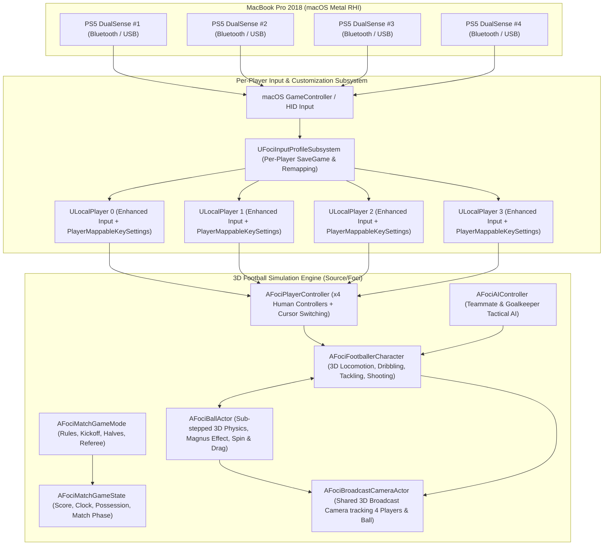

# Foci — Technical Specification & Project Task Breakdown

> [!IMPORTANT]
> **Hardware Constraint & Photorealism Strategy (MacBook Pro 2018)**
> A 2018 MacBook Pro features an Intel 8th-Gen CPU and either Intel Iris Plus 655 (13") or AMD Radeon Pro 555X/560X 4GB / Vega 20 (15") running macOS Metal 2 (Shader Model 5).
> Because Unreal Engine 5's **Lumen**, **Nanite**, and **Virtual Shadow Maps (VSM)** require modern ray-tracing/mesh-shader GPUs and are unsupported or prohibitively slow on 2018 Mac GPUs, **Foci** achieves **60 FPS photorealism** through:
> 1. **Precomputed Photorealistic Lighting**: GPU Lightmass baked GI, high-density Volumetric Lightmaps, Reflection Capture probes + Planar Reflections for wet pitch grass, and physical sky/stadium floodlight IES profiles.
> 2. **PBR Broadcast Materials**: Physically Based Rendering (PBR) shaders with subsurface scattering on player skin, micro-normal cloth/leather detail maps on kits and football, and an optimized WPO (World Position Offset) grass blade shader with strict LOD0–LOD3 culling.
> 3. **Broadcast Camera Post-Processing**: ACES Filmic Tonemapper, physical camera depth-of-field (DoF) during replays, motion blur, chromatic aberration, and stadium atmospheric fog.

---

## 1. System Architecture Overview



---

## 2. Core Technical Specifications

### 2.1 Target Platform & Performance Budget (MacBook Pro 2018)
| Parameter | Specification |
| :--- | :--- |
| **Target Hardware** | MacBook Pro 2018 (Intel Core i5/i7/i9, Radeon Pro 555X/560X 4GB VRAM or Iris Plus 655, 8–16 GB RAM) |
| **Graphics API / RHI** | macOS Metal (`SF_METAL_SM5`, Shader Model 5) |
| **Target Frame Rate** | Locked **60 FPS** during live 3D gameplay; **30/60 FPS** during close-up instant replays |
| **Target Resolution** | Native 1920x1200 / 1680x1050 (with Temporal Upsampling / TSR Lite at 75–85% screen percentage for Retina displays) |
| **Lighting & Shadows** | Static/Stationary Stadium Lights (Baked Lightmass) + Cascaded Shadow Maps (CSM, 2 cascades) + Per-Object Capsule Shadows for all 22 footballers |
| **Global Illumination** | `r.DynamicGlobalIlluminationMethod=0` (Baked Lightmass + Volumetric Lightmaps) |
| **Reflections** | `r.ReflectionMethod=2` (Screen Space Reflections + Box/Sphere Reflection Captures) |
| **Polygon & Draw Call Budget** | Max 800,000 triangles visible per frame; < 1,200 draw calls; instanced stadium crowd (Vertex Animation Texture / VAT sprites) |

### 2.2 4-Player Human Multiplayer Modes
- **Local Shared-Screen Broadcast Mode (Primary)**:
  - 4 `ULocalPlayer` instances (`PlayerIndex` 0..3) spawned on a single shared 3D Broadcast Camera (`bUseSplitscreen = false`).
  - Supports **2v2 Competitive** (2 humans per team), **4v0 Co-op vs AI**, **3v1**, or **2v2 Street/5-a-side & 11v11 Full Match**.
  - Color-coded 3D overhead player indicators (`P1` Red, `P2` Blue, `P3` Green, `P4` Yellow) with stamina/power arcs below each active human-controlled footballer's feet.
- **Tactical Player Switching**:
  - Each human player controls one footballer at a time and can switch to unselected teammates on their team:
    - **Auto / Ball-Relative Switch (`L1`)**: Switches to the best-positioned unselected teammate nearest the ball, avoiding hijacking a teammate already controlled by another human player.
    - **Right-Stick Directional Switch (`R-Stick Flick`)**: Raycasts/projects in 3D space from the current player's world position in the flicked direction to select a specific teammate.

### 2.3 PlayStation 5 DualSense Support & Per-Player Controls Customization
- **Native PS5 DualSense Integration**:
  - Supported via macOS `GameController.framework` / SDL2 / Unreal RawInput & Enhanced Input over Bluetooth and USB-C.
  - Full DualSense button glyph mapping (`Cross`, `Circle`, `Square`, `Triangle`, `L1`, `R1`, `L2` analog axis, `R2` analog axis, `L3`, `R3`, `Touchpad Click`, `Options`, `D-Pad`).
  - Haptic rumble feedback for goalpost hits, hard tackles, and shot charging.
- **Per-Player Control Format & Full Remapping**:
  - **Independent Player Profiles**: Each of the 4 human slots (`Player 1`–`Player 4`) binds to its own **`UFociInputProfile`** stored in `UFociControlsSaveGame`.
  - **Preset Formats** (instantly selectable per player):
    1. **Classic / Standard**: `Cross` = Ground Pass / Switch, `Circle` = Shoot / Clear, `Square` = Lob Pass / Cross / Slide Tackle, `Triangle` = Through Ball / GK Rush, `R2` = Sprint, `L2` = Jockey / Finesse Modifier, `L1` = Player Switch / Chip Modifier, `R1` = Driven Modifier / Teammate Contain.
    2. **Alternate (PES / eFootball Style)**: Swaps `Circle` (Lob Pass / Cross) and `Square` (Shoot / Press).
    3. **Two-Button / Arcade**: Simplified controls for casual players (`Cross` = Pass/Switch, `Circle` = Shoot/Tackle).
    4. **Custom (Fully Editable)**: Every action in `IMC_Foci_OnBall` and `IMC_Foci_OffBall` utilizes `UPlayerMappableKeySettings` so Player 1 can play on *Alternate*, Player 2 on *Classic*, and Players 3 & 4 on bespoke button layouts simultaneously.
  - **Per-Player Assist Toggles**:
    - Pass Assistance (`Assisted` / `Semi` / `Manual`)
    - Shot Assistance (`Assisted` / `Semi` / `Manual`)
    - Through-Ball Assistance (`Assisted` / `Manual`)
    - Auto-Switching (`Air Balls & Loose Balls` / `Air Balls Only` / `Manual`)
    - Analog Sprint (`On` / `Off` — uses `R2` trigger travel distance for variable sprint speed)

### 2.4 3D Football Gameplay & Physics Simulation
1. **3D Ball Physics (`AFociBallActor`)**:
   - Sub-stepped rigid-body sphere simulation (`UStaticMeshComponent` with custom physics material: restitution `0.72`, turf friction `0.45`, rolling resistance, and aerodynamic drag).
   - **Magnus Effect (3D Curve & Dip)**: Computes aerodynamic lift force per physics tick based on angular velocity ($\vec{\omega}$) and linear velocity ($\vec{v}$):
     $$\vec{F}_{\text{Magnus}} = C_M \, (\vec{\omega} \times \vec{v})$$
     enabling realistic curled free kicks, dipping top-spin volleys, and back-spin lofted passes.
2. **3D Player Locomotion & Ball Control (`AFociFootballerCharacter`)**:
   - **360-Degree Locomotion**: Continuous velocity/orientation warping across idle, jog, sprint, strafe/jockey (`L2`), and backpedal states.
   - **First-Touch & Dribbling System**: Context-sensitive touch impulses along the player's movement vector; close-control shielding (`L2`) and knock-on sprints (`R2` + Right Stick).
   - **Passing & Shooting Mechanics**:
     - Power bar accumulation based on button hold duration (`0.05s` to `0.85s`) determining launch speed and elevation angle in 3D space.
     - Modifier combinations: Finesse Shot (`R1 + Shoot` — high side-spin, lower velocity), Chip Shot (`L1 + Shoot` — high launch pitch angle $\theta \approx 42^\circ$), Driven Pass (`R1 + Pass`), Lofted Through Ball (`L1 + Triangle`).
   - **Defending & Physicality**:
     - Standing Tackle (timed lunge hitbox with ball-dislodge impulse), Sliding Tackle (directional root-motion slide with foul detection if player contact precedes ball contact), Shoulder Charge / Shielding.
3. **Goalkeeper & Tactical AI (`AFociAIController` & `AFociGoalkeeperCharacter`)**:
   - **Goalkeeper 3D Trajectory Prediction**: Predicts ball intersection with the goal plane in 3D space, triggering dive animations (high/low/left/right), 1v1 rush (`Triangle`), or catch vs. parry based on shot velocity.
   - **Outfield AI**: Dynamic 4-3-3 / 4-4-2 formation anchors that shift in 3D pitch coordinates based on ball position and team possession state (Attacking, Transition, Defending).
4. **Match Rules & Broadcast Flow (`AFociMatchGameMode` / `AFociMatchGameState`)**:
   - Full 3D pitch boundary detection: Goal Line Technology (whole ball crosses goal line between posts and under crossbar), Throw-ins, Corner Kicks, Goal Kicks, Offside detection (tracking second-last defender X-coordinate at pass release), Fouls, Free Kicks, Penalty Kicks, and Halftime/Fulltime flows.

---

## 3. Phased Project Task Breakdown

### Phase 1: MacBook Pro 2018 Graphics & Performance Configuration
- [ ] **Task 1.1 — Engine Rendering & Metal RHI Optimization (`Config/DefaultEngine.ini`, `Config/Mac/MacEngine.ini`)**
  - Disable Lumen (`r.DynamicGlobalIlluminationMethod=0`), Nanite (`r.Nanite=0`), and Virtual Shadow Maps (`r.Shadow.Virtual.Enable=0`).
  - Configure Metal SM5 target, Forward Shading (`r.ForwardShading=1` for MSAA + low GPU overhead on Radeon Pro 555X / Intel Iris Plus), Capsule Direct/Indirect Shadows, and 60 FPS frame rate lock.
- [ ] **Task 1.2 — Photorealistic Pitch & Stadium Lighting Architecture**
  - Create C++ `AFociStadiumLightingActor` and scalability presets (`FociGraphicsScalability`: *MacBook 2018 Performance 60FPS*, *MacBook 2018 Balanced*, *Photoreal Replay*) managing SSR, planar reflection toggles, grass LOD bias, and crowd density.

### Phase 2: PS5 DualSense & Per-Player Controls Customization System
- [ ] **Task 2.1 — Input Actions, Contexts & Custom Mappable Settings (`Source/Foci/Input/`)**
  - Implement `EFociControlContext` (`OnBall`, `OffBall`, `Goalkeeper`, `SetPiece`, `Menu`).
  - Implement `FFociActionBinding`, `EFociControlPreset` (`Classic`, `Alternate`, `TwoButton`, `Custom`), and `FFociPlayerInputProfile` (storing button mappings + pass/shot/switch assist settings per player).
- [ ] **Task 2.2 — `UFociInputProfileSubsystem` & `UFociControlsSaveGame`**
  - `UGameInstanceSubsystem` that manages independent input profiles for `LocalPlayer 0..3`, supports live runtime rebinding of any PS5 DualSense button/trigger, applies presets per player, and persists profiles to disk (`FociControlsSave.sav`).
- [ ] **Task 2.3 — 4-Player Local Controller Lobby & Controller Assignment**
  - Implement side-selection and per-player controller customization manager allowing 4 connected DualSense gamepads to pick Team (Home/Away) and edit their individual button formats before or during a match.

### Phase 3: 3D Ball Physics & Pitch Coordinate System
- [ ] **Task 3.1 — `AFociBallActor` (3D Aerodynamics, Magnus Spin, Turf Bounce)**
  - Implement sub-stepped 3D physics calculations: gravitational acceleration, air drag, Magnus force ($\vec{\omega} \times \vec{v}$), grass friction damping, and net/goalpost impact responses.
- [ ] **Task 3.2 — `AFociPitchVolume` & `AFociGoalActor`**
  - Define FIFA-standard 3D pitch dimensions ($105\text{m} \times 68\text{m}$, scaled to Unreal units: $10500 \times 6800\text{ cm}$; goal size $732 \times 244\text{ cm}$), out-of-bounds triggers, penalty box volumes, and 3D goal-line sensors.

### Phase 4: 3D Footballer Character, Mechanics & Broadcast Camera
- [ ] **Task 4.1 — `AFociFootballerCharacter` (Locomotion, Dribbling, Passing, Shooting, Tackling)**
  - Upgrade `AFociCharacter` into a full 3D football player with attributes (`Pace`, `Shooting`, `Passing`, `Dribbling`, `Defending`, `Physical`, `Stamina`), ball-possession magnet/dribble socket, 3D shot/pass trajectory solver, and tackle collision sweep.
- [ ] **Task 4.2 — `AFociPlayerController` (4-Player Switching & Context-Aware Input)**
  - Route per-player DualSense inputs dynamically based on whether the controlled footballer has possession, their teammate has possession, or the opposing team has possession.
  - Implement `L1` smart teammate switch and `Right-Stick` 3D directional teammate switch (excluding teammates already controlled by the other 3 human players).
- [ ] **Task 4.3 — `AFociBroadcastCameraActor` (Shared 4-Player 3D Stadium Camera)**
  - Implement dynamic 3D broadcast camera tracking the centroid of the ball and the 4 human-controlled players, with smooth zoom, pitch-angle tilt, and goal-box framing so all 4 human players remain readable on a single MacBook screen.

### Phase 5: Match Rules, Tactical AI & Goalkeeper
- [ ] **Task 5.1 — `AFociMatchGameMode` & `AFociMatchGameState`**
  - Implement match clock, halves, kickoff, goal validation, offside line calculation, throw-ins, corners, goal kicks, and foul/card state machine.
- [ ] **Task 5.2 — `AFociAIController` & `AFociGoalkeeperCharacter`**
  - Implement positional formation AI for the non-human-controlled footballers (e.g., 18 AI players in 11v11 with 4 humans, or 6 AI players in 5v5) and 3D dive/intercept logic for goalkeepers.

### Phase 6: Broadcast HUD, Pause Remapping UI & Verification
- [ ] **Task 6.1 — Broadcast Scorebug, 4-Player Foot Indicators & Controller Customization UI**
  - Build UMG / Slate C++ viewmodels for the match HUD (Scorebug, Match Timer, Radar/Minimap, `P1`–`P4` 3D overhead & foot power bars) and the 4-column PS5 DualSense Button Remapping screen.
- [ ] **Task 6.2 — Standalone C++ Physics & Input Unit Test Suite**
  - Build a CMake/Clang++ verification test suite for the 3D ball physics solver (Magnus curve, bounce, pass/shot trajectory math), offside rule evaluator, and per-player DualSense input remapping logic so core systems can be unit-tested directly in this Linux cloud environment.

---

## 4. Proposed Repository Structure (`Source/Foci/`)

```text
Foci/
├── Config/
│   ├── DefaultEngine.ini              # Metal SM5, Forward Shading, 60 FPS MBP 2018 config
│   ├── DefaultGame.ini
│   ├── DefaultInput.ini               # PS5 DualSense RawInput & Enhanced Input setup
│   └── Mac/
│       └── MacEngine.ini              # macOS-specific Metal RHI & scalability cvars
├── Docs/
│   └── SPECIFICATION.md               # Committed copy of this specification & task plan
└── Source/Foci/
    ├── Foci.Build.cs
    ├── Core/
    │   ├── FociMatchGameMode.h/.cpp   # Match rules, 4-player local spawn, referee state machine
    │   ├── FociMatchGameState.h/.cpp  # Score, clock, match phase, team lineups
    │   └── FociGraphicsScalability.h/.cpp # MacBook Pro 2018 60FPS photoreal presets
    ├── Input/
    │   ├── FociInputTypes.h           # PS5 DualSense bindings, presets, assist settings
    │   ├── FociInputProfileSubsystem.h/.cpp # Per-player (P1-P4) remapping & SaveGame persistence
    │   └── FociControlsSaveGame.h/.cpp
    ├── Gameplay/
    │   ├── FociBallActor.h/.cpp       # 3D ball physics, Magnus spin, drag, turf collision
    │   ├── FociPitchVolume.h/.cpp     # 3D pitch dimensions, goal sensors, out-of-bounds
    │   ├── FociFootballerCharacter.h/.cpp # 3D locomotion, pass/shoot/dribble/tackle mechanics
    │   ├── FociPlayerController.h/.cpp # Per-player DualSense routing & L1/R-Stick switching
    │   └── FociBroadcastCameraActor.h/.cpp # 4-player shared 3D broadcast camera
    └── AI/
        ├── FociAIController.h/.cpp    # Formation & tactical support AI
        └── FociGoalkeeperCharacter.h/.cpp # 3D shot trajectory prediction & diving
```
