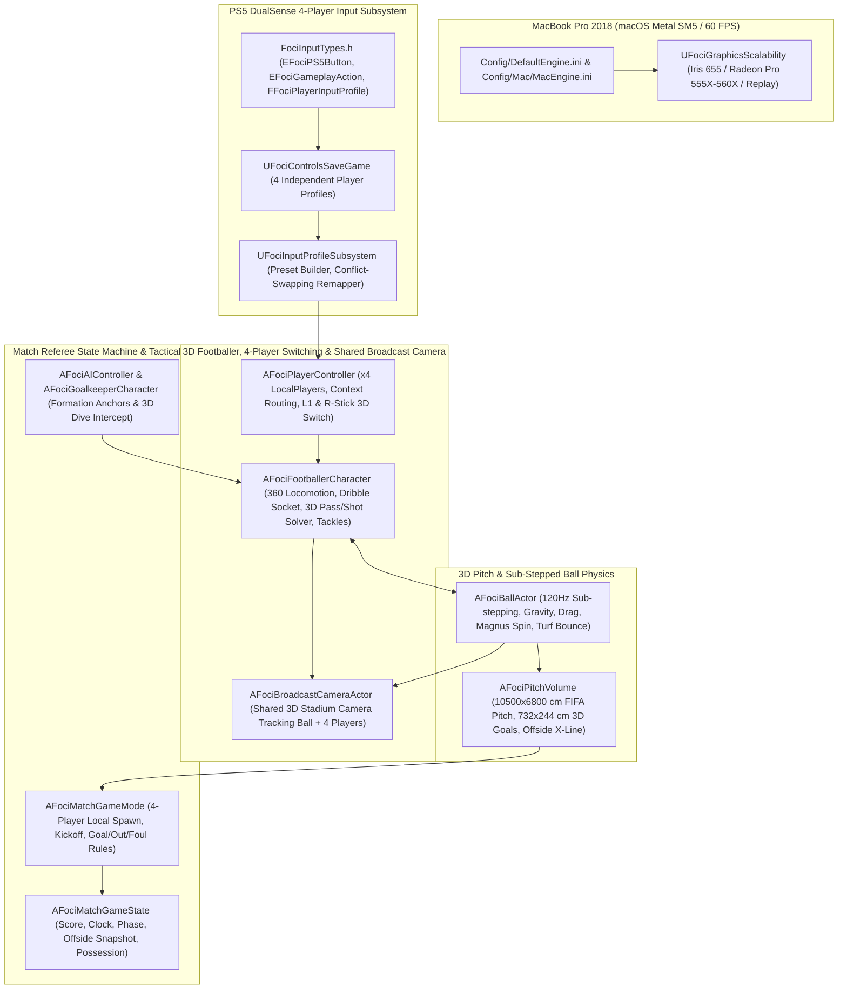

# Foci — Hydrogen-Ready Technical Specification & Granular Task Breakdown

> [!IMPORTANT]
> **Instructions for the Executing Agent (Hydrogen Model)**
> - **Repository Path**: `/home/antigravity/BobanPoznanovic/Foci` (also symlinked at `/home/antigravity/Foci`).
> - **Execution Order**: Execute tasks strictly in numeric order (`TASK-01` through `TASK-12`). Each task specifies exact target file paths, required `#include` headers, complete `UENUM` / `USTRUCT` / `UCLASS` signatures, mathematical formulas, and a terminal verification command.
> - **Compilation & Verification Constraint**: This cloud Linux VM does not have the 100+ GB Unreal Engine Editor installed, but it **does** have `clang++` (14.0.6), `cmake` (3.25.1), `ninja`, and `python3`. Therefore:
>   1. All Unreal Engine C++ headers and source files under `Source/Foci/` must strictly follow UE 5.5 UHT conventions (`#pragma once`, `"CoreMinimal.h"`, `*.generated.h` as the last `#include` in headers, `FOCI_API` export macro).
>   2. Pure deterministic simulation logic (3D ball physics with Magnus effect, per-player PS5 button remapping & conflict swapping, 3D pitch boundary/goal-line/offside geometry, and 3D directional player switching) must also be verifiable via the standalone C++17 unit test suite in `Tests/` (`TASK-12`) compiled with `clang++`.

---

## 1. System Architecture & Coordinate Conventions



### 1.1 3D World Coordinate System (Unreal Units: $1\text{ uu} = 1\text{ cm}$)
- **Pitch Center (Kickoff Spot)**: $(X = 0.0, Y = 0.0, Z = 0.0)$
- **Pitch Length (Touchline / X-Axis)**: $105\text{ m} = 10500.0\text{ cm}$.
  - **Home Team Goal Line**: $X = -5250.0\text{ cm}$ (Home attacks toward $+X$).
  - **Away Team Goal Line**: $X = +5250.0\text{ cm}$ (Away attacks toward $-X$).
- **Pitch Width (Goal Line / Y-Axis)**: $68\text{ m} = 6800.0\text{ cm}$.
  - **Left Touchline**: $Y = -3400.0\text{ cm}$.
  - **Right Touchline**: $Y = +3400.0\text{ cm}$.
- **Vertical Axis (Elevation / Z-Axis)**:
  - **Turf Surface**: $Z = 0.0\text{ cm}$.
  - **Ball Center Resting on Turf**: $Z = 11.0\text{ cm}$ (FIFA Size 5 radius $R = 11.0\text{ cm}$).
- **3D Goal Frame Dimensions**:
  - **Goal Width (Inner Post-to-Post along Y)**: $7.32\text{ m} = 732.0\text{ cm}$ ($Y \in [-366.0, +366.0]$).
  - **Goal Height (Ground to Lower Edge of Crossbar along Z)**: $2.44\text{ m} = 244.0\text{ cm}$ ($Z \in [0.0, 244.0]$).
  - **Goal Net Depth (along X)**: $200.0\text{ cm}$.

---

## 2. Granular Task Specifications for Hydrogen Model

---

### `TASK-01`: Configure Build Rules, MacBook Pro 2018 Metal SM5 Rendering, and PS5 DualSense RawInput

#### Objective
Configure `Foci.Build.cs` module dependencies and update `Config/DefaultEngine.ini`, `Config/Mac/MacEngine.ini`, and `Config/DefaultInput.ini` so the project runs at a locked **60 FPS** on a 2018 MacBook Pro (Metal SM5, Forward Shading, Baked GI, Capsule Shadows, no split-screen) and natively recognizes 4 PlayStation 5 DualSense controllers (Vendor `0x054C`, Product `0x0CE6`).

#### Files to Modify / Create
1. **`Source/Foci/Foci.Build.cs`** (Modify):
   - Add `"Foci"`, `"Foci/Core"`, `"Foci/Input"`, `"Foci/Gameplay"`, `"Foci/AI"`, `"Foci/UI"` to `PublicIncludePaths`.
   - Set `PublicDependencyModuleNames` to:
     `"Core"`, `"CoreUObject"`, `"Engine"`, `"InputCore"`, `"EnhancedInput"`, `"AIModule"`, `"UMG"`, `"Slate"`, `"SlateCore"`, `"PhysicsCore"`.
2. **`Config/DefaultEngine.ini`** (Modify):
   - Under `[/Script/EngineSettings.GameMapsSettings]`:
     - `EditorStartupMap=/Game/Maps/Stadium_Main`
     - `GameDefaultMap=/Game/Maps/Stadium_Main`
     - `GlobalDefaultGameMode=/Script/Foci.FociMatchGameMode`
     - `bUseSplitscreen=False` (critical: all 4 local players share one 3D broadcast camera)
   - Under `[/Script/Engine.RendererSettings]`:
     - `r.ForwardShading=True`
     - `r.DynamicGlobalIlluminationMethod=0` (Disables Lumen; uses baked Lightmass + Volumetric Lightmaps)
     - `r.ReflectionMethod=2` (Screen Space Reflections + Reflection Captures)
     - `r.Shadow.Virtual.Enable=0` (Disables VSM; uses Cascaded Shadow Maps + Capsule Shadows)
     - `r.Nanite=0`
     - `r.AllowStaticLighting=True`
     - `r.DefaultFeature.AntiAliasing=2` (MSAA)
     - `r.MSAACount=2`
     - `r.ScreenPercentage=85`
     - `r.CapsuleShadows=1`
   - Under `[/Script/MacTargetPlatform.MacTargetSettings]`:
     - `MaxShaderLanguageVersion=4` (Metal SM5 compatible with 2018 MacBook Pro)
     - `bUseFastIntrinsics=True`
     - `bEnableMathOptimizations=True`
     - `FrameRateLock=PUFRL_60`
3. **`Config/Mac/MacEngine.ini`** (Create):
   - Under `[SystemSettings]`, configure:
     `r.Metal.ShaderInlining=1`, `r.Metal.UseFastMath=1`, `r.ForwardShading=1`, `r.DynamicGlobalIlluminationMethod=0`, `r.Shadow.Virtual.Enable=0`, `r.Shadow.CSM.MaxCascades=2`, `r.Shadow.MaxCSMResolution=1024`, `r.CapsuleShadows=1`, `r.SSR.Quality=2`, `r.ScreenPercentage=85`, `t.MaxFPS=60`.
4. **`Config/DefaultInput.ini`** (Modify):
   - Under `[/Script/Engine.InputSettings]`: keep `EnhancedPlayerInput` and `EnhancedInputComponent`.
   - Under `[/Script/RawInput.RawInputSettings]`: register Sony DualSense (`VendorID="0x054C"`, `ProductID="0x0CE6"`) with deadzones `0.12` on `Gamepad_LeftX/Y` and `Gamepad_RightX/Y`, and `0.05` on `Gamepad_LeftTriggerAxis` and `Gamepad_RightTriggerAxis`.

#### Acceptance Criteria
- `Config/DefaultEngine.ini`, `Config/Mac/MacEngine.ini`, `Config/DefaultInput.ini`, and `Source/Foci/Foci.Build.cs` exist and contain all required keys.

---

### `TASK-02`: Implement MacBook Pro 2018 Photorealistic Scalability Manager (`UFociGraphicsScalability`)

#### Objective
Create a C++ Blueprint Function Library that switches rendering CVars at runtime between 3 hardware-tailored presets for MacBook Pro 2018.

#### Files to Create
- `Source/Foci/Core/FociGraphicsScalability.h`
- `Source/Foci/Core/FociGraphicsScalability.cpp`

#### Required Types & Signatures
1. **`UENUM(BlueprintType) enum class EFociGraphicsPreset : uint8`**:
   - `MacBook2018_IrisPerformance`: For 13" MacBook Pro 2018 (Intel Iris Plus 655) -> `TargetFPS = 60`, `ScreenPercentage = 75.0f`, `MSAACount = 2`, `CSMMaxCascades = 1`, `MaxCSMResolution = 1024`, `bEnableCapsuleShadows = true`, `SSRQuality = 1`, `GrassCullDistanceMultiplier = 0.75f`.
   - `MacBook2018_RadeonBalanced`: For 15" MacBook Pro 2018 (Radeon Pro 555X/560X 4GB) -> `TargetFPS = 60`, `ScreenPercentage = 85.0f`, `MSAACount = 2`, `CSMMaxCascades = 2`, `MaxCSMResolution = 1024`, `bEnableCapsuleShadows = true`, `SSRQuality = 2`, `GrassCullDistanceMultiplier = 1.0f`.
   - `PhotorealBroadcastReplay`: For close-up instant replays -> `TargetFPS = 30`, `ScreenPercentage = 100.0f`, `MSAACount = 4`, `CSMMaxCascades = 3`, `MaxCSMResolution = 2048`, `bEnableCapsuleShadows = true`, `SSRQuality = 3`, `GrassCullDistanceMultiplier = 1.5f`.
2. **`USTRUCT(BlueprintType) struct FOCI_API FFociGraphicsConfig`**:
   - Holds the 8 fields listed above (`TargetFPS`, `ScreenPercentage`, `MSAACount`, `CSMMaxCascades`, `MaxCSMResolution`, `bEnableCapsuleShadows`, `SSRQuality`, `GrassCullDistanceMultiplier`).
3. **`UCLASS() class FOCI_API UFociGraphicsScalability : public UBlueprintFunctionLibrary`**:
   - `static FFociGraphicsConfig GetConfigForPreset(EFociGraphicsPreset Preset);`
   - `static void ApplyGraphicsPreset(const UObject* WorldContextObject, EFociGraphicsPreset Preset);` (Updates `IConsoleManager::Get().FindConsoleVariable(...)` for `t.MaxFPS`, `r.ScreenPercentage`, `r.MSAACount`, `r.Shadow.CSM.MaxCascades`, `r.Shadow.MaxCSMResolution`, `r.CapsuleShadows`, `r.SSR.Quality`, `foliage.CullDistanceScale`, `r.DynamicGlobalIlluminationMethod=0`, `r.Shadow.Virtual.Enable=0`).

#### Acceptance Criteria
- Header and implementation compile cleanly and expose `GetConfigForPreset` and `ApplyGraphicsPreset` to Blueprints and C++.

---

### `TASK-03`: Define PlayStation 5 DualSense Input Types & Per-Player SaveGame (`FociInputTypes.h` & `UFociControlsSaveGame`)

#### Objective
Define all data types for PS5 DualSense buttons, football gameplay actions (On-Ball, Off-Ball, Tactical), editable control presets (*Classic*, *Alternate*, *TwoButton*, *Custom*), assist settings, and the SaveGame class storing 4 independent player profiles.

#### Files to Create
- `Source/Foci/Input/FociInputTypes.h`
- `Source/Foci/Input/FociControlsSaveGame.h`

#### Exact Specification
1. **`EFociPS5Button` (`uint8`)**:
   - `Cross`, `Circle`, `Square`, `Triangle`, `L1`, `R1`, `L2`, `R2`, `L3`, `R3`, `DPadUp`, `DPadDown`, `DPadLeft`, `DPadRight`, `Touchpad`, `Options`.
2. **`EFociGameplayAction` (`uint8`)**:
   - **Context Group 1 (Attack / On-Ball)**: `GroundPass`, `ThroughBall`, `LobPassCross`, `Shoot`, `Sprint`, `FinesseModifier`, `ChipModifier`, `ShieldBall`.
   - **Context Group 2 (Defense / Off-Ball)**: `SwitchPlayer`, `StandingTackle`, `SlidingTackle`, `TeammateContain`, `Jockey`, `GoalkeeperRush`.
   - **Context Group 3 (Tactical / System)**: `TacticalMentalityUp`, `TacticalMentalityDown`, `OffsideTrap`, `PauseMatch`.
3. **`EFociControlPreset` (`uint8`)**:
   - `Classic`, `Alternate`, `TwoButton`, `Custom`.
4. **`EFociAssistLevel` (`uint8`)**:
   - `Assisted`, `Semi`, `Manual`.
5. **`EFociAutoSwitchMode` (`uint8`)**:
   - `AirAndLooseBalls`, `AirBallsOnly`, `ManualOnly`.
6. **`EFociTeamSide` (`uint8`)**:
   - `Neutral`, `Home`, `Away`.
7. **`FFociPlayerInputProfile` (`USTRUCT(BlueprintType)`)**:
   - `int32 PlayerIndex = 0;` (`0` to `3` corresponding to Human Players 1–4)
   - `FString ProfileName = TEXT("Player 1");`
   - `EFociTeamSide TeamSide = EFociTeamSide::Home;`
   - `EFociControlPreset Preset = EFociControlPreset::Classic;`
   - `TMap<EFociGameplayAction, EFociPS5Button> ActionBindings;`
   - `EFociAssistLevel PassAssistance = EFociAssistLevel::Assisted;`
   - `EFociAssistLevel ShotAssistance = EFociAssistLevel::Assisted;`
   - `EFociAssistLevel CrossAssistance = EFociAssistLevel::Assisted;`
   - `EFociAutoSwitchMode AutoSwitchMode = EFociAutoSwitchMode::AirAndLooseBalls;`
   - `bool bAnalogSprint = true;`
   - `bool bEnableVibration = true;`
8. **`UFociControlsSaveGame` (`UCLASS() : public USaveGame`)**:
   - `static constexpr int32 MaxHumanPlayers = 4;`
   - `FString SaveSlotName = TEXT("FociControlsSaveSlot");`
   - `uint32 UserIndex = 0;`
   - `TArray<FFociPlayerInputProfile> PlayerProfiles;`

#### Acceptance Criteria
- All enums, structs, and `UFociControlsSaveGame` are defined with `BlueprintType` / `BlueprintReadWrite` metadata.

---

### `TASK-04`: Implement Per-Player PS5 DualSense Profile & Remapping Subsystem (`UFociInputProfileSubsystem`)

#### Objective
Implement `UFociInputProfileSubsystem` (`UGameInstanceSubsystem`) so each of the 4 human players can select a preset format (*Classic*, *Alternate*, *Two-Button*) or remap any individual PS5 DualSense button with automatic same-context conflict swapping and persistent SaveGame storage.

#### Files to Create
- `Source/Foci/Input/FociInputProfileSubsystem.h`
- `Source/Foci/Input/FociInputProfileSubsystem.cpp`

#### Required Algorithms & Method Signatures
1. **Default Initialization (`EnsureDefaultProfilesInitialized`)**:
   - Initializes 4 `FFociPlayerInputProfile` entries (`PlayerIndex` `0..3`).
   - Default `TeamSide`: Players `0` and `1` on `EFociTeamSide::Home`; Players `2` and `3` on `EFociTeamSide::Away` (ready for 2v2 out of the box, editable via `SetPlayerTeamSide`).
   - Default `Preset`: `EFociControlPreset::Classic`.
2. **Preset Binding Table (`BuildPresetBindings(EFociControlPreset Preset)`)**:
   | Gameplay Action | Context | `Classic` | `Alternate` | `TwoButton` |
   | :--- | :--- | :--- | :--- | :--- |
   | `GroundPass` | On-Ball (1) | `Cross` | `Cross` | `Cross` |
   | `ThroughBall` | On-Ball (1) | `Triangle` | `Triangle` | `Cross` |
   | `LobPassCross` | On-Ball (1) | `Square` | `Circle` | `Square` |
   | `Shoot` | On-Ball (1) | `Circle` | `Square` | `Circle` |
   | `Sprint` | On-Ball (1) | `R2` | `R2` | `R2` |
   | `FinesseModifier` | On-Ball (1) | `R1` | `R1` | `R1` |
   | `ChipModifier` | On-Ball (1) | `L1` | `L1` | `L1` |
   | `ShieldBall` | On-Ball (1) | `L2` | `L2` | `L2` |
   | `SwitchPlayer` | Off-Ball (2) | `L1` | `L1` | `Cross` |
   | `StandingTackle` | Off-Ball (2) | `Circle` | `Square` | `Circle` |
   | `SlidingTackle` | Off-Ball (2) | `Square` | `Circle` | `Square` |
   | `TeammateContain` | Off-Ball (2) | `R1` | `R1` | `R1` |
   | `Jockey` | Off-Ball (2) | `L2` | `L2` | `L2` |
   | `GoalkeeperRush` | Off-Ball (2) | `Triangle` | `Triangle` | `Triangle` |
   | `TacticalMentalityUp` | System (3) | `DPadRight` | `DPadRight` | `DPadRight` |
   | `TacticalMentalityDown`| System (3) | `DPadLeft` | `DPadLeft` | `DPadLeft` |
   | `OffsideTrap` | System (3) | `DPadUp` | `DPadUp` | `DPadUp` |
   | `PauseMatch` | System (3) | `Options` | `Options` | `Options` |
3. **Conflict-Swapping Button Remapper (`RemapPlayerAction`)**:
   ```cpp
   void RemapPlayerAction(int32 PlayerIndex, EFociGameplayAction Action, EFociPS5Button NewButton, bool bSwapConflictingInSameContext = true);
   ```
   - Looks up `OldButton = Profile.ActionBindings[Action]`.
   - If `bSwapConflictingInSameContext && OldButton != NewButton`: iterates through `Profile.ActionBindings`; if another action `OtherAction != Action` is bound to `NewButton` **and** `AreActionsInSameContext(OtherAction, Action)` is `true`, sets `Profile.ActionBindings[OtherAction] = OldButton`.
   - Sets `Profile.ActionBindings[Action] = NewButton`.
   - Sets `Profile.Preset = EFociControlPreset::Custom`.
   - Broadcasts `OnPlayerProfileChanged.Broadcast(PlayerIndex, Profile)`.
4. **Unreal `FKey` Mapping (`ConvertPS5ButtonToUnrealKey`)**:
   - Maps `Cross -> EKeys::Gamepad_FaceButton_Bottom`, `Circle -> EKeys::Gamepad_FaceButton_Right`, `Square -> EKeys::Gamepad_FaceButton_Left`, `Triangle -> EKeys::Gamepad_FaceButton_Top`, `L1 -> EKeys::Gamepad_LeftShoulder`, `R1 -> EKeys::Gamepad_RightShoulder`, `L2 -> EKeys::Gamepad_LeftTrigger`, `R2 -> EKeys::Gamepad_RightTrigger`, `L3 -> EKeys::Gamepad_LeftThumbstick`, `R3 -> EKeys::Gamepad_RightThumbstick`, `DPadUp/Down/Left/Right -> EKeys::Gamepad_DPad_*`, `Touchpad -> EKeys::Gamepad_Special_Left`, `Options -> EKeys::Gamepad_Special_Right`.
   - Also implement `EFociPS5Button ConvertUnrealKeyToPS5Button(const FKey& Key, bool& bOutIsValid);` so `AFociPlayerController` or UI capture widgets can translate raw gamepad presses directly to `EFociPS5Button`.

#### Acceptance Criteria
- Remapping Player 0's `Shoot` from `Circle` to `Square` automatically swaps Player 0's `LobPassCross` to `Circle` without modifying Player 0's Off-Ball bindings or Players 1–3's profiles.

---

### `TASK-05`: Implement 3D Ball Physics Actor with Sub-Stepping & Magnus Spin (`AFociBallActor`)

#### Objective
Implement `AFociBallActor` with 120 Hz sub-stepped 3D physics, aerodynamic drag, Magnus effect ($\vec{\omega} \times \vec{v}$ curve and dip), turf restitution bounce, rolling resistance, and trajectory prediction helper methods.

#### Files to Create
- `Source/Foci/Gameplay/FociBallActor.h`
- `Source/Foci/Gameplay/FociBallActor.cpp`

#### Exact Physics Algorithm & Signatures
1. **Properties**:
   - `USphereComponent* CollisionSphere` (`BallRadiusCm = 11.0f`)
   - `UStaticMeshComponent* BallMesh`
   - `float BallRadiusCm = 11.0f;`
   - `float BallMassKg = 0.43f;`
   - `float TurfRestitution = 0.68f;`
   - `float TurfRollingFriction = 320.0f;` ($\text{cm/s}^2$)
   - `float AirDragCoefficient = 0.00022f;`
   - `float MagnusCoefficient = 0.00045f;`
   - `float SpinDecayRate = 1.4f;`
   - `FVector LinearVelocity = FVector::ZeroVector;`
   - `FVector AngularVelocity = FVector::ZeroVector;` (rad/s)
   - `TWeakObjectPtr<AFociFootballerCharacter> PossessingFootballer;`
   - `TWeakObjectPtr<AFociFootballerCharacter> LastTouchFootballer;`
2. **Deterministic Physics Stepper (`StepBallPhysics3D`)**:
   ```cpp
   static void StepBallPhysics3D(
       FVector& InOutPosition,
       FVector& InOutVelocity,
       FVector& InOutAngularVelocity,
       float DeltaTime,
       float GroundZ,
       float RadiusCm,
       float Restitution,
       float RollingFriction,
       float DragCoeff,
       float MagnusCoeff,
       float SpinDecay);
   ```
   - **Step 1 (Air Drag)**: $\vec{a}_{\text{drag}} = -C_d \, \|\vec{v}\| \, \vec{v}$; $\vec{v} \leftarrow \vec{v} + \vec{a}_{\text{drag}} \Delta t$.
   - **Step 2 (Magnus Lift / Curve)**: If $\|\vec{\omega}\| > 0$ and $\|\vec{v}\| > 20\text{ cm/s}$, $\vec{a}_{\text{Magnus}} = C_M \, (\vec{\omega} \times \vec{v})$; $\vec{v} \leftarrow \vec{v} + \vec{a}_{\text{Magnus}} \Delta t$.
   - **Step 3 (Gravity vs. Ground Roll)**:
     - Let $Z_{\min} = \text{GroundZ} + \text{RadiusCm}$.
     - If $Z \le Z_{\min} + 0.5$ and $|v_z| < 35.0$: ball is rolling on turf ($Z = Z_{\min}$, $v_z = 0$, horizontal speed reduced by $\max(0, \|\vec{v}_{xy}\| - \text{RollingFriction} \cdot \Delta t)$).
     - Otherwise: ball is airborne ($v_z \leftarrow v_z - 980.0 \cdot \Delta t$).
   - **Step 4 (Position Integration)**: $\vec{p} \leftarrow \vec{p} + \vec{v} \Delta t$.
   - **Step 5 (Turf Bounce)**: If $Z < Z_{\min}$, clamp $Z = Z_{\min}$; if $v_z < 0$, set $v_z = -v_z \cdot \text{Restitution}$, multiply $v_x, v_y$ by $0.88$, and if $v_z < 25.0$ clamp $v_z = 0$.
   - **Step 6 (Spin Decay)**: $\vec{\omega} \leftarrow \vec{\omega} \cdot \max(0.0f, 1.0f - \text{SpinDecay} \cdot \Delta t)$.
3. **3D Trajectory Predictor (`PredictBallPositionAtTime`)**:
   ```cpp
   UFUNCTION(BlueprintPure, Category = "Foci|Ball")
   FVector PredictBallPositionAtTime(float FutureSeconds) const;
   ```
   - Copies current `GetActorLocation()`, `LinearVelocity`, `AngularVelocity` and runs `StepBallPhysics3D` in `1.0f / 60.0f` increments up to `FutureSeconds` (used by Goalkeeper dive AI and `L1` air-ball player switching).

#### Acceptance Criteria
- A ball kicked with side-spin ($\omega_z \neq 0$) curves laterally along $Y$; a ball kicked upward bounces on $Z = 11.0\text{ cm}$ with restitution `0.68` and comes to a rolling stop.

---

### `TASK-06`: Implement 3D Pitch Volume, Goal Line Technology & Offside Evaluator (`AFociPitchVolume`)

#### Objective
Implement `AFociPitchVolume` to manage 3D FIFA pitch boundaries ($10500 \times 6800\text{ cm}$), 3D goal detection ($732 \times 244\text{ cm}$ under the crossbar), out-of-bounds classification (Goal Kick vs. Corner Kick vs. Throw-In), and 3D X-coordinate offside evaluation.

#### Files to Create
- `Source/Foci/Gameplay/FociPitchVolume.h`
- `Source/Foci/Gameplay/FociPitchVolume.cpp`

#### Required Types & Pure Static Evaluators
1. **`UENUM(BlueprintType) enum class EFociPitchEvent : uint8`**:
   - `InPlay`, `GoalScoredHome` (ball entered Away goal at $+X$), `GoalScoredAway` (ball entered Home goal at $-X$), `ThrowInHome`, `ThrowInAway`, `CornerKickHome`, `CornerKickAway`, `GoalKickHome`, `GoalKickAway`.
2. **`AFociPitchVolume : public AActor`**:
   - Constants / Configurable Properties:
     - `float HalfPitchLengthCm = 5250.0f;` ($105\text{ m} / 2$)
     - `float HalfPitchWidthCm = 3400.0f;` ($68\text{ m} / 2$)
     - `float GoalHalfWidthCm = 366.0f;` ($7.32\text{ m} / 2$)
     - `float GoalCrossbarHeightCm = 244.0f;` ($2.44\text{ m}$)
     - `float PenaltyBoxLengthCm = 1650.0f;` ($16.5\text{ m}$)
     - `float PenaltyBoxHalfWidthCm = 2016.0f;` ($40.32\text{ m} / 2$)
3. **Boundary & Goal Evaluator (`EvaluateBallBoundary3D`)**:
   ```cpp
   static EFociPitchEvent EvaluateBallBoundary3D(
       const FVector& BallCenterLocation,
       float BallRadiusCm,
       EFociTeamSide LastTouchTeam,
       float HalfLengthCm = 5250.0f,
       float HalfWidthCm = 3400.0f,
       float GoalHalfWidth = 366.0f,
       float CrossbarHeight = 244.0f);
   ```
   - **Whole-Ball Rule**: The ball crosses a boundary line only when its entire sphere clears the line:
     - Crossed $+X$ goal line (`BallCenterLocation.X - BallRadiusCm > HalfLengthCm`):
       - If $|Y| \le (\text{GoalHalfWidth} - \text{BallRadiusCm})$ **and** $(Z + \text{BallRadiusCm}) \le \text{CrossbarHeight}$: returns `EFociPitchEvent::GoalScoredHome`.
       - Else (missed goal over crossbar or wide of posts): if `LastTouchTeam == EFociTeamSide::Home`, returns `EFociPitchEvent::GoalKickAway`; else returns `EFociPitchEvent::CornerKickHome`.
     - Crossed $-X$ goal line (`BallCenterLocation.X + BallRadiusCm < -HalfLengthCm`):
       - If $|Y| \le (\text{GoalHalfWidth} - \text{BallRadiusCm})$ **and** $(Z + \text{BallRadiusCm}) \le \text{CrossbarHeight}$: returns `EFociPitchEvent::GoalScoredAway`.
       - Else: if `LastTouchTeam == EFociTeamSide::Away`, returns `EFociPitchEvent::GoalKickHome`; else returns `EFociPitchEvent::CornerKickAway`.
     - Crossed $\pm Y$ touchline (`FMath::Abs(BallCenterLocation.Y) - BallRadiusCm > HalfWidthCm`):
       - Returns ` (LastTouchTeam == EFociTeamSide::Home) ? EFociPitchEvent::ThrowInAway : EFociPitchEvent::ThrowInHome`.
     - Otherwise: returns `EFociPitchEvent::InPlay`.
4. **Offside Rule Evaluator (`IsPlayerInOffsidePosition3D`)**:
   ```cpp
   static bool IsPlayerInOffsidePosition3D(
       float ReceiverX,
       float BallXAtPass,
       EFociTeamSide AttackingTeam,
       const TArray<float>& DefenderXPositions);
   ```
   - Remember: `Home` attacks toward $+X$; `Away` attacks toward $-X$.
   - A receiver cannot be offside in their own half (`AttackingTeam == Home && ReceiverX <= 0.0f` or `AttackingTeam == Away && ReceiverX >= 0.0f`).
   - Sorts `DefenderXPositions` to find the **second-last opponent** ($X_{\text{2ndDef}}$; if fewer than 2 defenders exist, uses the goal line $\pm 5250.0\text{ cm}$).
   - For `Home` ($+X$): Offside if `ReceiverX > BallXAtPass + 5.0f` **and** `ReceiverX > SecondLastDefenderX + 5.0f` (with $5\text{ cm}$ VAR tolerance).
   - For `Away` ($-X$): Offside if `ReceiverX < BallXAtPass - 5.0f` **and** `ReceiverX < SecondLastDefenderX - 5.0f`.

#### Acceptance Criteria
- `EvaluateBallBoundary3D` accurately distinguishes a 3D top-corner goal ($Z = 220\text{ cm}$) from a shot over the crossbar ($Z = 260\text{ cm}$) and assigns the proper Goal Kick or Corner Kick based on `LastTouchTeam`.

---

### `TASK-07`: Implement 3D Footballer Character & Ball Mechanics (`AFociFootballerCharacter`)

#### Objective
Implement `AFociFootballerCharacter` (subclassing `ACharacter`) with footballer attributes, 360-degree locomotion/sprint/jockey speed modulation, ball possession capture & dribble socket, 3D Assisted/Semi/Manual pass and shot velocity solver, and standing/sliding tackles.

#### Files to Create / Modify
- `Source/Foci/Gameplay/FociFootballerCharacter.h`
- `Source/Foci/Gameplay/FociFootballerCharacter.cpp`
- Update `Source/Foci/FociCharacter.h` so `AFociCharacter` either aliases or inherits from `AFociFootballerCharacter` for backward compatibility.

#### Required Attributes & Mechanics
1. **Struct `FFociFootballerStats` (`USTRUCT(BlueprintType)`)**:
   - `float Pace = 82.0f;` (1–99, scales max sprint speed between $520\text{ cm/s}$ and $780\text{ cm/s}$)
   - `float Shooting = 80.0f;` (1–99, scales max shot power and target accuracy)
   - `float Passing = 80.0f;` (1–99, scales pass accuracy and weight)
   - `float Dribbling = 82.0f;` (1–99, scales turn rate and close-control ball tether distance)
   - `float Defending = 75.0f;` (1–99, scales tackle lunge reach and ball-win probability)
   - `float Physical = 78.0f;` (1–99, scales stamina drain resistance and shielding strength)
2. **Properties on `AFociFootballerCharacter`**:
   - `EFociTeamSide TeamSide = EFociTeamSide::Home;`
   - `int32 SquadNumber = 10;`
   - `bool bIsGoalkeeper = false;`
   - `FVector FormationHomeLocation = FVector::ZeroVector;`
   - `FFociFootballerStats Stats;`
   - `float CurrentStamina = 1.0f;` (`0.0f` to `1.0f`)
   - `int32 ControllingHumanPlayerIndex = -1;` (`-1` if AI-controlled, `0..3` if controlled by Human Player 1–4)
   - `bool bIsSprinting = false;`
   - `bool bIsJockeying = false;`
   - `bool bIsFinesseModifierHeld = false;`
   - `bool bIsChipModifierHeld = false;`
3. **3D Pass & Shot Trajectory Solver (`ComputeKickVelocityAndSpin3D`)**:
   ```cpp
   static void ComputeKickVelocityAndSpin3D(
       const FVector& StartLocation,
       const FVector& RawAimDirection2D,
       float PowerRatio, // 0.0 to 1.0 from button charge duration
       bool bIsShot,
       bool bIsLobOrCross,
       bool bIsThroughBall,
       bool bIsFinesse,
       bool bIsChip,
       EFociAssistLevel AssistLevel,
       const FVector& IdealAssistedTargetLocation,
       FVector& OutLaunchVelocity,
       FVector& OutSpinVectorRadPerSec);
   ```
   - **Directional Assistance Blending**:
     - `Assisted`: blends `75%` toward `(IdealAssistedTargetLocation - StartLocation).GetSafeNormal2D()` and `25%` `RawAimDirection2D`.
     - `Semi`: blends `35%` toward `IdealAssistedTargetLocation` and `65%` `RawAimDirection2D`.
     - `Manual`: `100%` `RawAimDirection2D`.
   - **3D Elevation & Speed**:
     - **Ground Pass**: Launch pitch $\theta = 2.0^\circ$, speed $\in [900, 2400]\text{ cm/s}$ (scaled by `PowerRatio` or distance to receiver if `Assisted`).
     - **Through Ball**: Launch pitch $\theta = 4.0^\circ$ (or $32.0^\circ$ if `bIsChip` lofted through ball), aimed ahead of receiver's velocity vector.
     - **Lob Pass / Cross**: Launch pitch $\theta \in [24.0^\circ, 38.0^\circ]$, speed $\in [1400, 2700]\text{ cm/s}$, backspin $\omega = 18.0\text{ rad/s}$.
     - **Standard / Driven Shot**: Launch pitch $\theta \in [4.0^\circ, 19.0^\circ]$ based on `PowerRatio`, speed $\in [1800, 3400]\text{ cm/s}$.
     - **Finesse Shot (`bIsFinesse == true`)**: Speed scaled by `0.86f`, side-spin $\omega_z = \pm 38.0\text{ rad/s}$ curving inward toward the center of the goal via the Magnus effect.
     - **Chip Shot (`bIsChip == true`)**: High launch pitch $\theta = 42.0^\circ$, speed $\in [1100, 1750]\text{ cm/s}$ with backspin to arc over an onrushing goalkeeper.
4. **Gameplay Action Entry Points**:
   - `void SetMovementInput3D(const FVector2D& StickInput, float AnalogSprintFactor, bool bJockeyHeld);`
   - `void ExecutePassAction(AFociBallActor* Ball, const FVector2D& AimInput, float PowerRatio, bool bThroughBall, bool bLobCross, EFociAssistLevel Assist);`
   - `void ExecuteShootAction(AFociBallActor* Ball, const FVector2D& AimInput, float PowerRatio, EFociAssistLevel ShotAssist);`
   - `bool ExecuteTackleAction(AFociBallActor* Ball, bool bSlideTackle);` (Sweeps $165\text{ cm}$ forward for standing tackle or $260\text{ cm}$ for slide tackle; dislodges ball from opponent if within arc).

#### Acceptance Criteria
- `ComputeKickVelocityAndSpin3D` produces distinct 3D launch velocities and spin vectors for Ground Passes, Lob Crosses, Standard Shots, Finesse Shots, and Chip Shots across `Assisted`, `Semi`, and `Manual` modes.

---

### `TASK-08`: Implement 4-Player Local Controller & Smart 3D Teammate Switching (`AFociPlayerController`)

#### Objective
Upgrade `AFociPlayerController` so up to 4 connected PS5 DualSense controllers (`PlayerIndex` `0..3`) dynamically route button presses through their individual `FFociPlayerInputProfile` (supporting On-Ball vs. Off-Ball context switching, power-bar charging, `L1` ball-relative switching, and `Right-Stick` 3D directional switching without stealing another human player's active footballer).

#### Files to Modify
- `Source/Foci/FociPlayerController.h`
- `Source/Foci/FociPlayerController.cpp`

#### Required Switching Algorithm & Signatures
1. **3D Teammate Selection Algorithm (`SelectBestTeammateToSwitch3D`)**:
   ```cpp
   static int32 SelectBestTeammateToSwitch3D(
       int32 RequestingHumanPlayerIndex,
       int32 CurrentControlledCandidateIndex,
       const FVector& CurrentFootballerLocation,
       const FVector& BallLocation,
       const FVector2D& RightStickFlickDirection, // ZeroVector if L1 Ball-Relative switch
       const TArray<FVector>& TeammateLocations,
       const TArray<int32>& TeammateControllingHumanIndices, // -1 if AI, 0..3 if controlled by human
       const TArray<bool>& TeammateIsGoalkeeper);
   ```
   - **Rule 1 (Never Hijack Another Human Player)**: Candidate index `i` is immediately skipped if:
     - `i == CurrentControlledCandidateIndex`
     - `TeammateIsGoalkeeper[i] == true`
     - `TeammateControllingHumanIndices[i] != -1 && TeammateControllingHumanIndices[i] != RequestingHumanPlayerIndex` (already controlled by another of the 4 human players!).
   - **Rule 2 (`L1` Ball-Relative Switch — when `RightStickFlickDirection.SizeSquared() < 0.2f`)**:
     - Selects the available AI-controlled teammate with the minimum 3D Euclidean distance to `BallLocation`.
   - **Rule 3 (`Right-Stick` 3D Directional Switch — when `RightStickFlickDirection.SizeSquared() >= 0.2f`)**:
     - Normalizes `FlickDir3D = FVector(RightStickFlickDirection.Y, RightStickFlickDirection.X, 0.0f).GetSafeNormal()`.
     - For each eligible AI-controlled teammate at `TeammateLocations[i]`:
       - Computes `ToCandidate = TeammateLocations[i] - CurrentFootballerLocation`, `Dist = ToCandidate.Size2D()`, `Dir = ToCandidate.GetSafeNormal2D()`.
       - Computes cosine alignment `Dot = FVector::DotProduct(FlickDir3D, Dir)`.
       - Rejects candidates outside a $70^\circ$ forward cone (`Dot < 0.342f`).
       - Scores remaining candidates using `Score = (Dot * 2000.0f) - (Dist * 0.35f)` and returns the candidate index maximizing `Score`.
2. **Per-Player DualSense Input Processing**:
   - Reads the player's `FFociPlayerInputProfile` from `UFociInputProfileSubsystem` using `GetLocalPlayer()->GetControllerId()` (`0..3`).
   - Determines active context:
     - **On-Ball Context**: when `ControlledFootballer` is the ball's `PossessingFootballer`. Pressing the button bound to `GroundPass`, `ThroughBall`, `LobPassCross`, or `Shoot` starts charging `CurrentActionChargeTime` (`0.0f` to `0.85f`); releasing executes the corresponding 3D kick with `PowerRatio = FMath::Clamp(CurrentActionChargeTime / 0.75f, 0.15f, 1.0f)`.
     - **Off-Ball Context**: when `ControlledFootballer` does not have the ball. Pressing the button bound to `SwitchPlayer` invokes `RequestTeammateSwitch(FVector2D::ZeroVector)`; flicking the Right Stick invokes `RequestTeammateSwitch(RightStickVector)`; pressing `StandingTackle` or `SlidingTackle` triggers `ControlledFootballer->ExecuteTackleAction(...)`.

#### Acceptance Criteria
- `SelectBestTeammateToSwitch3D` never selects a goalkeeper or a footballer already controlled by Human Players 1–4, picks the closest AI teammate to the ball on `L1`, and picks the teammate aligned with the 3D flick cone on Right-Stick flick.

---

### `TASK-09`: Implement Shared 4-Player 3D Broadcast Camera (`AFociBroadcastCameraActor`)

#### Objective
Implement a shared 3D stadium broadcast camera that smoothly tracks the weighted 3D centroid of the football and all 4 active human-controlled footballers, dynamically adjusting boom distance (zoom) and FOV so all 4 human players remain framed on a single MacBook Pro 16:10 display without split-screen.

#### Files to Create
- `Source/Foci/Gameplay/FociBroadcastCameraActor.h`
- `Source/Foci/Gameplay/FociBroadcastCameraActor.cpp`

#### Exact Camera Framing Algorithm
1. **Components & Settings**:
   - `USceneComponent* FocusRoot`
   - `USpringArmComponent* CameraBoom` (`RelativeRotation = FRotator(-26.0f, -90.0f, 0.0f)` looking across the pitch from the South broadcast gantry toward $+Y$)
   - `UCameraComponent* BroadcastCamera` (`FieldOfView = 42.0f` telephoto broadcast lens for photorealistic perspective compression)
   - `float MinArmLengthCm = 2400.0f;`
   - `float MaxArmLengthCm = 4600.0f;`
   - `float CameraLagSpeed = 5.5f;`
   - `floatBallFocusWeight = 0.60f;` (60% weight on ball, 40% distributed across the 4 human-controlled players)
2. **Pure Static Framing Solver (`ComputeBroadcastCameraFrame3D`)**:
   ```cpp
   static void ComputeBroadcastCameraFrame3D(
       const FVector& BallLocation,
       const TArray<FVector>& HumanPlayerLocations,
       float BallWeight,
       float MinArmLength,
       float MaxArmLength,
       FVector& OutTargetFocusLocation,
       float& OutTargetArmLength);
   ```
   - Computes `HumanCentroid` as the average of `HumanPlayerLocations` (if empty, equals `BallLocation`).
   - Computes `OutTargetFocusLocation = FMath::Lerp(HumanCentroid, BallLocation, BallWeight)` with `OutTargetFocusLocation.Z = 60.0f`.
   - Computes `MaxSpreadCm`: the maximum 2D distance between `OutTargetFocusLocation` and any point in `{BallLocation} U HumanPlayerLocations`.
   - Maps `MaxSpreadCm` from `[800.0f, 3800.0f]` to `[MinArmLength, MaxArmLength]` using `FMath::GetMappedRangeValueClamped` so the camera zooms out smoothly when the 4 human players spread across the pitch and zooms in during tight box play.

#### Acceptance Criteria
- `ComputeBroadcastCameraFrame3D` centers on the ball when no human locations are spread out, shifts focus toward the 4 human players weighted by `BallWeight`, and increases `OutTargetArmLength` monotonically as player spread increases.

---

### `TASK-10`: Implement 4-Player Match GameMode, Referee Rules & GameState (`AFociMatchGameMode` & `AFociMatchGameState`)

#### Objective
Implement `AFociMatchGameState` and `AFociMatchGameMode` to spawn 4 local human players (`ULocalPlayer 0..3`), spawn both teams' 3D footballer squads + `AFociBallActor` + `AFociPitchVolume` + `AFociBroadcastCameraActor`, run the match clock (`FirstHalf`, `HalfTime`, `SecondHalf`, `FullTime`), and enforce 3D football rules (Kickoff, Goals, Throw-Ins, Corner Kicks, Goal Kicks, Offsides).

#### Files to Create / Modify
- `Source/Foci/Core/FociMatchGameState.h`
- `Source/Foci/Core/FociMatchGameState.cpp`
- `Source/Foci/Core/FociMatchGameMode.h`
- `Source/Foci/Core/FociMatchGameMode.cpp`

#### Required State & Rules Flow
1. **`EFociMatchPhase` (`uint8`)**:
   - `PreMatchLobby`, `KickOff`, `InPlay`, `GoalCelebration`, `ThrowIn`, `CornerKick`, `GoalKick`, `FreeKick`, `PenaltyKick`, `HalfTime`, `FullTime`.
2. **`AFociMatchGameState : public AGameStateBase`**:
   - `int32 HomeScore = 0;`
   - `int32 AwayScore = 0;`
   - `float MatchClockSeconds = 0.0f;` (Scaled match time: default 6 real minutes = 90 match minutes, configurable via `MatchTimeScale = 15.0f`)
   - `int32 CurrentHalf = 1;` (`1` or `2`)
   - `EFociMatchPhase CurrentPhase = EFociMatchPhase::KickOff;`
   - `EFociTeamSide KickOffTeam = EFociTeamSide::Home;`
3. **`AFociMatchGameMode : public AGameModeBase`**:
   - **`EnsureFourLocalHumanPlayers(UWorld* World)`**:
     - Ensures up to 4 `ULocalPlayer` instances (`ControllerId` `0..3`) exist via `UGameplayStatics::CreatePlayer(World, ControllerId, true)` so all 4 PS5 DualSense controllers are active in the match.
   - **`SpawnSquadsAndAssignHumanPlayers()`**:
     - Spawns Home and Away 4-3-3 formations (1 Goalkeeper + 10 Outfielders per team, or 5v5 when `bFiveASideMode = true`).
     - Reads each human player's `TeamSide` (`Home` vs. `Away`) from `UFociInputProfileSubsystem` and assigns each human `AFociPlayerController` (`0..3`) to possess a distinct outfield footballer on their chosen team, binding their view target to the shared `AFociBroadcastCameraActor`.
   - **`Tick(float DeltaTime)` Referee Rule Loop**:
     - Advances `MatchClockSeconds` while `CurrentPhase == EFociMatchPhase::InPlay`.
     - Calls `AFociPitchVolume::EvaluateBallBoundary3D(...)` every frame:
       - On `GoalScoredHome` / `GoalScoredAway`: increments `HomeScore` or `AwayScore`, transitions to `GoalCelebration`, then resets formations and places ball at $(0, 0, 11)$ for `KickOff`.
       - On `ThrowIn*`, `CornerKick*`, `GoalKick*`: places the ball at the appropriate 3D restart spot (touchline clamp, corner quadrant $(\pm 5200, \pm 3350, 11)$, or 6-yard box $(\pm 4700, 0, 11)$) and resumes play.
     - Triggers `HalfTime` at $45\text{ match minutes}$ ($2700\text{ scaled seconds}$) and `FullTime` at $90\text{ match minutes}$ ($5400\text{ scaled seconds}$).

#### Acceptance Criteria
- GameMode spawns up to 4 local human players, assigns them to Home/Away footballers according to their `FFociPlayerInputProfile`, and processes 3D goal/restart transitions.

---

### `TASK-11`: Implement Tactical Formation AI & Goalkeeper 3D Dive Predictor (`AFociAIController` & `AFociGoalkeeperCharacter`)

#### Objective
Implement `AFociAIController` to drive all non-human-controlled footballers (maintaining 3D formation shape, pressing the ball carrier, and passing/shooting when AI holds possession) and `AFociGoalkeeperCharacter` to predict 3D shots on goal and execute diving saves.

#### Files to Create
- `Source/Foci/AI/FociAIController.h`
- `Source/Foci/AI/FociAIController.cpp`
- `Source/Foci/AI/FociGoalkeeperCharacter.h`
- `Source/Foci/AI/FociGoalkeeperCharacter.cpp`

#### Required AI & Goalkeeper Algorithms
1. **Outfield Tactical Anchor (`ComputeDynamicFormationTarget3D`)**:
   ```cpp
   static FVector ComputeDynamicFormationTarget3D(
       const FVector& BaseFormationAnchor,
       const FVector& BallLocation,
       EFociTeamSide MyTeam,
       bool bMyTeamHasPossession,
       floatHalfPitchLengthCm = 5250.0f);
   ```
   - Shifts `BaseFormationAnchor.X` forward by $+25\%$ of `BallLocation.X` when `bMyTeamHasPossession` is `true` (attacking support) or compresses toward own goal when defending, and shifts `Y` by $+20\%$ toward `BallLocation.Y` (compactness), clamped inside `[-HalfPitchLengthCm + 300.0f, HalfPitchLengthCm - 300.0f]`.
2. **Goalkeeper 3D Shot Intercept & Dive Solver (`ComputeGoalkeeperIntercept3D`)**:
   ```cpp
   static bool ComputeGoalkeeperIntercept3D(
       const FVector& BallLocation,
       const FVector& BallVelocity,
       float GoalLineX, // -5250 for Home GK, +5250 for Away GK
       float GoalHalfWidthCm, // 366.0f
       float CrossbarHeightCm, // 244.0f
       FVector& OutInterceptPoint3D,
       float& OutTimeToGoalLine);
   ```
   - Checks if `BallVelocity.X` is traveling toward `GoalLineX` with speed $|v_x| > 150.0\text{ cm/s}$.
   - Computes `OutTimeToGoalLine = (GoalLineX - BallLocation.X) / BallVelocity.X`.
   - If `OutTimeToGoalLine` is within `[0.02f, 1.8f]`, predicts the 3D intersection $(X_{\text{goal}}, Y_{\text{pred}}, Z_{\text{pred}})$ using projectile/drag integration.
   - Returns `true` (shot on target requiring a dive!) if $|Y_{\text{pred}}| \le \text{GoalHalfWidthCm} + 60.0\text{ cm}$ and $Z_{\text{pred}} \le \text{CrossbarHeightCm} + 40.0\text{ cm}$, outputting `OutInterceptPoint3D` clamped to the goal plane so the goalkeeper dives in 3D space to catch or parry the ball.

#### Acceptance Criteria
- `ComputeGoalkeeperIntercept3D` returns `true` and calculates the exact 3D $(Y, Z)$ dive coordinates when a shot is traveling toward the goal frame, and returns `false` when the ball is moving away from the goal.

---

### `TASK-12`: Build & Run Standalone C++17 Verification Test Suite (`Tests/test_foci_simulation.cpp`)

#### Objective
Create a standalone C++17 verification suite that compiles and runs directly with `clang++` in this Linux environment to mathematically verify all core Foci simulation algorithms (MacBook Pro 2018 scalability presets, 4-player PS5 DualSense presets & conflict-swapping remapper, 3D sub-stepped ball physics with Magnus curve & turf bounce, 3D goal-line/offside rules, 4-player `L1`/`Right-Stick` teammate switching without human hijacking, shared broadcast camera framing, and Goalkeeper 3D shot interception).

#### Files to Create
- `Tests/test_foci_simulation.cpp`
- `Tests/run_tests.sh`

#### Verification Command to Run
```bash
clang++ -std=c++17 -O2 -Wall -Wextra /home/antigravity/BobanPoznanovic/Foci/Tests/test_foci_simulation.cpp -o /tmp/test_foci_simulation && /tmp/test_foci_simulation
```

#### Required Test Cases in `Tests/test_foci_simulation.cpp`
1. **`Test_MacBook2018_GraphicsPresets`**: Verifies Iris Plus 655 (`75%` screen scale, `60 FPS`, 1 CSM cascade) and Radeon Pro 555X/560X (`85%` screen scale, `60 FPS`, 2 CSM cascades) presets.
2. **`Test_PS5DualSense_4PlayerRemappingAndConflictSwap`**:
   - Verifies all 4 human player profiles initialize independently.
   - Verifies applying `EFociControlPreset::Alternate` to Player 2 swaps `Shoot` to `Square` and `LobPassCross` to `Circle` while leaving Player 1 on `Classic`.
   - Verifies custom remapping of Player 3's `Shoot` to `Triangle` swaps `ThroughBall` to `Circle` (same On-Ball context) without altering Player 3's Off-Ball `GoalkeeperRush` (`Triangle`) or Players 1, 2, and 4.
3. **`Test_3DBallPhysics_MagnusCurveAndTurfBounce`**:
   - Simulates a 3D finesse shot with side-spin ($\omega_z = 35\text{ rad/s}$) and verifies lateral $Y$ deflection $> 100\text{ cm}$ via the Magnus effect.
   - Simulates an aerial lob ball dropping onto turf ($Z = 11.0\text{ cm}$) and verifies bounce restitution and rolling friction decay.
4. **`Test_3DPitchBoundary_GoalLineTechnologyAndOffside`**:
   - Verifies a ball crossing $X = 5250\text{ cm}$ at $Y = 300\text{ cm}, Z = 210\text{ cm}$ triggers `GoalScoredHome`, whereas $Z = 270\text{ cm}$ (above crossbar) triggers `GoalKickAway` or `CornerKickHome` depending on `LastTouchTeam`.
   - Verifies 3D offside detection against the second-last defender X-coordinate.
5. **`Test_4PlayerSwitching_NeverHijacksHumanTeammates`**:
   - Sets up a team where Teammate 0 is controlled by Human P1 and Teammate 1 is controlled by Human P2 (`ControllingHumanIndex = 1`).
   - Verifies that when Human P1 triggers an `L1` switch or `Right-Stick` directional switch, Teammate 1 (controlled by P2) and the Goalkeeper are never hijacked, and the best AI-controlled teammate is selected.
6. **`Test_SharedBroadcastCamera_4PlayerFraming`** & **`Test_Goalkeeper3DIntercept`**:
   - Verifies camera zoom arm length scales with 4-player 3D spread and goalkeeper dive predictor computes accurate 3D goal-plane intercept coordinates.

#### Final Step (`TASK-12`)
- Run `Tests/run_tests.sh`, verify all unit tests pass (`EXIT CODE 0`), commit all files to `main`, and push to `origin` (`https://github.com/BobanPoznanovic/Foci.git`).
